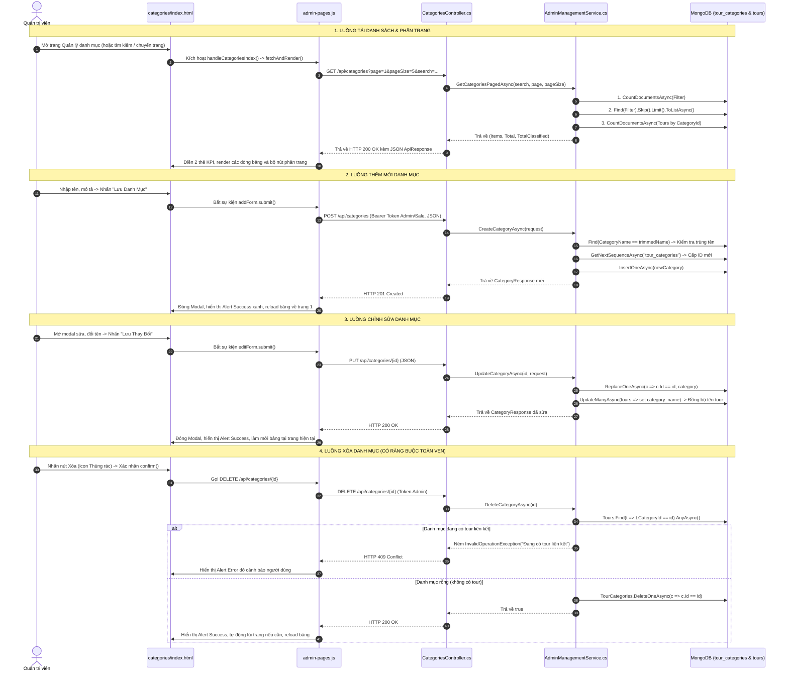

# BÁO CÁO PHÂN TÍCH CODE & TÀI LIỆU ÔN TẬP BẢO VỆ
## CHỨC NĂNG: QUẢN LÝ DANH MỤC TOUR (ADMIN CATEGORIES MANAGEMENT)
**Dự án:** BookingTour_DotNet  
**URL kiểm thử:** `http://localhost:5281/admin/categories/index.html`  
**Nhánh Git:** `feature/final_code`  
**Cơ sở dữ liệu:** MongoDB (NoSQL)  
**Backend:** ASP.NET Core Web API (.NET 8.0)  
**Frontend:** HTML5, Tailwind CSS, Vanilla JavaScript (SPA Module)

---

## MỤC LỤC
1. [Xác định các file liên quan trong hệ thống](#1-xác-định-các-file-liên-quan-trong-hệ-thống)
2. [Phân tích chi tiết Giao diện HTML](#2-phân-tích-chi-tiết-giao-diện-html)
3. [Phân tích chi tiết JavaScript Frontend](#3-phân-tích-chi-tiết-javascript-frontend)
4. [Phân tích Backend Web API (Controller)](#4-phân-tích-backend-web-api-controller)
5. [Phân tích tầng Service và Quy tắc Nghiệp vụ](#5-phân-tích-tầng-service-và-quy-tắc-nghiệp-vụ)
6. [Phân tích Mô hình Dữ liệu MongoDB (Model & Schema)](#6-phân-tích-mô-hình-dữ-liệu-mongodb-model--schema)
7. [Sơ đồ luồng hoạt động toàn bộ chức năng](#7-sơ-đồ-luồng-hoạt-động-toàn-bộ-chức-năng)
8. [Tài liệu chuẩn bị bảo vệ Đồ án](#8-tài-liệu-chuẩn-bị-bảo-vệ-đồ-án)
   - [A. Lời thoại thuyết trình trước Hội đồng (5–7 phút)](#a-lời-thoại-thuyết-trình-trước-hội-đồng-57-phút)
   - [B. Bộ 18 câu hỏi phản biện của Giảng viên](#b-bộ-18-câu-hỏi-phản-biện-của-giảng-viên)
   - [C. Câu trả lời chi tiết theo code thực tế](#c-câu-trả-lời-chi-tiết-theo-code-thực-tế)
   - [D. Danh sách các đoạn code trọng tâm cần mở trong VS Code](#d-danh-sách-các-đoạn-code-trọng-tâm-cần-mở-trong-vs-code)

---

## 1. XÁC ĐỊNH CÁC FILE LIÊN QUAN TRONG HỆ THỐNG

| STT | File / Đường dẫn | Vai trò trong hệ thống | Liên kết trực tiếp với các file khác |
|:---:|---|---|---|
| **1** | `wwwroot/admin/categories/index.html` | File giao diện người dùng (HTML layout) của trang Quản lý danh mục. Chứa cấu trúc bảng, form tìm kiếm, 2 thẻ KPI và 3 modal (Thêm, Sửa, Xem Tour). | Nhúng `admin-pages.js`, `api-client.js`, `admin-router.js`, `material-symbols.css`. |
| **2** | `wwwroot/assets/js/admin-pages.js` (Dòng 224–897) | Xử lý logic toàn bộ nghiệp vụ Client: nạp danh sách, phân trang, tìm kiếm, mở/đóng modal, gửi request AJAX và render DOM bảng. | Gọi `api-client.js`, tương tác trực tiếp với các phần tử DOM trong `index.html`. |
| **3** | `wwwroot/assets/js/api-client.js` | Module HTTP client dùng chung, bọc hàm `fetch` để tự động đính kèm JWT Bearer Token từ storage và parse JSON chuẩn hóa. | Được gọi bởi `admin-pages.js` để gửi request tới backend. |
| **4** | `wwwroot/assets/js/admin-router.js` (Dòng 344) | Điều phối routing SPA nội bộ trong Admin Portal, tự động kích hoạt hàm `handleCategoriesIndex()` khi người dùng chuyển trang. | Kích hoạt `window.BookingTourAdminPages.handleCategoriesIndex()`. |
| **5** | `Controllers/CategoriesController.cs` | Controller tiếp nhận các HTTP Request (`GET`, `POST`, `PUT`, `DELETE`), kiểm tra phân quyền JWT, validate ModelState và trả về ApiResponse chuẩn. | Kế thừa `ControllerBase`, inject `IAdminManagementService`. |
| **6** | `Services/IAdminManagementService.cs` | Khai báo các hợp đồng (interface) nghiệp vụ quản lý danh mục. | Triển khai bởi `AdminManagementService.cs`. |
| **7** | `Services/AdminManagementService.cs` (Dòng 20–240) | Triển khai chi tiết nghiệp vụ: kiểm tra trùng tên danh mục, sinh ID tăng tự động, kiểm tra ràng buộc khóa ngoại với Tour, cập nhật đồng bộ tên danh mục vào bảng Tour. | Inject `MongoDbContext`, thao tác trực tiếp với các collection MongoDB. |
| **8** | `DTOs/AdminDtos.cs` (Dòng 6–80) | Chứa các lớp truyền tải dữ liệu: `CategoryRequest` (nhận dữ liệu tạo/sửa), `CategoryResponse` (trả về danh mục kèm số lượng tour), `CategoryTourItemDto` (trả về tour theo danh mục). | Sử dụng bởi `CategoriesController` và `AdminManagementService`. |
| **9** | `Models/TourCategory.cs` | Model thực thể Danh mục, ánh xạ các trường BSON vào collection `tour_categories`. Kế thừa `BaseEntity`. | Kế thừa `BaseEntity.cs`, liên kết với `Tour.cs`. |
| **10** | `Models/BaseEntity.cs` | Định nghĩa các thuộc tính cốt lõi cho mọi thực thể: `MongoId` (`_id` ObjectId), `Id` (số nguyên định danh nghiệp vụ), `CreatedAt`, `UpdatedAt`. | Kế thừa bởi `TourCategory`, `Tour`, `Customer`, v.v. |
| **11** | `Models/Tour.cs` | Model Tour du lịch, chứa trường khóa ngoại `category_id` và trường nhúng `category_name` phục vụ kiểm tra toàn vẹn và đồng bộ. | Liên kết ngược về `TourCategory`. |
| **12** | `Data/MongoDbContext.cs` | Cấu hình kết nối MongoDB, khai báo thuộc tính `TourCategories`, định nghĩa Unique Index cho `Id` và `CategoryName`, và hàm cấp phát ID tự tăng `GetNextSequenceAsync`. | Cung cấp `IMongoCollection<TourCategory>` cho Service. |

---

## 2. PHÂN TÍCH CHI TIẾT GIAO DIỆN HTML

Giao diện trang tại `wwwroot/admin/categories/index.html` được thiết kế theo chuẩn Tailwind CSS hiện đại, tích hợp trong bố cục tổng thể của Admin Portal:

### 1. Thanh điều hướng và Header
- **Sidebar bên trái (`<aside>`):** Cố định (`fixed w-64`), chứa menu điều hướng tới 8 phân hệ quản trị. Mục "Quản lý Danh mục" được làm nổi bật với icon `category`.
- **Top Header (`<header>`):** Cố định phía trên (`h-16 sticky top-0`), hiển thị tên quản trị viên (`#adminUserDisplayName`), chức vụ (`#adminUserRole`), avatar (`#adminUserAvatar`) và nút Đăng xuất.

### 2. Tiêu đề và Thao tác chính
- Tiêu đề trang: `"Quản lý Danh mục Tour"` kèm dòng mô tả ngắn.
- Nút bấm chính: **"Thêm Danh Mục Mới"** (màu xanh navy `bg-blue-900`, icon `add`), khi click sẽ xóa class `hidden` của `#addCategoryModal`.

### 3. Khối Banner thông báo (Alerts)
- `#categoryAlertSuccess`: Hộp thông báo màu xanh lá, hiển thị khi thêm, sửa hoặc xóa danh mục thành công (`#categoryAlertSuccessText`). Tự động ẩn sau 5 giây.
- `#categoryAlertError`: Hộp thông báo màu đỏ, hiển thị khi gặp lỗi (trùng tên, danh mục đang có tour liên kết, lỗi mạng) (`#categoryAlertErrorText`).

### 4. Khối 2 Thẻ thống kê KPI (`grid-cols-1 md:grid-cols-2`)
- **Thẻ 1 - Tổng số Danh mục:**
  - ID hiển thị: `#statTotalCategories` (Ví dụ: `5`).
  - Viền trái màu xanh navy (`border-l-blue-900`), icon `category`.
- **Thẻ 2 - Tổng Tour Đang Phân Loại:**
  - ID hiển thị: `#statTotalClassifiedTours` (Ví dụ: `16`).
  - Viền trái màu xanh ngọc (`border-l-emerald-600`), icon `tour`.

### 5. Khối Tìm kiếm (Search Bar)
- Form `#searchCategoryForm`: Gồm ô nhập `#categorySearchInput` (placeholder: *"Tìm theo tên danh mục hoặc mô tả..."*), nút submit "Tìm kiếm", và nút đặt lại `#btnResetCategorySearch` (icon `restart_alt`).

### 6. Bảng dữ liệu Danh mục (Data Table)
- Tiêu đề bảng: `#categoryListHeading` hiển thị tổng số bản ghi, ví dụ: `"Danh sách Danh mục (5)"`.
- Cấu trúc 5 cột:
  1. **ID:** Mã định danh số nguyên (Ví dụ: `#1`, `#2`).
  2. **Tên Danh mục:** Nút bấm tương tác `.btn-view-category-tours` (gạch chân khi hover, có icon xem), click vào sẽ mở modal xem các tour thuộc danh mục này.
  3. **Mô tả:** Đoạn mô tả chi tiết đặc điểm loại hình tour.
  4. **Số lượng Tour:** Badge hình viên thuốc (`rounded-full`), hiển thị số lượng tour (Ví dụ: `6 tour`), cũng là nút click mở modal xem danh sách tour.
  5. **Thao tác:** 3 nút tác vụ:
     - *Nút Xem tour:* Icon `visibility`, màu xanh dương.
     - *Nút Sửa:* Icon `edit`, màu cam, mở `#editCategoryModal`.
     - *Nút Xóa:* Icon `delete`, màu đỏ, bật hộp thoại xác nhận xóa.
- Vùng thân bảng: `#categoryTableBody`. Khi đang tải dữ liệu sẽ hiện spinner xoay tròn (`#categoryTableBody`).

### 7. Khối Phân trang (Pagination)
- Dòng tóm tắt `#categoryPaginationSummary`: Hiển thị `"Hiển thị 1–5 trên tổng số 5 danh mục"`.
- Cụm nút chuyển trang `#categoryPaginationButtons`: Nút lùi trang (`<`), các nút số trang kèm dấu chấm lửng thông minh (`...`), và nút tiến trang (`>`).

### 8. Hệ thống 3 Modal Popup tương tác
1. **Modal Thêm danh mục (`#addCategoryModal`):**
   - Tiêu đề gradient xanh navy, form `#addCategoryForm`.
   - Input `#addCategoryName` (bắt buộc `required`), Textarea `#addCategoryDescription`.
   - Nút "Hủy" và nút "Lưu Danh Mục".
2. **Modal Sửa danh mục (`#editCategoryModal`):**
   - Tiêu đề gradient cam/hổ phách, form `#editCategoryForm`.
   - Input ẩn `#editCategoryId`, Input `#editCategoryName`, Textarea `#editCategoryDescription`.
   - Nút "Hủy" và nút "Lưu Thay Đổi".
3. **Modal Xem danh sách Tour theo danh mục (`#categoryToursModal`):**
   - Modal kích thước lớn (`max-w-4xl`), tiêu đề hiển thị tên danh mục được chọn (`#modalCategoryTitle`), phụ đề mã danh mục (`#modalCategorySubtitle`), thanh tổng quan mô tả (`#modalCategoryDesc`) và badge tổng số tour (`#modalCategoryTotalBadge`).
   - Bảng tour gồm 7 cột: Mã Tour, Tên Tour (kèm ảnh thumbnail thu nhỏ), Địa điểm (Tỉnh/Thành), Thời lượng, Giá từ, Trạng thái (Đang mở bán / Chờ lịch), Nút Xem tour ngoài trang khách.
   - Thanh phân trang riêng trong modal (`#modalCategoryToursPaginationSummary`, `#modalCategoryToursPaginationButtons`), mỗi trang hiển thị 5 tour.

---

## 3. PHÂN TÍCH CHI TIẾT JAVASCRIPT FRONTEND

Toàn bộ logic được gói trong hàm `handleCategoriesIndex()` trong file `wwwroot/assets/js/admin-pages.js` (Dòng 226–897).

### Các biến trạng thái nội bộ (Local State):
- `currentPage = 1`: Trang hiện tại (mặc định trang 1).
- `pageSize = 5`: Số lượng danh mục hiển thị trên mỗi trang (cố định là 5).
- `searchKeyword = ''`: Từ khóa tìm kiếm hiện tại.
- `isLoading = false`: Cờ chống gửi request trùng lặp (debounce / race-condition protection).

### Chi tiết các hàm chức năng:

#### 1. `showSuccess(msg)` & `showError(msg)`
- Hiển thị banner thông báo xanh lá hoặc đỏ, cập nhật text nội dung và tự động đặt `setTimeout` ẩn thông báo sau 5 giây.

#### 2. `showTableLoading()`
- Thay thế nội dung của `#categoryTableBody` bằng một dòng chứa icon xoay `sync` màu xanh và thông điệp *"Đang tải danh sách danh mục..."*.

#### 3. `fetchAndRender()` (Hàm điều phối trung tâm)
- **Nhiệm vụ:** Lấy dữ liệu danh mục từ API backend và render lên bảng.
- **Quy trình:**
  1. Kiểm tra nếu `isLoading == true` thì dừng. Đặt `isLoading = true`, gọi `showTableLoading()`.
  2. Tạo `URLSearchParams` đính kèm `page`, `pageSize`, và `search` (nếu có từ khóa).
  3. Gửi request: `window.BookingTourApi.apiRequest('/api/categories?' + params)`.
  4. Đồng thời gọi song song `/api/tours?pageSize=1` để lấy trường `total` (tổng số tour đang phân loại trong hệ thống).
  5. Cập nhật số liệu lên 2 thẻ KPI: `#statTotalCategories` và `#statTotalClassifiedTours`.
  6. Cập nhật tiêu đề `#categoryListHeading`.
  7. Duyệt danh sách danh mục và tạo các thẻ `<tr>` HTML trong `#categoryTableBody`.
  8. Gán các thuộc tính dữ liệu `data-id`, `data-name`, `data-desc`, `data-count` vào từng nút bấm.
  9. Lắng nghe sự kiện click:
     - Nút `.btn-view-category-tours`: Gọi hàm `openCategoryToursModal()`.
     - Nút `.btn-edit-category`: Điền dữ liệu vào form sửa và mở `#editCategoryModal`.
     - Nút `.btn-delete-category`: Hiển thị `confirm()`, nếu đồng ý sẽ gọi API `DELETE /api/categories/{id}`.
  10. Gọi hàm `renderPagination(totalItems, totalPages)` để cập nhật các nút phân trang.

#### 4. `renderPagination(totalItems, totalPages)` & `getPaginationRange(current, total)`
- Tính toán dải số trang cần hiển thị với thuật toán dấu chấm lửng thông minh (ví dụ: `1, 2, 3, 4, 5, '...', 10`).
- Render nút Previous `<`, các nút số trang (trang hiện tại được tô nền xanh `bg-blue-900 text-white`), và nút Next `>`.
- Vô hiệu hóa (`disabled`) nút Previous ở trang đầu và nút Next ở trang cuối.
- Gắn sự kiện chuyển trang khi click vào từng nút.

#### 5. Xử lý Thêm mới Danh mục (`addForm.addEventListener('submit')`)
- Lấy giá trị `name` và `description` từ form `#addCategoryForm`.
- Kiểm tra tính hợp lệ: nếu tên rỗng báo lỗi *"Vui lòng nhập tên danh mục!"*.
- Gửi request: `POST /api/categories` với payload JSON `{ category_name, description }`.
- Nếu thành công: đóng modal, reset form, hiển thị thông báo thành công, đặt `currentPage = 1` và gọi `fetchAndRender()`.
- Nếu thất bại: bắt lỗi từ API response và hiển thị qua `showError()`.

#### 6. Xử lý Cập nhật Danh mục (`editForm.addEventListener('submit')`)
- Lấy `id`, `name`, `description` từ form `#editCategoryForm`.
- Gửi request: `PUT /api/categories/{id}` với payload JSON `{ category_name, description }`.
- Đóng modal, hiển thị thông báo thành công và gọi `fetchAndRender()` để làm mới dữ liệu tại trang hiện tại.

#### 7. Xử lý Xóa Danh mục
- Bật hộp thoại trình duyệt `confirm("Bạn có chắc chắn muốn xóa danh mục này?")`.
- Gửi request: `DELETE /api/categories/{id}`.
- Xử lý thông minh sau khi xóa: Nếu dòng bị xóa là bản ghi duy nhất còn lại của trang hiện tại (và trang > 1), hệ thống tự động lùi về trang trước `currentPage--` để người dùng không bị rơi vào trang trắng rỗng.
- Nếu danh mục đang có tour liên kết, API trả về mã lỗi 409 Conflict, JavaScript bắt được exception và hiển thị thông báo đỏ cảnh báo người dùng.

#### 8. Xử lý Modal Xem Tour theo Danh mục (`openCategoryToursModal` & `loadCategoryTours`)
- Khi người dùng click vào tên danh mục hoặc số lượng tour:
  1. Gán thông tin danh mục lên header của modal.
  2. Mở modal `#categoryToursModal`.
  3. Gọi hàm `loadCategoryTours(catId, 1)`.
  4. Gửi request `GET /api/categories/{catId}/tours?page=1&pageSize=5`.
  5. Render bảng danh sách các tour du lịch thuộc danh mục (ảnh đại diện, tên tour, thời lượng, giá tiền, badge trạng thái mở bán/chờ lịch).
  6. Render bộ nút phân trang độc lập bên trong modal để duyệt các trang tour tiếp theo.

---

## 4. PHÂN TÍCH BACKEND WEB API (CONTROLLER)

File xử lý: `Controllers/CategoriesController.cs`  
Kế thừa: `ControllerBase`  
Route gốc: `[Route("api/[controller]")]` (Tương đương `/api/categories`)  
Dependency Injection: `IAdminManagementService _service`

### Bảng tổng hợp các API trong Source Code:

| HTTP Method | Endpoint đầy đủ | Mục đích nghiệp vụ | Phân quyền (Authorization) | Dữ liệu đầu vào | Mã HTTP Response |
|:---:|---|---|:---:|---|:---:|
| `GET` | `/api/categories`<br>`/categories` | Lấy danh sách danh mục có tìm kiếm và phân trang | `[AllowAnonymous]` | Query params: `search` (string?), `page` (int = 1), `pageSize` (int = 5), `all` (bool?) | `200 OK` (`ApiResponse<List<CategoryResponse>>`) |
| `GET` | `/api/categories/{id:int}` | Lấy chi tiết thông tin một danh mục theo ID | `[AllowAnonymous]` | Route param: `id` (int) | `200 OK` hoặc `404 Not Found` |
| `GET` | `/api/categories/{id:int}/tours` | Lấy danh sách các tour du lịch thuộc về một danh mục (kèm phân trang) | `[AllowAnonymous]` | Route param: `id` (int)<br>Query params: `page` (int), `pageSize` (int) | `200 OK` hoặc `404 Not Found` |
| `POST` | `/api/categories` | Tạo mới một danh mục tour | `[Authorize(Roles = "Admin,Sale")]` | Body JSON: `CategoryRequest` (`category_name`, `description`) | `201 Created`, `400 Bad Request`, `409 Conflict` (trùng tên) |
| `PUT` | `/api/categories/{id:int}` | Cập nhật tên và mô tả danh mục | `[Authorize(Roles = "Admin,Sale")]` | Route param: `id` (int)<br>Body JSON: `CategoryRequest` | `200 OK`, `400 Bad Request`, `404 Not Found`, `409 Conflict` |
| `DELETE` | `/api/categories/{id:int}` | Xóa vĩnh viễn một danh mục | `[Authorize(Roles = "Admin")]` *(Chỉ Admin)* | Route param: `id` (int) | `200 OK`, `404 Not Found`, `409 Conflict` (còn tour ràng buộc) |

### Cơ chế xử lý lỗi (Exception Handling) trong Controller:
- **`ArgumentException`:** Trả về `409 Conflict` kèm thông báo lỗi nghiệp vụ (ví dụ: tên danh mục bị trùng lặp).
- **`KeyNotFoundException`:** Trả về `404 Not Found` khi danh mục có ID yêu cầu không tồn tại trong MongoDB.
- **`InvalidOperationException`:** Trả về `409 Conflict` khi vi phạm ràng buộc toàn vẹn dữ liệu (xóa danh mục đang có tour).
- **`ModelState.IsValid == false`:** Trả về `400 Bad Request` kèm chi tiết lỗi validation.

---

## 5. PHÂN TÍCH TẦNG SERVICE VÀ QUY TẮC NGHIỆP VỤ

Interface: `Services/IAdminManagementService.cs`  
Triển khai: `Services/AdminManagementService.cs` (Region `Categories` dòng 20–240)

### 1. Hàm `GetAllCategoriesAsync()`
- Truy vấn toàn bộ danh mục sắp xếp theo tên: `_context.TourCategories.Find(_ => true).SortBy(c => c.CategoryName).ToListAsync()`.
- **Kỹ thuật tối ưu hóa truy vấn MongoDB:** Thay vì gửi N câu truy vấn đếm số lượng tour cho từng danh mục, code sử dụng **MongoDB Aggregation Pipeline** để gom nhóm và đếm 1 lần duy nhất:
  ```csharp
  var counts = await _context.Tours.Aggregate().Group(t => t.CategoryId,
      group => new { Id = group.Key, Count = group.Count() }).ToListAsync();
  var countMap = counts.ToDictionary(x => x.Id, x => x.Count);
  ```
- Ghép số lượng `ToursCount` vào từng `CategoryResponse` rồi trả về.

### 2. Hàm `GetCategoriesPagedAsync(string? search, int page = 1, int pageSize = 5)`
- Xây dựng bộ lọc `Builders<TourCategory>.Filter`: Nếu có tham số `search`, tạo biểu thức chính quy (Regex) không phân biệt hoa thường (`"i"`):
  ```csharp
  var regex = new MongoDB.Bson.BsonRegularExpression(cleanSearch, "i");
  filter = builder.Or(
      builder.Regex(c => c.CategoryName, regex),
      builder.Regex(c => c.Description, regex)
  );
  ```
- Đếm tổng số bản ghi thỏa mãn: `CountDocumentsAsync(filter)`.
- Phân trang chuẩn bằng `.Skip((p - 1) * ps).Limit(ps)`.
- Đếm số lượng tour cho từng danh mục trong trang và đếm tổng số tour đã được phân loại trong toàn hệ thống (`totalClassified`).
- Trả về tuple: `(items, total, totalClassified)`.

### 3. Hàm `GetToursByCategoryIdPagedAsync(int categoryId, int page = 1, int pageSize = 5)`
- Lọc tour theo `CategoryId`: `Builders<Tour>.Filter.Eq(t => t.CategoryId, categoryId)`.
- Đếm tổng số tour thuộc danh mục này và phân trang bằng `Skip`/`Limit`.
- Đối với mỗi tour, đếm số lượng chuyến khởi hành (`TourDepartures`) để hiển thị trạng thái *"Đang mở bán"* (nếu `departures_count > 0`) hoặc *"Chờ lịch"*.

### 4. Hàm `CreateCategoryAsync(CategoryRequest request)`
- **Quy tắc 1 - Kiểm tra rỗng:** `if (string.IsNullOrWhiteSpace(request.CategoryName))` ném `ArgumentException`.
- **Quy tắc 2 - Chống trùng tên (Case-insensitive Unique Check):**
  ```csharp
  var existing = await _context.TourCategories
      .Find(c => c.CategoryName.ToLower() == trimmedName.ToLower())
      .FirstOrDefaultAsync();
  if (existing != null) throw new ArgumentException($"Tên danh mục \"{trimmedName}\" đã tồn tại.");
  ```
- **Quy tắc 3 - Cấp phát ID tự động:** Sử dụng cơ chế sequence counter của MongoDB: `nextId = await _context.GetNextSequenceAsync("tour_categories")`.
- Khởi tạo `TourCategory` với `CreatedAt = DateTime.UtcNow`, `UpdatedAt = DateTime.UtcNow`, thực hiện `InsertOneAsync`.

### 5. Hàm `UpdateCategoryAsync(int id, CategoryRequest request)`
- Kiểm tra danh mục có tồn tại theo ID không; nếu không có ném `KeyNotFoundException`.
- Kiểm tra trùng tên với các danh mục khác: `c.CategoryName.ToLower() == trimmedName.ToLower() && c.Id != id`.
- Cập nhật trường `CategoryName`, `Description`, `UpdatedAt = DateTime.UtcNow`.
- Gọi `ReplaceOneAsync(c => c.Id == id, category)`.
- **Quy tắc 4 - Đồng bộ hóa dữ liệu phi chuẩn hóa (Denormalization Sync):**  
  Trong NoSQL MongoDB, collection `tours` nhúng trực tiếp trường `category_name` để tối ưu tốc độ đọc khi hiển thị danh sách tour cho khách hàng. Do đó, khi Admin đổi tên danh mục, Service sẽ tự động cập nhật đồng bộ toàn bộ các tour có liên quan:
  ```csharp
  await _context.Tours.UpdateManyAsync(
      t => t.CategoryId == id,
      Builders<Tour>.Update.Set(t => t.CategoryName, category.CategoryName)
  );
  ```

### 6. Hàm `DeleteCategoryAsync(int id)`
- Kiểm tra danh mục có tồn tại không (`KeyNotFoundException`).
- **Quy tắc 5 - Kiểm tra toàn vẹn dữ liệu (Referential Integrity Check):**
  ```csharp
  var hasTours = await _context.Tours.Find(t => t.CategoryId == id).AnyAsync();
  if (hasTours)
  {
      throw new InvalidOperationException("Không thể xóa danh mục này vì đang có các tour du lịch liên kết.");
  }
  ```
  Ngăn chặn việc xóa danh mục cha khi con đang tồn tại (tương tự ràng buộc `RESTRICT` trong RDBMS), tránh làm cho các tour du lịch bị mồ côi danh mục (`orphan data`).
- Nếu không có tour nào liên kết, tiến hành xóa: `DeleteOneAsync(c => c.Id == id)`.

---

## 6. PHÂN TÍCH MÔ HÌNH DỮ LIỆU MONGODB (MODEL & SCHEMA)

### 1. Thực thể `TourCategory` (`Models/TourCategory.cs`)
```csharp
public class TourCategory : BaseEntity
{
    [BsonElement("category_name")]
    [JsonPropertyName("category_name")]
    public string CategoryName { get; set; } = string.Empty;

    [BsonElement("description")]
    [JsonPropertyName("description")]
    public string? Description { get; set; }

    [BsonIgnore]
    [JsonPropertyName("tours_count")]
    public int ToursCount { get; set; }
}
```

### 2. Lớp cha `BaseEntity` (`Models/BaseEntity.cs`)
```csharp
public abstract class BaseEntity
{
    [BsonId]
    [BsonRepresentation(BsonType.ObjectId)]
    [JsonPropertyName("mongoId")]
    public string? MongoId { get; set; }

    [BsonElement("id")]
    [JsonPropertyName("id")]
    public int Id { get; set; }

    [BsonElement("created_at")]
    [JsonPropertyName("created_at")]
    public DateTime CreatedAt { get; set; } = DateTime.UtcNow;

    [BsonElement("updated_at")]
    [JsonPropertyName("updated_at")]
    public DateTime UpdatedAt { get; set; } = DateTime.UtcNow;
}
```

### 3. Collection MongoDB và Cấu trúc Index (`Data/MongoDbContext.cs`)
- **Tên Collection:** `"tour_categories"`.
- **Cơ chế Index độc nhất (Unique Indexes):**
  Trong hàm `EnsureIndexesAsync()`, hệ thống thiết lập 2 Unique Index cho collection này:
  ```csharp
  await TourCategories.Indexes.CreateManyAsync(new[]
  {
      new CreateIndexModel<TourCategory>(
          Builders<TourCategory>.IndexKeys.Ascending(c => c.Id), 
          new CreateIndexOptions { Unique = true }),
      new CreateIndexModel<TourCategory>(
          Builders<TourCategory>.IndexKeys.Ascending(c => c.CategoryName), 
          new CreateIndexOptions { Unique = true })
  });
  ```
  - Index trên `Id`: Đảm bảo không bao giờ bị trùng ID nghiệp vụ.
  - Index trên `CategoryName`: Đảm bảo tính toàn vẹn ở tầng vật lý database, ngăn chặn việc tạo 2 danh mục cùng tên.

### 4. Cơ chế Sinh ID tự tăng trong MongoDB
MongoDB mặc định sử dụng chuỗi `ObjectId` 24 ký tự làm `_id`. Để có ID số nguyên đẹp dạng `1, 2, 3...` dễ quản lý trên URL và giao diện, dự án sử dụng pattern **Sequence Counter Collection**:
- Bảng `counters` lưu trữ `{ _id: "tour_categories", sequence_value: 5 }`.
- Khi thêm mới, gọi `FindOneAndUpdateAsync` với toán tử `$inc: { sequence_value: 1 }` và tùy chọn `ReturnDocument.After`. Thao tác này là **Atomic (nguyên tử)**, đảm bảo an toàn tuyệt đối khi nhiều người dùng thao tác cùng lúc (concurrency safe).

---

## 7. SƠ ĐỒ LUỒNG HOẠT ĐỘNG TOÀN BỘ CHỨC NĂNG

### Sơ đồ tuần tự tổng quát:



---

## 8. TÀI LIỆU CHUẨN BỊ BẢO VỆ ĐỒ ÁN

### A. Lời thoại thuyết trình trước Hội đồng (5–7 phút)

> *"Kính thưa Thầy/Cô và Hội đồng chấm đồ án,*  
> *Hôm nay em xin phép được trình bày về chức năng **Quản lý Danh mục Tour (Categories Management)** của phân hệ Admin trong hệ thống BookingTour_DotNet.*  
> 
> *Trong một hệ thống du lịch, danh mục đóng vai trò phân loại tour theo các loại hình trải nghiệm của du khách như Tour Biển Đảo, Tour Núi, Tour Nghỉ Dưỡng hay Tour Tâm Linh. Trên giao diện quản lý danh mục tại đường dẫn `/admin/categories/index.html`:*  
> 
> 1. *Phía trên cùng, hệ thống cung cấp **2 thẻ chỉ số thống kê KPI**: Thống kê tổng số danh mục và tổng số lượng tour đã được phân loại trong toàn hệ thống.*  
> 2. *Thanh tìm kiếm hỗ trợ tìm kiếm nhanh theo cả tên danh mục lẫn nội dung mô tả bằng biểu thức chính quy Regex không phân biệt hoa thường.*  
> 3. *Bảng danh mục hiển thị phân trang chuẩn với số lượng **5 danh mục trên một trang**, thể hiện mã ID, tên danh mục, mô tả, số lượng tour đang liên kết và các nút thao tác.*  
> 4. *Đặc biệt, hệ thống cung cấp chức năng **Xem nhanh danh sách tour theo danh mục** dưới dạng Modal Popup. Khi Admin click vào tên danh mục hoặc số lượng tour, một cửa sổ lớn sẽ mở ra hiển thị toàn bộ các tour thuộc danh mục đó, kèm ảnh đại diện, giá vé, thời lượng, số chuyến khởi hành và có phân trang độc lập bên trong modal.*  
> 
> *Về mặt kiến trúc kỹ thuật và an toàn dữ liệu:*  
> - *Ở tầng Backend, `CategoriesController` tiếp nhận các API RESTful và kiểm soát phân quyền nghiêm ngặt: Quyền `Admin` và `Sale` được phép thêm, sửa; riêng thao tác Xóa danh mục chỉ dành riêng cho quyền `Admin`.*  
> - *Tại tầng Service `AdminManagementService`, em đã thiết kế các quy tắc nghiệp vụ chặt chẽ: Chống trùng lặp tên danh mục bằng kiểm tra `ToLower()`, tự động cấp phát ID tăng dần thông qua bảng counter của MongoDB, và đồng bộ tự động `category_name` vào collection `tours` khi tên danh mục thay đổi.*  
> - *Đặc biệt, về **toàn vẹn dữ liệu trong NoSQL**: Hệ thống áp dụng cơ chế kiểm tra trước khi xóa. Nếu danh mục đang chứa tour du lịch, hệ thống sẽ từ chối xóa và trả về mã lỗi 409 Conflict nhằm ngăn ngừa tình trạng dữ liệu mồ côi.*  
> 
> *Sau đây em xin phép được thao tác trực tiếp trên giao diện và mở các đoạn code cốt lõi trong Visual Studio Code để chứng minh các chức năng này. Em xin cảm ơn Thầy/Cô!"*

---

### B. Bộ 18 câu hỏi phản biện của Giảng viên

1. **Câu 1:** Chức năng Quản lý danh mục gồm những thao tác nào?
2. **Câu 2:** Danh mục tour được lưu trong collection nào của MongoDB và có những trường dữ liệu gì?
3. **Câu 3:** Tại sao trong NoSQL MongoDB lại có ID số nguyên (`1, 2, 3...`) thay vì chỉ dùng `ObjectId` mặc định?
4. **Câu 4:** Hệ thống chống tạo 2 danh mục trùng tên như thế nào?
5. **Câu 5:** Nếu một danh mục đang có 5 tour du lịch bên trong, Admin nhấn xóa thì chuyện gì xảy ra?
6. **Câu 6:** Khi Admin sửa tên danh mục từ *"Tour Biển"* thành *"Tour Biển Đảo"*, dữ liệu trong các tour thuộc danh mục này có bị sai lệch không?
7. **Câu 7:** Trường `ToursCount` (số lượng tour) có được lưu trực tiếp trong collection `tour_categories` không?
8. **Câu 8:** Trong hàm `GetAllCategoriesAsync`, làm sao để đếm số lượng tour của từng danh mục mà không làm chậm database?
9. **Câu 9:** Chức năng tìm kiếm danh mục hoạt động như thế nào?
10. **Câu 10:** Trang quản lý danh mục phân trang bao nhiêu phần tử mỗi trang?
11. **Câu 11:** Phân trang trong MongoDB được thực hiện bằng những toán tử nào?
12. **Câu 12:** Khi xóa phần tử duy nhất ở trang 2 thì giao diện xử lý ra sao để tránh bị trang trắng?
13. **Câu 13:** API xóa danh mục và sửa danh mục có phân quyền không?
14. **Câu 14:** Khi click vào một danh mục, Modal xem tour lấy dữ liệu từ đâu?
15. **Câu 15:** DTO `CategoryResponse` có cả thuộc tính `category_name` và `name` để làm gì?
16. **Câu 16:** Collection `tour_categories` có những Index nào?
17. **Câu 17:** Nếu API Backend bị sập hoặc mất mạng, giao diện trang danh mục hiển thị như thế nào?
18. **Câu 18:** Sự khác biệt giữa DTO `CategoryRequest` và Model `TourCategory` là gì?

---

### C. Câu trả lời chi tiết theo code thực tế

#### Trả lời Câu 1: Các thao tác trong chức năng
Bao gồm đầy đủ 5 thao tác: Xem danh sách phân trang (5 bản ghi/trang), Tìm kiếm theo từ khóa, Thêm danh mục mới, Sửa tên/mô tả danh mục, Xóa danh mục (có kiểm tra ràng buộc), và Xem danh sách tour thuộc danh mục trong Modal.

#### Trả lời Câu 2: Collection và Schema
Được lưu trong collection `"tour_categories"`. Các trường gồm: `_id` (ObjectId của MongoDB), `id` (int, mã định danh số nguyên), `category_name` (string, tên danh mục), `description` (string, mô tả), `created_at` (DateTime UTC), `updated_at` (DateTime UTC).

#### Trả lời Câu 3: Cơ chế sinh ID số nguyên
Để thân thiện với người dùng và quản trị viên (dễ đọc, dễ truyền trên URL như `/api/categories/1`). Hệ thống sử dụng hàm `_context.GetNextSequenceAsync("tour_categories")` dựa trên collection `counters`, sử dụng toán tử nguyên tử `$inc` để sinh ID duy nhất, không lo bị trùng lặp.

#### Trả lời Câu 4: Chống trùng tên
Hệ thống bảo vệ ở **2 tầng**:
1. *Tầng Service:* Code kiểm tra `.Find(c => c.CategoryName.ToLower() == trimmedName.ToLower())`. Nếu thấy tồn tại sẽ ném `ArgumentException` và trả về `409 Conflict`.
2. *Tầng Database:* Trong `MongoDbContext.cs`, trường `CategoryName` được tạo **Unique Index** (`CreateIndexOptions { Unique = true }`). Do đó, kể cả gửi 2 request đồng thời thì database cũng chặn bản ghi trùng.

#### Trả lời Câu 5: Khi xóa danh mục đang có tour
Hệ thống **từ chối xóa**. Trong `AdminManagementService.cs` dòng 232–236:
`await _context.Tours.Find(t => t.CategoryId == id).AnyAsync()`  
Nếu trả về `true`, Service ném lỗi `InvalidOperationException("Không thể xóa danh mục này vì đang có các tour du lịch liên kết.")`. Controller trả về mã HTTP `409 Conflict` và giao diện hiển thị banner cảnh báo màu đỏ.

#### Trả lời Câu 6: Đồng bộ tên danh mục vào bảng Tour
Không bị sai lệch. Trong `AdminManagementService.cs` dòng 210–213, sau khi cập nhật danh mục, Service thực thi ngay câu lệnh:
```csharp
await _context.Tours.UpdateManyAsync(
    t => t.CategoryId == id,
    Builders<Tour>.Update.Set(t => t.CategoryName, category.CategoryName)
);
```
Tất cả các tour có `category_id == id` sẽ được đồng bộ trường `category_name` mới ngay lập tức.

#### Trả lời Câu 7: Lưu trữ trường `ToursCount`
**Không lưu trong collection `tour_categories`.** Thuộc tính `ToursCount` trong model `TourCategory.cs` được đánh dấu thuộc tính `[BsonIgnore]`. Số lượng tour được tính toán động tại thời điểm truy vấn thông qua hàm `CountDocumentsAsync` hoặc `Aggregate Group`, đảm bảo số lượng tour luôn phản ánh chính xác thực tế.

#### Trả lời Câu 8: Kỹ thuật đếm số lượng tour tối ưu
Trong hàm `GetAllCategoriesAsync()`, thay vì chạy vòng lặp gửi N câu truy vấn đếm, code sử dụng **MongoDB Aggregation Pipeline** với toán tử `$group`:
`_context.Tours.Aggregate().Group(t => t.CategoryId, group => new { Id = group.Key, Count = group.Count() })`  
MongoDB chỉ gom nhóm và đếm 1 lần trên toàn bộ bảng Tour rồi trả về một bảng ánh xạ `Dictionary<int, int>`, giúp tiết kiệm tài nguyên và đạt tốc độ phản hồi tối đa.

#### Trả lời Câu 9: Cơ chế tìm kiếm
Tìm kiếm bằng biểu thức chính quy BsonRegularExpression với cờ `"i"` (không phân biệt chữ hoa, chữ thường). Tìm kiếm đồng thời trên cả 2 trường `CategoryName` và `Description` thông qua toán tử `builder.Or`.

#### Trả lời Câu 10: Quy chuẩn phân trang
Phân trang cố định **5 danh mục trên một trang** (`pageSize = 5`). Trang 1 hiển thị bản ghi 1–5, trang 2 hiển thị 6–10, v.v.

#### Trả lời Câu 11: Toán tử phân trang MongoDB
Sử dụng 2 phương thức:
- `.Skip((page - 1) * pageSize)`: Bỏ qua các bản ghi của các trang trước.
- `.Limit(pageSize)`: Giới hạn số bản ghi lấy về cho trang hiện tại.

#### Trả lời Câu 12: Xử lý lùi trang khi xóa bản ghi cuối
Trong `admin-pages.js` dòng 449–451:
```javascript
if (items.length === 1 && currentPage > 1) {
  currentPage--;
}
fetchAndRender();
```
Nếu trang hiện tại chỉ còn 1 danh mục và người dùng xóa nó đi, JavaScript sẽ tự giảm `currentPage` xuống 1 trang rồi mới tải lại, đưa người dùng về trang có dữ liệu thay vì trang trống.

#### Trả lời Câu 13: Phân quyền API
Có phân quyền bằng JWT:
- Tạo mới (`POST`) và Cập nhật (`PUT`): Quyền `[Authorize(Roles = "Admin,Sale")]`.
- Xóa vĩnh viễn (`DELETE`): Chỉ dành riêng cho quyền quản trị tối cao `[Authorize(Roles = "Admin")]`.
- Xem danh sách (`GET`): Đặt `[AllowAnonymous]` để cả khách hàng và các module khác đều có thể đọc dữ liệu phân loại tour.

#### Trả lời Câu 14: Dữ liệu trong Modal Xem Tour
Modal gọi API riêng biệt: `GET /api/categories/{id}/tours?page=1&pageSize=5`. API này lọc trong collection `tours` theo điều kiện `CategoryId == id`, đồng thời đếm số lượng chuyến khởi hành (`departures_count`) của từng tour để xác định tour đang mở bán hay chờ lịch.

#### Trả lời Câu 15: Tương thích kép trong DTO
Để tương thích với cả 2 chuẩn đặt tên JSON:
- `category_name`: Chuẩn snake_case cho RESTful API.
- `name`: Thuộc tính tiện ích (getter) trỏ về `CategoryName`, giúp các component frontend cũ hoặc thư viện thứ ba truy cập trực tiếp `c.name` mà không bị `undefined`.

#### Trả lời Câu 16: Các Index trong `tour_categories`
Gồm 3 Index:
1. Index mặc định trên `_id` (ObjectId).
2. Unique Index trên trường `id` (số nguyên nghiệp vụ).
3. Unique Index trên trường `category_name` (chống trùng tên ở tầng database).

#### Trả lời Câu 17: Xử lý khi API Backend mất kết nối
Khối `try...catch` trong `fetchAndRender()` bắt lỗi `apiErr`, chuyển giao diện bảng sang trạng thái lỗi màu đỏ với icon cảnh báo `error` và dòng thông báo: *"Không thể kết nối đến máy chủ MongoDB để tải danh mục."* Hệ thống không bị crash hoặc trắng trang.

#### Trả lời Câu 18: Sự khác biệt giữa DTO và Model
- **`CategoryRequest` (DTO):** Chỉ chứa các trường dữ liệu mà client được phép gửi lên (`category_name`, `description`), kèm các validation attributes như `[Required]`. Không chứa `Id`, `CreatedAt`, `ToursCount` để tránh lỗ hổng bảo mật Over-Posting.
- **`TourCategory` (Model/Entity):** Ánh xạ trực tiếp cấu trúc lưu trữ trong MongoDB, chứa đầy đủ `MongoId`, `Id`, `CreatedAt`, `UpdatedAt`.

---

### D. Danh sách các đoạn code trọng tâm cần mở trong VS Code

Khi trình bày, hãy mở sẵn các file sau và điều hướng đến đúng dòng:

1. **`wwwroot/admin/categories/index.html` (Dòng 224–252):**
   - *Cấu trúc bảng danh mục và khối phân trang.*
   - *Giảng viên hỏi:* "Giao diện bảng danh mục render thế nào, phân trang đặt ở đâu?"

2. **`wwwroot/admin/categories/index.html` (Dòng 341–406):**
   - *Modal xem danh sách tour thuộc danh mục.*
   - *Giảng viên hỏi:* "Modal xem tour theo danh mục nằm ở file nào?"

3. **`wwwroot/assets/js/admin-pages.js` (Dòng 271–320):**
   - *Hàm `fetchAndRender()` gọi API `/api/categories` và render DOM.*
   - *Giảng viên hỏi:* "Frontend gọi API nào để lấy danh mục, xử lý phân trang ra sao?"

4. **`wwwroot/assets/js/admin-pages.js` (Dòng 584–622):**
   - *Hàm xử lý submit form thêm danh mục (`addForm.submit`).*
   - *Giảng viên hỏi:* "Khi bấm thêm mới, dữ liệu gửi xuống dạng gì?"

5. **`Controllers/CategoriesController.cs` (Dòng 21–38 & 117–138):**
   - *Action `GetAll` và Action `Delete` với thuộc tính phân quyền `[Authorize(Roles = "Admin")]`.*
   - *Giảng viên hỏi:* "Endpoint xóa là gì? Ai có quyền xóa danh mục?"

6. **`Services/AdminManagementService.cs` (Dòng 44–87):**
   - *Hàm `GetCategoriesPagedAsync`: Lọc Regex, Skip, Limit, đếm tour.*
   - *Giảng viên hỏi:* "Trong MongoDB, em thực hiện tìm kiếm và phân trang như thế nào?"

7. **`Services/AdminManagementService.cs` (Dòng 141–180):**
   - *Hàm `CreateCategoryAsync`: Chống trùng tên `ToLower()` và cấp ID tự tăng `GetNextSequenceAsync`.*
   - *Giảng viên hỏi:* "Làm sao hệ thống không cho tạo 2 danh mục trùng tên?"

8. **`Services/AdminManagementService.cs` (Dòng 209–214):**
   - *Hàm `UpdateCategoryAsync`: Lệnh `UpdateManyAsync` đồng bộ trường `category_name` vào bảng Tour.*
   - *Giảng viên hỏi:* "Trong MongoDB phi chuẩn hóa, khi đổi tên danh mục thì các tour liên quan có cập nhật theo không?"

9. **`Services/AdminManagementService.cs` (Dòng 227–240):**
   - *Hàm `DeleteCategoryAsync`: Ràng buộc kiểm tra `hasTours` ngăn xóa danh mục.*
   - *Giảng viên hỏi:* "Tại sao NoSQL không có Foreign Key nhưng hệ thống vẫn không cho xóa danh mục đang có tour?"

10. **`Data/MongoDbContext.cs` (Dòng 61–65):**
    - *Định nghĩa Unique Index cho trường `Id` và `CategoryName`.*
    - *Giảng viên hỏi:* "Em tạo Index gì cho bảng danh mục trong MongoDB?"

