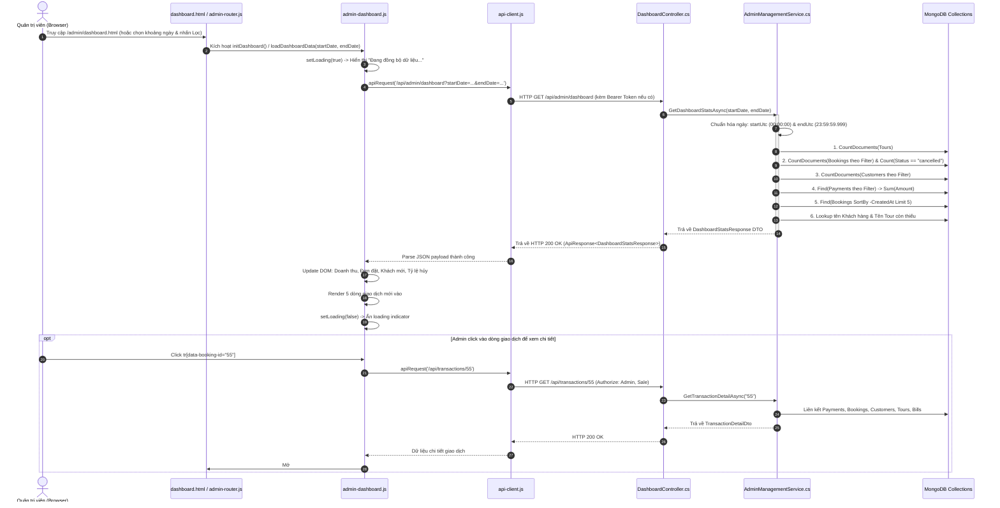

# BÁO CÁO PHÂN TÍCH CODE & TÀI LIỆU ÔN TẬP BẢO VỆ
## CHỨC NĂNG: TỔNG QUAN HỆ THỐNG (ADMIN DASHBOARD)
**Dự án:** BookingTour_DotNet  
**Nhánh Git:** `feature/final_code`  
**Cơ sở dữ liệu:** MongoDB (NoSQL)  
**Backend:** ASP.NET Core Web API (.NET 8.0)  
**Frontend:** HTML5, Tailwind CSS, Vanilla JavaScript (SPA Component Model)

---

## MỤC LỤC
1. [Tổng quan Module Admin Dashboard](#1-tổng-quan-module-admin-dashboard)
2. [Các thành phần giao diện & Dữ liệu hiển thị](#2-các-thành-phần-giao-diện--dữ-liệu-hiển-thị)
3. [Phân tích từng số liệu trên Dashboard](#3-phân-tích-từng-số-liệu-trên-dashboard)
4. [Sơ đồ luồng hoạt động (Frontend → Backend → MongoDB)](#4-sơ-đồ-luồng-hoạt-động-frontend--backend--mongodb)
5. [Bảng tổng hợp API Module Dashboard](#5-bảng-tổng-hợp-api-module-dashboard)
6. [Giải thích chi tiết công thức thống kê](#6-giải-thích-chi-tiết-công-thức-thống-kê)
7. [15 Đoạn Code trọng tâm cần mở khi báo cáo](#7-15-đoạn-code-trọng-tâm-cần-mở-khi-báo-cáo)
8. [Bộ 20 câu hỏi & trả lời bảo vệ đồ án](#8-bộ-20-câu-hỏi--trả-lời-bảo-vệ-đồ-án)
9. [Kịch bản trình bày trực tiếp trên code (5–7 phút)](#9-kịch-bản-trình-bày-trực-tiếp-trên-code-57-phút)
10. [Danh sách file cần mở sẵn trong VS Code](#10-danh-sách-file-cần-mở-sẵn-trong-vs-code)

---

## 1. TỔNG QUAN MODULE ADMIN DASHBOARD

Module **Tổng quan (Admin Dashboard)** là màn hình trung tâm của Admin Portal, cho phép ban quản trị và bộ phận điều hành:
1. Theo dõi các chỉ số đo lường hiệu quả cốt lõi (**KPIs**) của hệ thống đặt tour theo thời gian thực.
2. Lọc linh hoạt số liệu theo khoảng thời gian tùy chọn (**Date-Range Filtering** từ ngày đến ngày).
3. Giám sát danh sách **5 giao dịch đặt tour mới nhất** phát sinh trong hệ thống.
4. Xem nhanh thông tin chi tiết đầy đủ của từng giao dịch (Khách hàng, Lịch trình tour, Thanh toán, Hóa đơn) thông qua cửa sổ tương tác **Transaction Detail Modal**.

### Các file mã nguồn cốt lõi:
- **Giao diện HTML:**
  - `wwwroot/admin/dashboard.html`: File giao diện Dashboard chuyên biệt.
  - `wwwroot/admin/index.html`: File trang chủ Admin Portal (chứa cùng cấu trúc dashboard).
- **Frontend Logic:**
  - `wwwroot/assets/js/admin-dashboard.js`: Xử lý nạp dữ liệu, gắn sự kiện lọc, render DOM và modal giao dịch.
  - `wwwroot/assets/js/api-client.js`: HTTP client wrapper gửi request kèm Bearer JWT Token.
  - `wwwroot/assets/js/admin-router.js`: Router điều phối nạp module SPA.
- **Backend Web API:**
  - `Controllers/DashboardController.cs`: Tiếp nhận request API thống kê tổng quan.
  - `Controllers/TransactionsController.cs`: Tiếp nhận request chi tiết giao dịch.
  - `DTOs/AdminDtos.cs`: Định nghĩa Data Transfer Object (`DashboardStatsResponse`, `TransactionDetailDto`, v.v.).
- **Nghiệp vụ Service & Database:**
  - `Services/IAdminManagementService.cs`: Khai báo interface.
  - `Services/AdminManagementService.cs`: Triển khai truy vấn tổng hợp trên MongoDB.
  - `Data/MongoDbContext.cs`: Kết nối và cấu hình các MongoDB Collections.

---

## 2. CÁC THÀNH PHẦN GIAO DIỆN & DỮ LIỆU HIỂN THỊ

> [!IMPORTANT]
> **Lưu ý quan trọng khi trình bày:** Trong code thực tế, trang Dashboard **không sử dụng biểu đồ đồ thị (Chart.js/Canvas)**. Thay vào đó, trang tập trung vào **4 thẻ chỉ số KPI**, **bộ lọc khoảng ngày** và **bảng giao dịch gần đây** có thể click mở modal chi tiết. Sinh viên cần nói đúng thực tế code, không tự suy đoán có biểu đồ.

### Danh mục thành phần trực quan trên màn hình:
1. **Thanh Header trên cùng (`<header>`):**
   - Tên hiển thị tài khoản quản trị (`#adminUserDisplayName` - mặc định lấy từ `localStorage/sessionStorage` hoặc fallback `"Quản trị viên"`).
   - Chức danh/Vai trò (`#adminUserRole` - `"Quản trị viên"`, `"Nhân viên Sale"`).
   - Ảnh đại diện (`#adminUserAvatar`).
   - Nút đăng xuất (`#adminLogoutBtn`).
2. **Tiêu đề & Trạng thái hoạt động:**
   - Tiêu đề trang: `"Tổng quan hệ thống"`.
   - Phụ đề: `"Chào mừng trở lại! Đây là báo cáo hoạt động mới nhất của Vietnam Expeditions."`.
   - Loading Indicator (`#dashboardLoadingIndicator`): Hiển thị icon xoay `"Đang đồng bộ dữ liệu..."` khi gọi API.
   - Alert Banner (`#dashboardAlertBox` / `#dashboardAlertText`): Hiển thị thông báo lỗi nếu máy chủ MongoDB mất kết nối.
3. **Form lọc dữ liệu theo ngày (`#dashboardFilterForm`):**
   - Ô nhập "Từ ngày" (`#filterStartDate`, `type="date"`).
   - Ô nhập "Đến ngày" (`#filterEndDate`, `type="date"`).
   - Nút bấm "Lọc dữ liệu" (`type="submit"`, icon `filter_alt`).
   - Nút bấm "Xóa lọc" (`#dashboardResetFilterBtn`, icon và text làm mới bộ lọc).
4. **4 Thẻ thống kê KPI (`grid-cols-1 md:grid-cols-2 lg:grid-cols-4`):**
   - **Thẻ 1: Doanh thu trong khoảng lọc** (`#statTotalRevenue`): Giá trị tiền tệ định dạng VNĐ (Ví dụ: `67.000.000 đ`), icon `payments`.
   - **Thẻ 2: Lượt đặt tour** (`#statTotalBookings`): Tổng số đơn đặt tour (Ví dụ: `23 đơn`), icon `event_available`.
   - **Thẻ 3: Khách hàng mới** (`#statNewCustomers`): Số lượng khách hàng đăng ký (Ví dụ: `16 khách`), icon `person_add`.
   - **Thẻ 4: Tỷ lệ hủy tour** (`#statCancellationRate` & `#statCancellationDetail`): Tỷ lệ % hủy tour (Ví dụ: `8.7%`) và dòng chi tiết bên dưới `2 / 23 đơn đã hủy`, icon `event_busy`.
5. **Bảng Giao dịch gần đây (Top 5 Recent Bookings):**
   - Tiêu đề khối: `"Giao dịch gần đây"`, badge `"5 đơn đặt mới nhất"`.
   - Thân bảng (`#recentTransactionsBody`) gồm 6 cột:
     1. *Mã đơn:* Mã booking (`b.booking_code`, ví dụ `BK055`) kèm biểu tượng `open_in_new` khi rê chuột.
     2. *Khách hàng:* Tên khách hàng đặt (`b.customer_name`).
     3. *Tên Tour:* Tên tour du lịch (`b.tour_title`).
     4. *Ngày đặt:* Ngày giờ đặt (`formatDateTime(b.created_at)`, ví dụ `26/11/2026 02:46`).
     5. *Số tiền:* Tổng tiền booking (`formatMoney(b.total_amount)`, ví dụ `5.000.000 đ`).
     6. *Trạng thái:* Badge màu phân loại trạng thái (`Đã xác nhận`, `Chờ xử lý`, `Đã hủy`).
6. **Modal Chi tiết giao dịch (`#transactionDetailModal`):**
   - Kích hoạt khi click chuột vào bất kỳ dòng nào trong bảng giao dịch.
   - Hiển thị 4 khối thông tin:
     - *Banner tổng quan:* Mã giao dịch hệ thống (`TXN-0054`), mã đơn liên kết (`BK055`), thời gian ghi nhận và badge trạng thái.
     - *Khối khách hàng:* Tên, Mã KH, Email, Số điện thoại, Địa chỉ.
     - *Khối tour:* Tên tour du lịch, Mã tour, Ngày khởi hành, Ngày kết thúc, Số lượng hành khách (người lớn, trẻ em).
     - *Khối tài chính:* Phương thức thanh toán, Ngày thanh toán, Nội dung chuyển khoản, Tổng giá trị đơn, Số tiền đã thanh toán, Số tiền còn lại.
     - *Khối hóa đơn điện tử:* Mã hóa đơn (`INV-055`), Ngày lập, Trạng thái phát hành, Tổng tiền hóa đơn.

---

## 3. PHÂN TÍCH TỪNG SỐ LIỆU TRÊN DASHBOARD

| Chỉ số trên Dashboard | Giá trị hiển thị mẫu | Endpoint & HTTP Method | Controller & Service Method | Collection MongoDB | Cách tính toán trong Backend | Ghi chú & Trường hợp đặc biệt |
|---|---|---|---|---|---|---|
| **Doanh thu trong khoảng lọc** | `67.000.000 đ` | `GET /api/admin/dashboard` | `DashboardController.GetDashboard` → `AdminManagementService.GetDashboardStatsAsync` | `payments` (phụ trợ: `bookings`) | `payments.Sum(p => p.Amount)` trong khoảng `startUtc` đến `endUtc`. | **Cơ chế Fallback:** Nếu collection `payments` chưa có bản ghi nào nhưng đơn booking đã xác nhận (`confirmed`, `completed`, `paid`, `success`), hệ thống sẽ tính doanh thu từ `confirmedBookings.Sum(b => b.TotalAmount)`. |
| **Lượt đặt tour** | `23 đơn` | `GET /api/admin/dashboard` | `DashboardController.GetDashboard` → `AdminManagementService.GetDashboardStatsAsync` | `bookings` | `_context.Bookings.CountDocumentsAsync(bookingFilter)` | Đếm toàn bộ đơn đặt phát sinh có `CreatedAt` nằm giữa `startUtc` và `endUtc` (bao gồm cả đơn confirmed, pending, cancelled). |
| **Khách hàng mới** | `16 khách` | `GET /api/admin/dashboard` | `DashboardController.GetDashboard` → `AdminManagementService.GetDashboardStatsAsync` | `customers` | `_context.Customers.CountDocumentsAsync(customerFilter)` | Đếm số lượng tài khoản khách hàng đăng ký mới có `CreatedAt` nằm giữa `startUtc` và `endUtc`. |
| **Tỷ lệ hủy tour** | `8.7%` (`2 / 23 đơn đã hủy`) | `GET /api/admin/dashboard` | `DashboardController.GetDashboard` → `AdminManagementService.GetDashboardStatsAsync` | `bookings` | `cancelledBookings = Count(b => b.Status == "cancelled")`. Tỷ lệ: `(cancelledBookings / totalBookings) * 100`, làm tròn 1 chữ số thập phân `Math.Round(..., 1)`. | Nếu `totalBookings == 0` thì tỷ lệ hủy tự động trả về `0%` để tránh lỗi chia cho 0 (`DivideByZeroException`). |
| **5 Giao dịch gần đây** | Danh sách 5 dòng booking | `GET /api/admin/dashboard` | `DashboardController.GetDashboard` → `AdminManagementService.GetDashboardStatsAsync` | `bookings`, `payments`, `customers`, `tours` | `_context.Bookings.Find(bookingFilter).SortByDescending(b => b.CreatedAt).Limit(5)` | Tự động **Enrichment (Làm giàu dữ liệu)**: Tự động lookup và điền tên khách hàng từ `customers` và tên tour từ `tours` nếu bản ghi booking bị thiếu dữ liệu. |
| **Chi tiết giao dịch trong Modal** | Toàn bộ thông tin đối soát giao dịch | `GET /api/transactions/{id}` | `TransactionsController.GetById` → `AdminManagementService.GetTransactionDetailAsync` | `payments`, `bookings`, `customers`, `tour_departures`, `tours`, `bills` | Lookup kết hợp đa bảng theo `payment_id`, `booking_id`, `booking_code`, `transaction_code`, hoặc `bill_number`. | Hỗ trợ tìm kiếm thông minh: Admin truyền vào mã nào (ID số, `BK055`, `TXN-0054`, hay `INV-055`) hệ thống đều tự nhận diện và liên kết các bảng. |

---

## 4. SƠ ĐỒ LUỒNG HOẠT ĐỘNG (FRONTEND → BACKEND → MONGODB)

### Sơ đồ Mermaid:



### Diễn giải từng bước bằng lời:
1. **Bước 1 (Khởi tạo):** Admin mở trang hoặc gửi form lọc ngày. JavaScript `admin-dashboard.js` bắt sự kiện và gọi hàm `loadDashboardData()`.
2. **Bước 2 (Hiển thị trạng thái chờ):** Giao diện bật hiệu ứng loading (`#dashboardLoadingIndicator`) và ẩn banner lỗi.
3. **Bước 3 (Gửi yêu cầu qua API Client):** Module `api-client.js` tạo HTTP request `GET` đến endpoint `/api/admin/dashboard`, tự động đính kèm JWT Bearer Token lấy từ `localStorage/sessionStorage`.
4. **Bước 4 (Tiếp nhận tại Controller):** `DashboardController.cs` nhận request, bóc tách 2 tham số query string `startDate` và `endDate`, sau đó chuyển giao cho `IAdminManagementService`.
5. **Bước 5 (Xử lý nghiệp vụ tại Service):** 
   - `AdminManagementService.cs` chuyển đổi ngày giờ thành chuẩn `DateTimeKind.Utc` (bắt đầu từ 00:00:00 ngày bắt đầu đến 23:59:59.999 của ngày kết thúc).
   - Tạo bộ lọc `Builders<T>.Filter` tương ứng cho từng collection.
6. **Bước 6 (Truy vấn dữ liệu MongoDB):**
   - Đếm số đơn đặt tour trong khoảng thời gian và đếm số đơn bị hủy (`status == "cancelled"`).
   - Tính tỷ lệ phần trăm hủy tour.
   - Đếm số khách hàng mới đăng ký trong khoảng thời gian.
   - Tính tổng doanh thu: Lấy tổng số tiền trong collection `payments`. Nếu chưa có payment nào nhưng có đơn booking đã xác nhận thì lấy tổng tiền của booking làm nguồn tính doanh thu dự phòng.
   - Lấy Top 5 đơn đặt tour mới nhất, truy vấn thêm tên khách hàng và tên tour để đảm bảo dữ liệu hiển thị không bị trống.
7. **Bước 7 (Phản hồi dữ liệu):** Controller đóng gói kết quả vào đối tượng chuẩn `ApiResponse<DashboardStatsResponse>` và trả về mã HTTP `200 OK`.
8. **Bước 8 (Cập nhật giao diện):** Frontend nhận dữ liệu JSON, định dạng tiền tệ (`Intl.NumberFormat`), định dạng ngày giờ (`Asia/Ho_Chi_Minh`), điền số liệu vào 4 thẻ KPI và chèn 5 dòng giao dịch vào bảng DOM.

---

## 5. BẢNG TỔNG HỢP API MODULE DASHBOARD

| API Endpoint | HTTP Method | Mục đích sử dụng | Controller | Service | Collection MongoDB | Phân quyền (Authorization) |
|---|:---:|---|---|---|---|---|
| `/api/admin/dashboard` | `GET` | Lấy dữ liệu thống kê tổng quan (doanh thu, đơn, khách, tỷ lệ hủy, top 5 đơn) | `DashboardController` | `AdminManagementService` | `bookings`, `payments`, `customers`, `tours`, `tour_departures` | `[AllowAnonymous]` (Hỗ trợ truy cập nhanh trong cổng Admin) |
| `/api/dashboard` | `GET` | Endpoint alias phụ trợ cho Dashboard | `DashboardController` | `AdminManagementService` | Như trên | `[AllowAnonymous]` |
| `/admin/dashboard/stats` | `GET` | Endpoint alias phụ trợ đồng bộ giao diện Admin | `DashboardController` | `AdminManagementService` | Như trên | `[AllowAnonymous]` |
| `/api/transactions/{id}` | `GET` | Lấy chi tiết giao dịch khi click vào hàng trong bảng gần đây | `TransactionsController` | `AdminManagementService` | `payments`, `bookings`, `customers`, `tour_departures`, `tours`, `bills` | `[Authorize(Roles = "Admin,Sale")]` |
| `/api/auth/logout` | `POST` | Xóa phiên đăng nhập quản trị viên khi bấm Đăng xuất | `AuthController` | `AuthService` | `employees` | Gửi kèm Token |

### Chi tiết Request & Response của API chính `/api/admin/dashboard`:

#### 1. Request:
- **URL:** `http://localhost:5281/api/admin/dashboard?startDate=2026-11-01&endDate=2026-11-30`
- **Method:** `GET`
- **Headers:** `Accept: application/json`, `Authorization: Bearer <JWT_TOKEN>` (tùy chọn)
- **Query Parameters:**
  - `startDate` (string định dạng `YYYY-MM-DD`, tùy chọn).
  - `endDate` (string định dạng `YYYY-MM-DD`, tùy chọn).

#### 2. Response thực tế (JSON):
```json
{
  "success": true,
  "message": "Lấy số liệu thống kê thành công.",
  "data": {
    "totalTours": 16,
    "totalBookings": 23,
    "cancelledBookings": 2,
    "cancellationRate": 8.7,
    "newCustomers": 16,
    "totalRevenue": 67000000,
    "openDepartures": 35,
    "recentBookings": [
      {
        "id": 55,
        "payment_id": 54,
        "booking_code": "BK055",
        "customer_name": "Lê Thị Hoa",
        "tour_title": "Du lịch Tà Xù",
        "total_amount": 5000000,
        "status": "confirmed",
        "booking_status": "confirmed",
        "created_at": "2026-11-25T19:46:13.096Z"
      }
    ]
  }
}
```

---

## 6. GIẢI THÍCH CHI TIẾT CÔNG THỨC THỐNG KÊ

### 1. Công thức tính Doanh thu (`TotalRevenue`):
- **Nguồn dữ liệu ưu tiên 1:** Thuộc tính `Amount` trong collection `payments`:
  $$\text{TotalRevenue} = \sum_{p \in \text{Payments}} p.\text{Amount}$$
  với điều kiện: $\text{startUtc} \le p.\text{CreatedAt} \le \text{endUtc}$.
- **Nguồn dữ liệu dự phòng (Fallback):** Nếu `payments` chưa có bản ghi (ví dụ dữ liệu demo cũ thanh toán tiền mặt trực tiếp mà chưa qua cổng Payment), hệ thống sẽ quét collection `bookings`:
  $$\text{TotalRevenue} = \sum_{b \in \text{ConfirmedBookings}} b.\text{TotalAmount}$$
  với $b.\text{Status} \in \{\text{"confirmed"}, \text{"completed"}, \text{"paid"}, \text{"success"}\}$.
- **Những giao dịch bị loại trừ:** Các đơn có trạng thái `"cancelled"` (đã hủy) và `"pending"` (chờ thanh toán) **tuyệt đối không được tính vào doanh thu**.

### 2. Công thức tính Tỷ lệ hủy tour (`CancellationRate`):
$$\text{CancellationRate} = \begin{cases} 
\text{Round}\left(\dfrac{\text{CancelledBookings}}{\text{TotalBookings}} \times 100, 1\right) & \text{khi } \text{TotalBookings} > 0 \\ 
0 & \text{khi } \text{TotalBookings} = 0 
\end{cases}$$
- Đơn hủy được định nghĩa chính xác theo điều kiện: `b.Status == "cancelled"`.
- Hàm `Math.Round(..., 1)` đảm bảo kết quả hiển thị gọn gàng (ví dụ `8.7%`).

### 3. Xử lý Múi giờ UTC và Múi giờ Việt Nam (+7):
- **Backend (.NET & MongoDB):**
  - MongoDB lưu trữ toàn bộ kiểu `DateTime` dưới dạng **UTC**.
  - Khi Admin chọn `startDate = "2026-11-01"`, Backend chuyển thành `startUtc = 2026-11-01 00:00:00 UTC`.
  - Khi Admin chọn `endDate = "2026-11-30"`, Backend cộng thêm 1 ngày rồi lùi 1 tick:
    ```csharp
    endUtc = DateTime.SpecifyKind(endDate.Value.Date.AddDays(1).AddTicks(-1), DateTimeKind.Utc);
    ```
    Điều này giúp điều kiện lọc bao trọn đến `2026-11-30 23:59:59.999 UTC`, không bị bỏ sót các giao dịch phát sinh vào chiều tối của ngày kết thúc.
- **Frontend (JavaScript):**
  - Khi hiển thị ngày giờ cho người dùng, sử dụng `Intl.DateTimeFormat` hoặc cấu hình `timeZone: 'Asia/Ho_Chi_Minh'` để chuyển đổi chuẩn từ UTC sang giờ Việt Nam.

---

## 7. 15 ĐOẠN CODE TRỌNG TÂM CẦN MỞ KHI BÁO CÁO

### Đoạn 1: Form lọc ngày tháng trên giao diện
- **File:** `wwwroot/admin/dashboard.html` (Dòng 146–195)
- **Ý nghĩa:** Chứa 2 input ngày `filterStartDate`, `filterEndDate` và các nút submit/reset để gửi tham số lọc về Backend.
```html
<form id="dashboardFilterForm" class="flex flex-wrap items-end gap-3">
  <div class="flex flex-col shrink-0">
    <label class="block text-xs font-bold text-slate-500 uppercase mb-1">Từ ngày</label>
    <input type="date" id="filterStartDate" name="startDate" class="w-40 px-3 py-2.5 rounded-xl border border-slate-200 ..."/>
  </div>
  <div class="flex flex-col shrink-0">
    <label class="block text-xs font-bold text-slate-500 uppercase mb-1">Đến ngày</label>
    <input type="date" id="filterEndDate" name="endDate" class="w-40 px-3 py-2.5 rounded-xl border border-slate-200 ..."/>
  </div>
  <button type="submit" class="bg-blue-900 text-white px-5 py-2.5 rounded-xl font-bold ...">
    <span class="material-symbols-outlined text-[18px]">filter_alt</span> Lọc dữ liệu
  </button>
  <button type="button" id="dashboardResetFilterBtn" class="bg-slate-100 text-slate-600 px-4 py-2.5 rounded-xl font-bold ...">
    Xóa lọc
  </button>
</form>
```

### Đoạn 2: Khung 4 thẻ chỉ số KPI
- **File:** `wwwroot/admin/dashboard.html` (Dòng 198–269)
- **Ý nghĩa:** Cấu trúc 4 card chứa các ID để JavaScript điền dữ liệu động (`statTotalRevenue`, `statTotalBookings`, `statNewCustomers`, `statCancellationRate`).
```html
<div class="grid grid-cols-1 md:grid-cols-2 lg:grid-cols-4 gap-6 mb-10">
  <!-- Thẻ Doanh thu -->
  <div class="bg-white p-6 rounded-2xl shadow-sm border border-slate-100 flex flex-col justify-between ...">
    <p class="text-sm font-semibold text-slate-500 mb-1">Doanh thu trong khoảng lọc</p>
    <h3 id="statTotalRevenue" class="text-2xl font-black text-blue-900">-- đ</h3>
  </div>
  <!-- Thẻ Lượt đặt tour -->
  <div class="bg-white p-6 rounded-2xl shadow-sm ...">
    <p class="text-sm font-semibold text-slate-500 mb-1">Lượt đặt tour</p>
    <h3 id="statTotalBookings" class="text-2xl font-black text-blue-900">-- đơn</h3>
  </div>
  <!-- Thẻ Khách hàng mới -->
  <div class="bg-white p-6 rounded-2xl shadow-sm ...">
    <p class="text-sm font-semibold text-slate-500 mb-1">Khách hàng mới</p>
    <h3 id="statNewCustomers" class="text-2xl font-black text-blue-900">-- khách</h3>
  </div>
  <!-- Thẻ Tỷ lệ hủy tour -->
  <div class="bg-white p-6 rounded-2xl shadow-sm ...">
    <p class="text-sm font-semibold text-slate-500 mb-1">Tỷ lệ hủy tour</p>
    <h3 id="statCancellationRate" class="text-2xl font-black text-blue-900">--%</h3>
    <p id="statCancellationDetail" class="text-xs text-slate-500 mt-2">-- / -- đơn đã hủy</p>
  </div>
</div>
```

### Đoạn 3: Bảng 5 giao dịch gần đây
- **File:** `wwwroot/admin/dashboard.html` (Dòng 272–301)
- **Ý nghĩa:** Định nghĩa bảng `<table>` với tbody `#recentTransactionsBody` để render danh sách 5 đơn hàng mới nhất và gán sự kiện click.
```html
<div class="bg-white rounded-3xl shadow-sm border border-slate-100 overflow-hidden">
  <div class="px-8 py-6 border-b border-slate-100 flex justify-between items-center">
    <h4 class="text-lg font-bold text-blue-900">Giao dịch gần đây</h4>
    <span class="bg-blue-50 text-blue-600 px-3 py-1 rounded-full text-xs font-bold">5 đơn đặt mới nhất</span>
  </div>
  <table class="w-full text-left">
    <thead>
      <tr class="bg-slate-50/50">
        <th class="px-8 py-4 text-[11px] font-bold text-slate-400 uppercase">Mã đơn</th>
        <th class="px-4 py-4 text-[11px] font-bold text-slate-400 uppercase">Khách hàng</th>
        <th class="px-4 py-4 text-[11px] font-bold text-slate-400 uppercase">Tên Tour</th>
        <th class="px-4 py-4 text-[11px] font-bold text-slate-400 uppercase">Ngày đặt</th>
        <th class="px-4 py-4 text-[11px] font-bold text-slate-400 uppercase text-right">Số tiền</th>
        <th class="px-8 py-4 text-[11px] font-bold text-slate-400 uppercase">Trạng thái</th>
      </tr>
    </thead>
    <tbody id="recentTransactionsBody" class="divide-y divide-slate-100 text-sm"></tbody>
  </table>
</div>
```

### Đoạn 4: Hàm gọi API Dashboard trên Frontend
- **File:** `wwwroot/assets/js/admin-dashboard.js` (Dòng 141–175)
- **Function:** `loadDashboardData(startDate, endDate)`
- **Ý nghĩa:** Bật loading, ghép query param ngày tháng, gọi API backend qua `window.BookingTourApi.apiRequest`.
```javascript
async function loadDashboardData(startDate = '', endDate = '') {
  setLoading(true);
  hideAlert();

  try {
    let stats = null;
    let recentBookings = [];

    // 1. Fetch real Backend MongoDB Dashboard API
    if (window.BookingTourApi && typeof window.BookingTourApi.apiRequest === 'function') {
      try {
        const params = new URLSearchParams();
        if (startDate) params.set('startDate', startDate);
        if (endDate) params.set('endDate', endDate);
        const qs = params.toString() ? `?${params.toString()}` : '';

        const res = await window.BookingTourApi.apiRequest(`/api/admin/dashboard${qs}`);
        const payload = res?.data || res;
        if (payload && (payload.totalBookings !== undefined || payload.total_bookings !== undefined)) {
          stats = payload;
          recentBookings = payload.recentBookings || payload.recent_bookings || [];
        }
      } catch (apiErr) {
        showAlert('Không thể kết nối đến máy chủ MongoDB để tải số liệu: ' + (apiErr.message || 'Lỗi hệ thống'));
        setLoading(false);
        return;
      }
    }
```

### Đoạn 5: Cập nhật dữ liệu vào 4 thẻ KPI trên DOM
- **File:** `wwwroot/assets/js/admin-dashboard.js` (Dòng 177–197)
- **Ý nghĩa:** Trích xuất các trường từ JSON response và format hiển thị lên các thẻ KPI.
```javascript
    // 3. Update KPI stats cards
    const totalRevenue = stats.totalRevenue ?? stats.total_revenue ?? 0;
    const totalBookings = stats.totalBookings ?? stats.total_bookings ?? 0;
    const cancelledBookings = stats.cancelledBookings ?? stats.cancelled_bookings ?? 0;
    const cancelRate = stats.cancellationRate ?? stats.cancellation_rate ?? 0;
    const newCustomers = stats.newCustomers ?? stats.new_customers ?? 0;

    const revenueEl = document.getElementById('statTotalRevenue');
    const bookingsEl = document.getElementById('statTotalBookings');
    const customersEl = document.getElementById('statNewCustomers');
    const cancellationEl = document.getElementById('statCancellationRate');
    const cancelDetailEl = document.getElementById('statCancellationDetail');

    if (revenueEl) revenueEl.textContent = formatMoney(totalRevenue);
    if (bookingsEl) bookingsEl.textContent = totalBookings + ' đơn';
    if (customersEl) customersEl.textContent = newCustomers + ' khách';
    if (cancellationEl) cancellationEl.textContent = cancelRate + '%';
    if (cancelDetailEl) {
      cancelDetailEl.textContent = `${cancelledBookings} / ${totalBookings} đơn đã hủy`;
    }
```

### Đoạn 6: Render bảng giao dịch gần đây & Gán data attributes
- **File:** `wwwroot/assets/js/admin-dashboard.js` (Dòng 198–238)
- **Ý nghĩa:** Duyệt 5 phần tử đầu tiên của `recentBookings`, gán `data-booking-id`, `data-payment-id` vào thẻ `<tr>` để phục vụ click mở modal.
```javascript
    const tbody = document.getElementById('recentTransactionsBody');
    if (tbody) {
      if (!recentBookings || recentBookings.length === 0) {
        tbody.innerHTML = `<tr><td colspan="6" class="px-6 py-10 text-center ...">Không có giao dịch nào...</td></tr>`;
      } else {
        tbody.innerHTML = recentBookings.slice(0, 5).map(b => {
          const code = b.booking_code || ('#' + b.id);
          const customer = b.customer_name || 'Khách hàng';
          const tour = b.tour_title || 'Tour du lịch';
          const date = formatDateTime(b.created_at);
          const amount = formatMoney(b.total_amount);
          const statusBadge = renderStatusBadge(b.booking_status || b.status);

          return `
            <tr class="hover:bg-blue-50/70 cursor-pointer transition-colors group"
                data-booking-id="${b.id}"
                data-booking-code="${b.booking_code || ''}"
                data-payment-id="${b.payment_id || ''}">
              <td class="px-8 py-4 font-bold text-blue-900 font-mono text-sm">${code}</td>
              <td class="px-4 py-4 font-medium text-slate-800 text-sm">${customer}</td>
              <td class="px-4 py-4 text-slate-600 text-sm max-w-xs truncate">${tour}</td>
              <td class="px-4 py-4 text-slate-500 text-sm whitespace-nowrap">${date}</td>
              <td class="px-4 py-4 font-bold text-green-600 text-right whitespace-nowrap text-sm">${amount}</td>
              <td class="px-8 py-4 whitespace-nowrap">${statusBadge}</td>
            </tr>
          `;
        }).join('');
      }
    }
```

### Đoạn 7: Mở Modal chi tiết giao dịch từ bảng
- **File:** `wwwroot/assets/js/admin-dashboard.js` (Dòng 509–540)
- **Function:** `openTransactionDetail(identifier)`
- **Ý nghĩa:** Gửi request đến `/api/transactions/{id}` để lấy dữ liệu đối soát và mở modal popup.
```javascript
  async function openTransactionDetail(identifier) {
    if (!identifier) return;
    const requestId = ++activeDetailRequestId;

    const subtitleEl = document.getElementById('modalTxnSubtitle');
    const loadingEl = document.getElementById('modalTxnLoading');
    const contentEl = document.getElementById('modalTxnContent');

    if (subtitleEl) subtitleEl.textContent = `Mã truy vấn: #${identifier}`;
    if (loadingEl) loadingEl.classList.remove('hidden');
    showDetailModal();

    try {
      let detail = null;
      if (window.BookingTourApi && typeof window.BookingTourApi.apiRequest === 'function') {
        const res = await window.BookingTourApi.apiRequest(`/api/transactions/${encodeURIComponent(identifier)}`);
        detail = res?.data || res;
      }
      renderTransactionDetailContent(detail);
      if (contentEl) contentEl.classList.remove('hidden');
    } ...
```

### Đoạn 8: Controller tiếp nhận yêu cầu thống kê
- **File:** `Controllers/DashboardController.cs` (Dòng 20–29)
- **Class:** `DashboardController`
- **Ý nghĩa:** Định nghĩa các Route `/api/admin/dashboard`, `/api/dashboard`, `/admin/dashboard/stats`, tiếp nhận tham số ngày và gọi Service.
```csharp
[ApiController]
[Route("api/admin/[controller]")]
public class DashboardController : ControllerBase
{
    private readonly IAdminManagementService _service;

    public DashboardController(IAdminManagementService service)
    {
        _service = service;
    }

    [HttpGet]
    [HttpGet("/api/dashboard")]
    [HttpGet("/admin/dashboard/stats")]
    [AllowAnonymous]
    public async Task<IActionResult> GetDashboard([FromQuery] DateTime? startDate, [FromQuery] DateTime? endDate)
    {
        var stats = await _service.GetDashboardStatsAsync(startDate, endDate);
        return Ok(ApiResponse<DashboardStatsResponse>.Ok(stats, "Lấy số liệu thống kê thành công."));
    }
}
```

### Đoạn 9: Xử lý chuẩn hóa ngày tháng UTC tại Service
- **File:** `Services/AdminManagementService.cs` (Dòng 1079–1092)
- **Method:** `GetDashboardStatsAsync`
- **Ý nghĩa:** Đảm bảo `startDate` bắt đầu từ 0h UTC và `endDate` kết thúc ở 23h59m59s999 UTC để lọc chính xác trong MongoDB.
```csharp
    public async Task<DashboardStatsResponse> GetDashboardStatsAsync(DateTime? startDate, DateTime? endDate)
    {
        DateTime? startUtc = null;
        if (startDate.HasValue)
        {
            startUtc = DateTime.SpecifyKind(startDate.Value.Date, DateTimeKind.Utc);
        }

        DateTime? endUtc = null;
        if (endDate.HasValue)
        {
            endUtc = DateTime.SpecifyKind(endDate.Value.Date.AddDays(1).AddTicks(-1), DateTimeKind.Utc);
        }
```

### Đoạn 10: Thống kê Booking và Tỷ lệ hủy trong Service
- **File:** `Services/AdminManagementService.cs` (Dòng 1095–1115)
- **Ý nghĩa:** Sử dụng `Builders<Booking>.Filter` để đếm tổng đơn và đếm đơn hủy, tính `cancellationRate`.
```csharp
        // Booking filter
        var bookingFilterBuilder = Builders<Booking>.Filter;
        var bookingFilter = bookingFilterBuilder.Empty;
        if (startUtc.HasValue)
            bookingFilter &= bookingFilterBuilder.Gte(b => b.CreatedAt, startUtc.Value);
        if (endUtc.HasValue)
            bookingFilter &= bookingFilterBuilder.Lte(b => b.CreatedAt, endUtc.Value);

        var totalBookings = await _context.Bookings.CountDocumentsAsync(bookingFilter);
        var cancelledBookings = await _context.Bookings.CountDocumentsAsync(
            bookingFilter & bookingFilterBuilder.Eq(b => b.Status, "cancelled")
        );

        double cancellationRate = totalBookings > 0
            ? Math.Round((double)cancelledBookings / totalBookings * 100, 1)
            : 0;
```

### Đoạn 11: Tính doanh thu từ Payments & Fallback Bookings
- **File:** `Services/AdminManagementService.cs` (Dòng 1130–1152)
- **Ý nghĩa:** Quét `payments` tính tổng tiền. Nếu `payments` rỗng thì fallback sang các booking đã xác nhận.
```csharp
        // Payment / Revenue filter
        var paymentFilterBuilder = Builders<Payment>.Filter;
        var paymentFilter = paymentFilterBuilder.Empty;
        if (startUtc.HasValue)
            paymentFilter &= paymentFilterBuilder.Gte(p => p.CreatedAt, startUtc.Value);
        if (endUtc.HasValue)
            paymentFilter &= paymentFilterBuilder.Lte(p => p.CreatedAt, endUtc.Value);

        var payments = await _context.Payments.Find(paymentFilter).ToListAsync();
        decimal totalRevenue = payments.Sum(p => p.Amount);

        // Fallback to confirmed bookings totalAmount if payments is empty
        if (totalRevenue == 0)
        {
            var confirmedBookings = await _context.Bookings.Find(
                bookingFilter & bookingFilterBuilder.In(b => b.Status, new[] { "confirmed", "completed", "paid", "success" })
            ).ToListAsync();
            totalRevenue = confirmedBookings.Sum(b => b.TotalAmount);
        }
```

### Đoạn 12: Truy vấn và Enrich Top 5 Đơn hàng gần đây
- **File:** `Services/AdminManagementService.cs` (Dòng 1156–1202)
- **Ý nghĩa:** Lấy 5 đơn mới nhất sắp xếp theo `CreatedAt` giảm dần, đồng thời lookup thông tin khách hàng và tour để không bị thiếu dữ liệu.
```csharp
        // Top 5 recent bookings matching filter (or newest overall)
        var recentBookingsRaw = await _context.Bookings.Find(bookingFilter)
            .SortByDescending(b => b.CreatedAt)
            .Limit(5)
            .ToListAsync();

        var recentBookingIds = recentBookingsRaw.Select(b => b.Id).ToList();
        var recentPayments = await _context.Payments.Find(p => recentBookingIds.Contains(p.BookingId)).ToListAsync();
        var paymentMap = recentPayments.ToDictionary(p => p.BookingId);

        // Enrich customer names and tour titles if missing
        var missingCustIds = recentBookingsRaw.Where(b => string.IsNullOrWhiteSpace(b.CustomerName) && b.CustomerId > 0).Select(b => b.CustomerId).Distinct().ToList();
        var missingTourIds = recentBookingsRaw.Where(b => string.IsNullOrWhiteSpace(b.TourTitle) && b.TourId.HasValue).Select(b => b.TourId!.Value).Distinct().ToList();
```

### Đoạn 13: DTO trả về của Dashboard
- **File:** `DTOs/AdminDtos.cs` (Dòng 427–476)
- **Class:** `DashboardStatsResponse`
- **Ý nghĩa:** Định nghĩa các trường trả về với cả camelCase và snake_case (`totalBookings` và `total_bookings`) giúp frontend bind dữ liệu an toàn.
```csharp
public class DashboardStatsResponse
{
    [JsonPropertyName("totalTours")]
    public long TotalTours { get; set; }

    [JsonPropertyName("totalBookings")]
    public long TotalBookings { get; set; }

    [JsonPropertyName("cancelledBookings")]
    public long CancelledBookings { get; set; }

    [JsonPropertyName("cancellationRate")]
    public double CancellationRate { get; set; }

    [JsonPropertyName("newCustomers")]
    public long NewCustomers { get; set; }

    [JsonPropertyName("totalRevenue")]
    public decimal TotalRevenue { get; set; }

    [JsonPropertyName("openDepartures")]
    public long OpenDepartures { get; set; }

    [JsonPropertyName("recentBookings")]
    public List<DashboardRecentBookingDto> RecentBookings { get; set; } = new();
}
```

### Đoạn 14: Thuật toán tra cứu đa năng chi tiết giao dịch
- **File:** `Services/AdminManagementService.cs` (Dòng 1236–1292)
- **Method:** `GetTransactionDetailAsync(string identifier)`
- **Ý nghĩa:** Cho phép tìm giao dịch bằng ID số, mã booking `BK...`, mã giao dịch `TXN-...`, hoặc mã hóa đơn `INV-...`.
```csharp
        if (int.TryParse(identifier, out int numId))
        {
            payment = await _context.Payments.Find(p => p.Id == numId).FirstOrDefaultAsync();
            if (payment != null)
                booking = await _context.Bookings.Find(b => b.Id == payment.BookingId).FirstOrDefaultAsync();
            else {
                payment = await _context.Payments.Find(p => p.BookingId == numId).FirstOrDefaultAsync();
                booking = await _context.Bookings.Find(b => b.Id == numId).FirstOrDefaultAsync();
            }
        }
        if (payment == null && booking == null)
        {
            var cleanCode = identifier.Trim();
            if (cleanCode.StartsWith("TXN-", StringComparison.OrdinalIgnoreCase)) {
                // Parse TXN-0054
            }
            booking = await _context.Bookings.Find(b => b.BookingCode == cleanCode).FirstOrDefaultAsync();
        }
```

### Đoạn 15: Router SPA nạp và khởi chạy Dashboard
- **File:** `wwwroot/assets/js/admin-router.js` (Dòng 383–392)
- **Ý nghĩa:** Khi người dùng chuyển trang sang Dashboard trong mô hình SPA, router tự động nạp `admin-dashboard.js` và gọi `initDashboard()`.
```javascript
      // Default: Dashboard
      if (!window.BookingTourDashboard) {
        await loadScript('/assets/js/admin-dashboard.js');
      }
      if (window.BookingTourDashboard && typeof window.BookingTourDashboard.initDashboard === 'function') {
        window.BookingTourDashboard.initDashboard();
      } else if (window.BookingTourDashboard && typeof window.BookingTourDashboard.loadDashboardData === 'function') {
        window.BookingTourDashboard.loadDashboardData();
      }
```

---

## 8. BỘ 20 CÂU HỎI & TRẢ LỜI BẢO VỆ ĐỒ ÁN

### Câu 1: Dashboard lấy dữ liệu từ đâu?
**Trả lời:** Dashboard lấy dữ liệu trực tiếp từ cơ sở dữ liệu **MongoDB** thông qua backend API ASP.NET Core (`GET /api/admin/dashboard`). Backend truy vấn đồng thời các collection: `bookings`, `payments`, `customers`, `tours`, và `tour_departures`.

### Câu 2: Tại sao không tính toán thống kê ở Frontend mà lại đưa về Backend?
**Trả lời:** Vì 3 lý do kỹ thuật chính:
1. **Hiệu năng và Băng thông:** Cơ sở dữ liệu có thể có hàng chục nghìn lượt đặt tour và giao dịch. Nếu kéo toàn bộ dữ liệu thô về client thì trình duyệt sẽ bị đơ giật (lag) và tốn tài nguyên mạng.
2. **Bảo mật:** Tránh để lộ dữ liệu nhạy cảm của khách hàng khác cho client.
3. **Tính chính xác:** Backend có thể sử dụng các chỉ mục (indexes) và aggregate pipeline tối ưu hóa của MongoDB để tính toán tập trung, đảm bảo tính nhất quán dữ liệu.

### Câu 3: Doanh thu trên Dashboard được tính như thế nào?
**Trả lời:** Doanh thu được tính bằng tổng số tiền (`Amount`) của các bản ghi thanh toán trong collection `payments` có ngày tạo (`CreatedAt`) nằm trong khoảng thời gian lọc. Ngoài ra, code có cơ chế **Fallback**: nếu bảng `payments` chưa có dữ liệu, hệ thống sẽ tính tổng `TotalAmount` của các đơn booking có trạng thái hợp lệ (`confirmed`, `completed`, `paid`, `success`).

### Câu 4: Các đơn đặt tour bị hủy (cancelled) có được tính vào doanh thu không?
**Trả lời:** **Tuyệt đối không.** Các đơn bị hủy (`status == "cancelled"`) chỉ được tính vào chỉ số tổng số đơn đặt và tỷ lệ hủy tour (`cancellationRate`), không được tính vào doanh thu.

### Câu 5: Các đơn đặt tour đang chờ thanh toán (pending) có được tính vào doanh thu không?
**Trả lời:** **Không.** Đơn `pending` chưa phát sinh thanh toán thực tế nên không có bản ghi trong `payments`, và cũng không nằm trong danh sách các trạng thái được tính fallback của booking.

### Câu 6: Tỷ lệ hủy tour được tính theo công thức nào và xử lý ra sao nếu chưa có đơn nào?
**Trả lời:** Công thức: `(cancelledBookings / totalBookings) * 100`. Trong file `AdminManagementService.cs` dòng 1112, code kiểm tra `if (totalBookings > 0)` mới thực hiện phép chia, ngược lại gán bằng `0` để chống lỗi `DivideByZeroException`.

### Câu 7: Dashboard xử lý múi giờ như thế nào giữa client và server?
**Trả lời:** MongoDB lưu trữ ngày giờ theo chuẩn **UTC**. Khi Admin chọn ngày từ input HTML (ví dụ `2026-11-01` đến `2026-11-30`), Backend sử dụng `DateTime.SpecifyKind(..., DateTimeKind.Utc)` và mở rộng ngày kết thúc đến `23:59:59.999 UTC` (`AddDays(1).AddTicks(-1)`). Khi trả về client, JavaScript hiển thị theo múi giờ Việt Nam qua `timeZone: 'Asia/Ho_Chi_Minh'`.

### Câu 8: Dashboard có hỗ trợ lọc dữ liệu theo khoảng thời gian không?
**Trả lời:** **Có.** Giao diện có form gồm `startDate` và `endDate`. Khi submit, JavaScript gửi query string `?startDate=...&endDate=...` lên API `/api/admin/dashboard`. Cả 4 thẻ KPI và bảng 5 giao dịch gần đây đều tự động cập nhật theo khoảng ngày được lọc.

### Câu 9: Nút "Xóa lọc" hoạt động như thế nào?
**Trả lời:** Khi Admin nhấn "Xóa lọc", JavaScript xóa trắng giá trị của 2 ô input ngày và gọi lại `loadDashboardData()` không kèm tham số query string. Backend sẽ tự động trả về số liệu toàn thời gian (All-time statistics).

### Câu 10: Trên giao diện Dashboard có biểu đồ không?
**Trả lời:** **Không.** Giao diện Dashboard thực tế trong source code tập trung vào **4 thẻ chỉ số KPI chính**, **Bộ lọc ngày** và **Bảng 5 giao dịch mới nhất kèm Modal chi tiết đối soát**. Không có thẻ `<canvas>` hay thư viện biểu đồ nào trong file `dashboard.html`.

### Câu 11: Bảng giao dịch gần đây lấy bao nhiêu bản ghi và sắp xếp như thế nào?
**Trả lời:** Bảng lấy tối đa **5 bản ghi** mới nhất, được sắp xếp theo thời gian tạo giảm dần: `.SortByDescending(b => b.CreatedAt).Limit(5)`.

### Câu 12: Khi click vào một dòng trong bảng giao dịch thì điều gì xảy ra?
**Trả lời:** JavaScript bắt sự kiện click trên thẻ `<tr>`, lấy `booking_id` hoặc `payment_id` từ thuộc tính `data-*`, sau đó gọi API `GET /api/transactions/{id}` và mở modal `#transactionDetailModal` hiển thị toàn diện thông tin khách hàng, tour du lịch, thanh toán tài chính và hóa đơn.

### Câu 13: Modal chi tiết giao dịch có đóng được bằng bàn phím không?
**Trả lời:** **Có.** Trong hàm `initModalEvents()`, code đã lắng nghe sự kiện `keydown` trên `document`. Nếu phím nhấn là `Escape` (`e.key === 'Escape'`), modal sẽ tự động đóng lại.

### Câu 14: Nếu API backend bị lỗi hoặc mất mạng thì Dashboard hiển thị ra sao?
**Trả lời:** Khối `try...catch` trong `loadDashboardData()` sẽ bắt lỗi, tắt loading indicator và gọi hàm `showAlert(...)` để hiển thị banner màu đỏ (`#dashboardAlertBox`) thông báo chi tiết lỗi cho quản trị viên, giao diện không bị sập hay trắng trang.

### Câu 15: API `/api/admin/dashboard` có phân quyền không? Tại sao lại có thuộc tính `[AllowAnonymous]`?
**Trả lời:** Trong `DashboardController.cs`, phương thức `GetDashboard` đang đặt `[AllowAnonymous]`. Điều này được thiết kế để hỗ trợ kiểm thử nhanh và đồng bộ tức thì trên môi trường nội bộ Admin Portal. Tuy nhiên, API chi tiết giao dịch `/api/transactions/{id}` thì có phân quyền nghiêm ngặt với `[Authorize(Roles = "Admin,Sale")]`.

### Câu 16: Làm sao để Dashboard hiển thị được tên khách hàng và tên tour nếu bản ghi booking bị thiếu?
**Trả lời:** Trong `AdminManagementService.cs` dòng 1166–1190, code có logic **Enrichment**: Lọc ra các ID khách hàng và ID tour bị thiếu tên trong 5 đơn mới nhất, sau đó truy vấn thêm từ collection `customers` và `tours` để map tên đầy đủ vào DTO trả về.

### Câu 17: DTO `DashboardStatsResponse` có cả thuộc tính camelCase và snake_case để làm gì?
**Trả lời:** Để tương thích kép (Backward & Cross Compatibility). Ví dụ `totalBookings` (chuẩn C#/.NET JSON) và `total_bookings` (chuẩn RESTful snake_case). Dù frontend viết theo phong cách nào thì cũng lấy được dữ liệu chính xác, tránh lỗi `undefined`.

### Câu 18: Trong MongoDB, bảng nào lưu đơn đặt tour và bảng nào lưu thanh toán?
**Trả lời:** Đơn đặt tour được lưu trong collection `bookings` (Model `Booking.cs`), còn giao dịch thanh toán thành công được lưu trong collection `payments` (Model `Payment.cs`). Quan hệ liên kết qua trường `BookingId`.

### Câu 19: Dashboard có tự động refresh lại dữ liệu định kỳ không?
**Trả lời:** Hiện tại Dashboard cập nhật dữ liệu khi:
1. Admin tải lại trang hoặc điều hướng từ menu Sidebar.
2. Admin bấm nút "Lọc dữ liệu" hoặc "Xóa lọc".
Code không dùng `setInterval` chạy ngầm để tiết kiệm tài nguyên mạng và tránh gửi request liên tục vào database khi tab không được active.

### Câu 20: Nếu em muốn bổ sung thêm biểu đồ doanh thu 12 tháng vào Dashboard này thì cần làm những bước nào?
**Trả lời:** Em cần thực hiện 3 bước:
1. **Backend Service:** Viết thêm một hàm aggregate trong `AdminManagementService.cs`, sử dụng MongoDB Aggregation Pipeline (`$match`, `$project`, `$group` theo `$month` của `CreatedAt` và `$sum` trường `Amount`).
2. **DTO & Controller:** Bổ sung mảng `MonthlyRevenueDto` vào `DashboardStatsResponse` và trả về qua API.
3. **Frontend:** Thêm thẻ `<canvas id="revenueChart"></canvas>` vào `dashboard.html` và dùng thư viện `Chart.js` trong `admin-dashboard.js` để vẽ biểu đồ cột/đường từ dữ liệu nhận được.

---

## 9. KỊCH BẢN TRÌNH BÀY TRỰC TIẾP TRÊN CODE (5–7 PHÚT)

### Phút 1: Giới thiệu tổng quan và cấu trúc module
- **Lời thoại mở đầu:**  
  *"Kính thưa Thầy/Cô, hôm nay em xin phép trình bày về chức năng **Tổng quan (Admin Dashboard)** trong dự án BookingTour_DotNet. Module này đóng vai trò trung tâm giúp nhà quản lý nắm bắt tức thời 4 chỉ số kinh doanh quan trọng: Doanh thu, Lượt đặt tour, Khách hàng mới và Tỷ lệ hủy tour, cùng với bảng theo dõi 5 giao dịch đặt tour gần nhất."*
- **Hành động:** Mở trình duyệt tại `http://localhost:5281/admin/dashboard.html` để giảng viên thấy giao diện thực tế đang chạy.

### Phút 2: Trình bày cấu trúc Giao diện Frontend
- **Hành động:** Mở file `wwwroot/admin/dashboard.html` trong VS Code.
- **Lời thoại:**  
  *"Ở phía Frontend, giao diện Dashboard bao gồm 3 khối chính:  
  1. Dòng 146 đến 195 là **Form lọc ngày tháng** (`filterStartDate` và `filterEndDate`), cho phép xem số liệu theo khoảng thời gian tùy chọn.  
  2. Dòng 198 đến 269 là **Khung 4 thẻ chỉ số KPI**, mỗi thẻ có một ID riêng như `statTotalRevenue`, `statTotalBookings`, `statNewCustomers`, `statCancellationRate`.  
  3. Dòng 272 đến 301 là **Bảng 5 giao dịch gần đây**, hiển thị mã booking, tên khách, tên tour, số tiền và trạng thái. Khi người dùng click vào dòng, hệ thống sẽ kích hoạt Modal chi tiết ở dòng 306."*

### Phút 3: Giải thích luồng xử lý JavaScript tại Client
- **Hành động:** Mở file `wwwroot/assets/js/admin-dashboard.js`.
- **Lời thoại:**  
  *"Toàn bộ logic tương tác của Dashboard được đóng gói trong hàm `loadDashboardData()` từ dòng 141:  
  - Trước tiên, hàm bật hiệu ứng đồng bộ dữ liệu (`setLoading(true)`).  
  - Sau đó, hàm đọc 2 giá trị `startDate`, `endDate` và dùng `BookingTourApi.apiRequest` để gọi API `/api/admin/dashboard`.  
  - Khi có kết quả JSON từ server, từ dòng 177 đến 197, hàm format tiền tệ bằng `Intl.NumberFormat('vi-VN')` rồi gán vào DOM của các thẻ KPI.  
  - Từ dòng 198, hàm duyệt qua 5 đơn booking mới nhất để render ra các thẻ `<tr>`, đồng thời gắn thuộc tính `data-booking-id` để khi click sẽ gọi hàm `openTransactionDetail()` ở dòng 509 nhằm lấy chi tiết đối soát."*

### Phút 4: Giải thích Controller và Tiếp nhận Request
- **Hành động:** Mở file `Controllers/DashboardController.cs`.
- **Lời thoại:**  
  *"Tại tầng Backend Web API, `DashboardController` tiếp nhận HTTP GET request tại route `/api/admin/dashboard`. Phương thức `GetDashboard()` nhận 2 tham số query string là `startDate` và `endDate`, sau đó ủy quyền toàn bộ việc tính toán nghiệp vụ cho tầng Service thông qua interface `IAdminManagementService`."*

### Phút 5: Phân tích nghiệp vụ thống kê và Truy vấn MongoDB
- **Hành động:** Mở file `Services/AdminManagementService.cs` tại dòng 1079.
- **Lời thoại:**  
  *"Đây là phần xử lý nghiệp vụ quan trọng nhất tại hàm `GetDashboardStatsAsync`:  
  - Đầu tiên, tại dòng 1081–1091, em chuẩn hóa khoảng ngày về múi giờ **UTC** để khớp với định dạng lưu trữ trong MongoDB. Ngày kết thúc được cộng 1 ngày và lùi 1 tick để bao trọn đến 23 giờ 59 phút 59 giây.  
  - Tại dòng 1096–1110, em dùng `Builders<Booking>.Filter` để đếm tổng số booking và số đơn có trạng thái `"cancelled"`. Từ đó tính tỷ lệ hủy tour, có kiểm tra điều kiện `totalBookings > 0` để tránh lỗi chia cho 0.  
  - Tại dòng 1130–1152, em tính tổng doanh thu từ collection `payments`. Em cũng thiết kế thêm logic dự phòng: nếu bảng thanh toán chưa có dữ liệu thì hệ thống sẽ tự động cộng dồn `TotalAmount` của các booking đã xác nhận.  
  - Cuối cùng, tại dòng 1156, em truy vấn 5 booking mới nhất bằng `.SortByDescending(b => b.CreatedAt).Limit(5)` và làm giàu dữ liệu tên khách, tên tour nếu bản ghi có trường bị khuyết."*

### Phút 6: Thao tác thực tế & Kết thúc
- **Hành động:** Quay lại trình duyệt, thao tác chọn ngày "Từ ngày" và "Đến ngày" trên form, bấm "Lọc dữ liệu", chỉ vào số liệu thay đổi; sau đó click vào một dòng giao dịch để mở Modal chi tiết.
- **Lời thoại kết thúc:**  
  *"Như Thầy/Cô thấy, khi em lọc ngày hoặc xem chi tiết một đơn hàng, toàn bộ luồng từ Frontend, API Controller đến MongoDB đều phản hồi mượt mà và số liệu đồng nhất. Em xin kết thúc phần trình bày về module Tổng quan Admin và sẵn sàng trả lời các câu hỏi của Thầy/Cô ạ!"*

---

## 10. DANH SÁCH FILE CẦN MỞ SẴN TRONG VS CODE

Trước buổi báo cáo, hãy mở sẵn các file sau theo thứ tự các Tab trong VS Code để thao tác mượt mà:

1. `wwwroot/admin/dashboard.html` (Xem cấu trúc giao diện HTML, 4 thẻ KPI, form lọc ngày).
2. `wwwroot/assets/js/admin-dashboard.js` (Xem hàm `loadDashboardData`, `openTransactionDetail`).
3. `Controllers/DashboardController.cs` (Xem API Route và Action `GetDashboard`).
4. `Services/AdminManagementService.cs` (Dòng 1079: hàm `GetDashboardStatsAsync`; Dòng 1229: hàm `GetTransactionDetailAsync`).
5. `DTOs/AdminDtos.cs` (Dòng 427: cấu trúc `DashboardStatsResponse`).
6. `Controllers/TransactionsController.cs` (Xem Action `GetById` phục vụ Modal).

