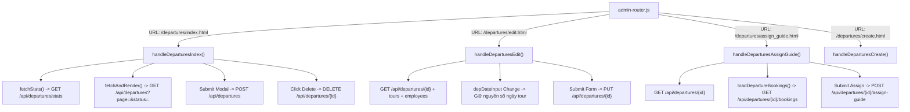
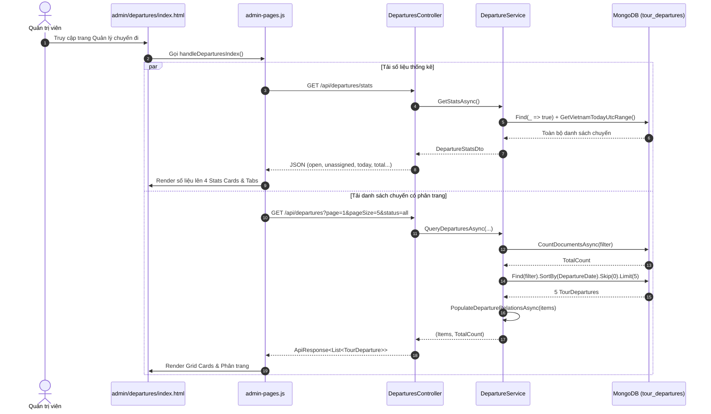
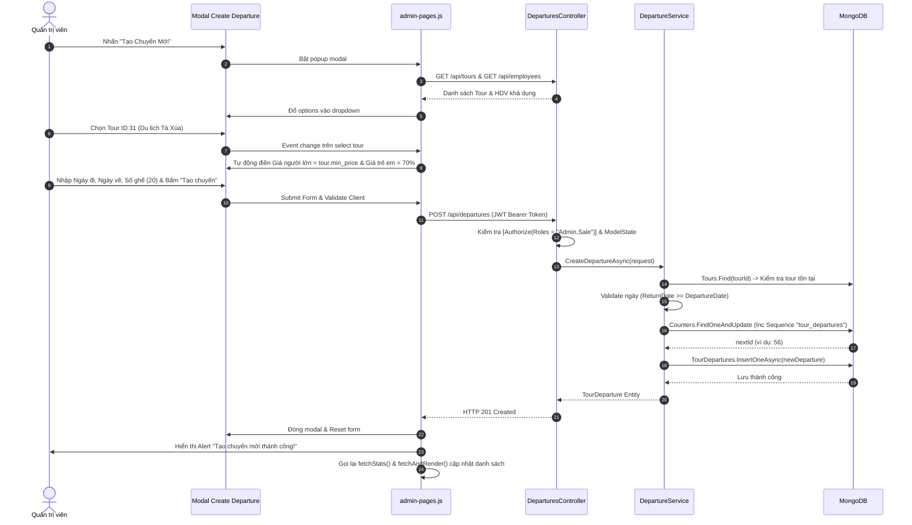

# BÁO CÁO PHÂN TÍCH CODE CHUYÊN SÂU – CHỨC NĂNG QUẢN LÝ LỊCH KHỞI HÀNH (ADMIN DEPARTURES)

> **Dự án**: `BookingTour_DotNet`  
> **Nhánh Git**: `feature/final_code`  
> **Trang quản trị**: `http://localhost:5281/admin/departures/index.html`  
> **Mục đích**: Tài liệu phân tích kỹ thuật chuẩn bị báo cáo và bảo vệ đồ án trước Hội đồng / Giảng viên hướng dẫn.  
> **Quy chuẩn thực hiện**: Phân tích 100% dựa trên source code thực tế trong hệ thống, không suy diễn, trích dẫn chính xác đường dẫn file, hàm xử lý và dòng code thực thi.

---

## MỤC LỤC TỔNG QUAN

1. [Danh mục file thực tế và vai trò kiến trúc](#1-danh-mục-file-thực-tế-và-vai-trò-kiến-trúc)
2. [Phân tích chi tiết giao diện Admin Departures (HTML UI)](#2-phân-tích-chi-tiết-giao-diện-admin-departures-html-ui)
3. [Phân tích JavaScript xử lý nghiệp vụ Client](#3-phân-tích-javascript-xử-lý-nghiệp-vụ-client)
4. [Bảng đặc tả API Endpoints hệ thống](#4-bảng-đặc-tả-api-endpoints-hệ-thống)
5. [Phân tích Backend Controller (`DeparturesController.cs`)](#5-phân-tích-backend-controller-departurescontrollercs)
6. [Phân tích Service & Business Logic (`DepartureService.cs`)](#6-phân-tích-service--business-logic-departureservicecs)
7. [Phân tích Data Model & MongoDB Schema](#7-phân-tích-data-model--mongodb-schema)
8. [Các ràng buộc nghiệp vụ & Cơ chế an toàn dữ liệu](#8-các-ràng-buộc-nghiệp-vụ--cơ-chế-an-toàn-dữ-liệu)
9. [Luồng dữ liệu hoàn chỉnh (End-to-End Traces & Sơ đồ Mermaid)](#9-luồng-dữ-liệu-hoàn-chỉnh-end-to-end-traces--sơ-đồ-mermaid)
10. [Kịch bản thuyết trình & 20 câu hỏi phản biện bảo vệ đồ án](#10-kịch-bản-thuyết-trình--20-câu-hỏi-phản-biện-bảo-vệ-đồ-án)

---

## 1. DANH MỤC FILE THỰC TẾ VÀ VAI TRÒ KIẾN TRÚC

Module **Quản lý lịch khởi hành** được xây dựng theo kiến trúc phân tầng chuyên nghiệp (Multi-tier Architecture) kết hợp RESTful API và Single Page Navigation tương đối với Frontend Vanilla JS (Tailwind CSS) và Backend ASP.NET Core 8 Web API + MongoDB Driver.

```
       [ Client Browser ]
               │
        (HTML5 / TailwindCSS / DOM)
               │
  ┌────────────┴──────────────────────────┐
  │  wwwroot/admin/departures/index.html   │
  │  wwwroot/admin/departures/edit.html    │
  │  wwwroot/admin/departures/assign_guide.html
  └────────────┬──────────────────────────┘
               │ (Event Listeners & DOM Rendering)
  ┌────────────┴──────────────────────────┐
  │  wwwroot/assets/js/admin-pages.js      │  Lines 1595 - 3030
  │  wwwroot/assets/js/admin-router.js     │  Lines 351 - 362
  │  wwwroot/assets/js/api-client.js       │  HTTP Wrapper (JWT Header)
  └────────────┬──────────────────────────┘
               │ HTTP Requests (JSON)
  ┌────────────┴──────────────────────────┐
  │  Controllers/DeparturesController.cs   │  Routing & Role Authorization
  └────────────┬──────────────────────────┘
               │ DTOs (Data Transfer Objects)
  ┌────────────┴──────────────────────────┐
  │  DTOs/DepartureDtos.cs                 │  Create/Update/Stats/Booking DTOs
  └────────────┬──────────────────────────┘
               │ Business Logic & Transactions
  ┌────────────┴──────────────────────────┐
  │  Services/IDepartureService.cs         │  Service Contracts
  │  Services/DepartureService.cs          │  Validation, Concurrency, Queries
  └────────────┬──────────────────────────┘
               │ MongoDB Driver (C# Linq & Builders)
  ┌────────────┴──────────────────────────┐
  │  Models/TourDeparture.cs & BaseEntity  │  Entity Definitions
  │  Data/MongoDbContext.cs                │  Collections, Counters & Indexes
  └───────────────────────────────────────┘
```

### Bảng chi tiết các file thành phần:

| STT | Đường dẫn file | Vai trò trong hệ thống | Ghi chú dòng code chính |
| :---: | :--- | :--- | :--- |
| **1** | `wwwroot/admin/departures/index.html` | Giao diện chính quản lý chuyến đi: 4 thẻ thống kê, bộ lọc từ khóa/ngày, tabs trạng thái, danh sách chuyến dạng lưới card, phân trang, Modal tạo chuyến mới. | 368 dòng HTML5, Tailwind CSS |
| **2** | `wwwroot/admin/departures/edit.html` | Trang chỉnh sửa thông tin chuyến khởi hành: nạp dữ liệu cũ, chỉnh sửa ngày (tự tính ngày về dựa trên duration), số ghế, giá vé, trạng thái. | 249 dòng HTML |
| **3** | `wwwroot/admin/departures/assign_guide.html` | Trang phân công Hướng dẫn viên và **theo dõi danh sách khách hàng đặt chỗ** của chuyến khởi hành (kèm phân trang khách). | 298 dòng HTML |
| **4** | `wwwroot/admin/departures/create.html` | Trang tạo chuyến khởi hành độc lập (dành cho chế độ fallback không dùng modal). | 185 dòng HTML |
| **5** | `wwwroot/assets/js/admin-pages.js` | Toàn bộ logic tương tác JavaScript phía client: `handleDeparturesIndex`, `handleDeparturesEdit`, `handleDeparturesAssignGuide`, `handleDeparturesCreate`. | Dòng 1595 – 3030 (~1.435 dòng JS) |
| **6** | `wwwroot/assets/js/admin-router.js` | Điều hướng trang quản trị, tự động load script và gọi đúng hàm handler tương ứng với URL. | Dòng 351 – 362 |
| **7** | `wwwroot/assets/js/api-client.js` | Thư viện wrapper gọi fetch API chuẩn hóa, tự động gắn `Authorization: Bearer <jwt_token>` và xử lý lỗi phản hồi. | `window.BookingTourApi.apiRequest` |
| **8** | `Controllers/DeparturesController.cs` | Controller tiếp nhận HTTP requests, kiểm tra phân quyền `[Authorize(Roles = "Admin,Sale")]`, validation ModelState, trả về mã trạng thái HTTP chuẩn. | 166 dòng C# |
| **9** | `Services/IDepartureService.cs` | Interface định nghĩa các nghiệp vụ chuyến khởi hành: Query, Stats, GetById, Create, Update, Delete, AssignGuide, GetBookings. | 23 dòng C# |
| **10** | `Services/DepartureService.cs` | Service thực thi logic nghiệp vụ: xử lý múi giờ Việt Nam (+7 UTC), kiểm tra ghế, khóa lạc quan (Optimistic Concurrency), tính giá trẻ em tự động, populate quan hệ Tour & HDV. | 406 dòng C# |
| **11** | `DTOs/DepartureDtos.cs` | Định nghĩa các DTO: `DepartureCreateRequest`, `DepartureUpdateRequest`, `AssignGuideRequest`, `DepartureStatsDto`, `DepartureBookingsResponse`, `DepartureBookingDto`. | 155 dòng C# |
| **12** | `Models/TourDeparture.cs` | Entity MongoDB ánh xạ collection `tour_departures`. Kế thừa `BaseEntity` (`Id`, `CreatedAt`, `UpdatedAt`). | 64 dòng C# |
| **13** | `Data/MongoDbContext.cs` | Đăng ký Collection `TourDepartures`, hàm sinh ID tăng tự động `GetNextSequenceAsync("tour_departures")`, khởi tạo Index tìm kiếm. | Dòng 31, 37–49, 100–107 |

---

## 2. PHÂN TÍCH CHI TIẾT GIAO DIỆN ADMIN DEPARTURES (HTML UI)

Giao diện trang `admin/departures/index.html` được thiết kế theo tiêu chuẩn hiện đại, trực quan hóa trạng thái đợt khởi hành theo dạng lưới thẻ (Grid Cards), hỗ trợ quản trị viên nắm bắt nhanh số chỗ còn trống, hướng dẫn viên và tình trạng đơn đặt.

### 2.1. Thanh tiêu đề và nút thao tác chính
* **Tiêu đề trang**: "Quản lý Chuyến Khởi Hành" (Dòng 122).
* **Mô tả**: "Quản lý các đợt khởi hành thực tế của các tour, kiểm soát số chỗ và phân công HDV".
* **Nút tạo mới**: `#btnOpenCreateDepartureModal` (Dòng 125–130) – Mở popup modal tạo chuyến đi ngay trên màn hình hiện tại mà không phải load lại toàn trang.
* **Hộp thông báo (Alerts)**:
  * `#departureAlertSuccess` (Dòng 133–141): Hiển thị thông báo màu xanh khi tạo/sửa/xóa/phân công thành công.
  * `#departureAlertError` (Dòng 142–150): Hiển thị thông báo màu đỏ khi có lỗi từ server.

### 2.2. Bốn thẻ số liệu thống kê (Stats Cards)
Nằm tại dòng 152–209 của `index.html`:
1. **Đang mở bán (`#statDeparturesOpen`)**: Số lượng chuyến khởi hành có trạng thái `open` và còn chỗ trống (`available_seats > 0`). Biểu tượng máy bay cất cánh (`flight_takeoff`).
2. **Chưa gán HDV (`#statDeparturesNoGuide`)**: Số lượng chuyến chưa có người dẫn đoàn hoặc tên HDV là "Chưa phân công". Biểu tượng thêm người (`person_add`).
3. **Khởi hành hôm nay (`#statDeparturesToday`)**: Số chuyến khởi hành đúng vào ngày hôm nay theo giờ Việt Nam. Biểu tượng lịch ngày (`calendar_today`).
4. **Tổng số chuyến (`#statDeparturesTotal`)**: Tổng số chuyến khởi hành đã được thiết lập trong hệ thống. Biểu tượng lịch tháng (`calendar_month`).

### 2.3. Form tìm kiếm & Lọc dữ liệu nâng cao
Nằm tại dòng 212–239 của `index.html`:
* **Input từ khóa (`#departureKeywordInput`)**: Tìm theo Tên Tour, Mã chuyến (#DEP-...) hoặc Tên Hướng dẫn viên.
* **Input ngày khởi hành (`#departureDateInput`)**: Cho phép chọn ngày cụ thể để xem các tour khởi hành vào ngày đó.
* **Nút Lọc kết quả (`button[type="submit"]`)**: Kích hoạt sự kiện submit lọc danh sách.
* **Nút Đặt lại bộ lọc (`#btnResetDepartureFilter`)**: Xóa sạch từ khóa và ngày đã chọn, đưa danh sách về trang 1 mặc định.

### 2.4. Thanh Tabs lọc nhanh theo trạng thái (Status Filter Tabs)
Nằm tại dòng 241–255 của `index.html`:
* Gồm 4 nút tab có thuộc tính `data-status`:
  * `data-status="all"`: Tất cả chuyến đi.
  * `data-status="open"`: Đang bán (chưa đầy và chưa hủy).
  * `data-status="full"`: Đã đầy khách (`status == 'full'` hoặc `available_seats <= 0`).
  * `data-status="cancelled"`: Đã hủy.
* Tự động hiển thị số lượng tương ứng trên từng nhãn tab (ví dụ: `Tất cả (25)`, `Đang bán (18)`, `Đã đầy (4)`, `Đã hủy (3)`).

### 2.5. Lưới Card chuyến khởi hành (`#departuresGridContainer`)
Dữ liệu được render động thành 2 cột (`grid-cols-1 lg:grid-cols-2 gap-6`). Mỗi thẻ chuyến khởi hành hiển thị đầy đủ thông tin:
* **Header card**: Mã chuyến `#DEP-{id}`, huy hiệu trạng thái (Xanh: Đang bán, Vàng: Đã đầy, Đỏ: Đã hủy). Tên tour có liên kết xem chi tiết tour (`../tours/show.html?id=...`), tỉnh thành đến.
* **Lịch trình**: Ngày khởi hành và ngày trở về (được định dạng thân thiện `dd/MM/yyyy`).
* **Tiến độ giữ chỗ (Seat Progress Bar)**:
  * Tỷ lệ phần trăm lấp đầy: `booked / maxSeats * 100%`.
  * Thanh tiến độ chuyển màu trực quan: `< 60%` màu xanh ngọc, `60% - 89%` màu vàng cam, `>= 90%` màu đỏ hồng.
  * Hiển thị chi tiết: `X / Y khách đã đặt (Z chỗ trống)`.
* **Bảng giá**: Giá người lớn và giá trẻ em (được format VNĐ).
* **Thông tin Hướng dẫn viên**: Tên HDV hiện tại. Nếu chưa phân công, hiển thị link cảnh báo màu cam kèm icon dẫn sang trang phân công ngay.
* **Thanh tác vụ (Footer Card)**:
  * Nút icon `person_add`: Dẫn sang trang phân công HDV và xem khách đặt (`assign_guide.html?departure_id={id}`).
  * Nút icon `edit`: Dẫn sang trang chỉnh sửa chuyến đi (`edit.html?id={id}`).
  * Nút icon `delete`: Gọi xác nhận xóa chuyến đi (chỉ cho phép xóa nếu chưa có booking nào).

### 2.6. Khối phân trang (`#departurePaginationContainer`)
Nằm tại dòng 261–270:
* Tóm tắt: `Hiển thị 1–5 trên tổng số 18 chuyến khởi hành`.
* Các nút số trang có thuật toán ngắt dấu ba chấm `...` thông minh (`getPaginationRange`) cùng 2 nút điều hướng Trước/Sau (`chevron_left`, `chevron_right`).

### 2.7. Modal tạo chuyến khởi hành mới (`#createDepartureModal`)
Nằm tại dòng 273–358:
* Popup ẩn hiện bằng class `hidden`.
* Dropdown chọn Tour du lịch (`#createDepTourSelect`): Tải động danh sách tất cả các tour hiện có từ `/api/tours`.
* Tự động điền giá: Khi quản trị viên chọn một tour trong dropdown, JavaScript tự động đọc `min_price` của tour đó và điền sẵn vào ô **Giá người lớn**, đồng thời tự động tính 70% giá vào ô **Giá trẻ em**.
* Ô nhập Ngày khởi hành (`#createDepStartDate`) và Ngày kết thúc (`#createDepEndDate`): Tự động điền ngày mai và 4 ngày sau theo múi giờ Việt Nam.
* Ô nhập số chỗ (`#createDepMaxSeats`), Trạng thái (`#createDepStatus`), và Dropdown chọn HDV (`#createDepGuideSelect`).

---

## 3. PHÂN TÍCH JAVASCRIPT XỬ LÝ NGHIỆP VỤ CLIENT

Toàn bộ logic của module Departures được tổ chức chặt chẽ trong file `wwwroot/assets/js/admin-pages.js` với các hàm quản trị chuyên biệt:



### 3.1. Phân tích hàm `handleDeparturesIndex()` (Dòng 1597 – 2226)

#### Các biến trạng thái nội bộ:
```javascript
let currentPage = 1;         // Trang hiện tại (mặc định 1)
const pageSize = 5;          // Kích thước trang cố định (5 chuyến/trang)
let currentStatus = 'all';    // Bộ lọc trạng thái ('all', 'open', 'full', 'cancelled')
let searchKeyword = '';      // Từ khóa tìm kiếm
let filterDate = '';         // Ngày khởi hành cần lọc (YYYY-MM-DD)
let isLoading = false;       // Cờ chống double-request
let cachedTours = null;      // Bộ nhớ đệm danh sách tours cho modal
let cachedGuides = null;     // Bộ nhớ đệm danh sách HDV cho modal
```

#### Hàm `fetchStats()` (Dòng 1634 – 1661):
* Gửi request `GET /api/departures/stats`.
* Cập nhật dữ liệu vào 4 thẻ thống kê: `#statDeparturesOpen`, `#statDeparturesNoGuide`, `#statDeparturesToday`, `#statDeparturesTotal`.
* Cập nhật số đếm lên các nút tab trạng thái: `Tất cả (N)`, `Đang bán (N)`, `Đã đầy (N)`, `Đã hủy (N)`.

#### Hàm `fetchAndRender()` (Dòng 1664 – 1866):
* Thiết lập trạng thái loading hiển thị icon xoay `sync`.
* Tạo `URLSearchParams` truyền các tham số: `page`, `pageSize`, `status`, `search`, `date`.
* Gọi API `GET /api/departures?{params}` thông qua `window.BookingTourApi.apiRequest`.
* Xử lý dữ liệu trả về:
  * Trích xuất mảng `items`, `totalItems`, `totalPages`.
  * Nếu không có chuyến nào: Hiển thị giao diện Empty State thân thiện kèm gợi ý đặt lại bộ lọc.
  * Nếu có dữ liệu: Map từng phần tử `TourDeparture` thành các khối thẻ HTML, tính toán tỷ lệ giữ chỗ (`booked / maxSeats * 100%`), màu sắc thanh tiến trình, nhãn trạng thái và định dạng tiền tệ.
* Gắn sự kiện Xóa (`.btn-delete-departure`):
  * Bật hộp thoại `confirm()` xác nhận với người dùng.
  * Gọi API `DELETE /api/departures/{id}`.
  * Xử lý trường hợp xóa mục cuối cùng của trang thì tự động lùi về trang trước (`currentPage--`).
  * Gọi lại `fetchAndRender()` và `fetchStats()` để đồng bộ giao diện.

#### Logic phân trang `renderPagination()` (Dòng 1869 – 1961):
* Tính toán khoảng số trang hiển thị bằng hàm `getPaginationRange(currentPage, totalPages)`:
  * Nếu tổng số trang `<= 7`: Hiển thị toàn bộ `[1, 2, 3, 4, 5, 6, 7]`.
  * Nếu trang hiện tại ở đầu (`<= 4`): Hiển thị `[1, 2, 3, 4, 5, '...', total]`.
  * Nếu trang hiện tại ở cuối: Hiển thị `[1, '...', total - 4, ..., total]`.
  * Nếu trang ở giữa: Hiển thị `[1, '...', current - 1, current, current + 1, '...', total]`.
* Lắng nghe sự kiện click trên từng nút số trang và nút Prev/Next.

#### Logic Modal Tạo chuyến mới (Dòng 2008 – 2220):
* Tự động khởi tạo giá trị ngày mặc định bằng hàm `toVietnamDateInput`: Ngày khởi hành = Ngày mai; Ngày về = Ngày mai + 4 ngày.
* Lắng nghe sự kiện `change` trên dropdown Tour (`#createDepTourSelect`):
  ```javascript
  tourSelect.addEventListener('change', () => {
    const selectedId = Number(tourSelect.value);
    const tour = cachedTours.find(t => t.id === selectedId);
    if (tour) {
      const price = Number(tour.min_price || 0);
      if (adultPriceInput && price > 0) adultPriceInput.value = price;
      if (childPriceInput && price > 0) childPriceInput.value = Math.round(price * 0.7);
    }
  });
  ```
* Bắt sự kiện submit form: Kiểm tra validation phía client (Tour được chọn, Ngày về `>=` Ngày đi, `maxSeats > 0`, Giá `>= 0`).
* Đóng gói Payload gửi lên API:
  ```javascript
  const payload = {
    tour_id: tourId,
    departure_date: depDate,
    return_date: retDate,
    max_seats: maxSeats,
    adult_price: adultPrice,
    child_price: childPrice,
    guide_id: guideId,
    status: status
  };
  await window.BookingTourApi.apiRequest('/api/departures', {
    method: 'POST',
    body: JSON.stringify(payload)
  });
  ```
* Đóng modal, reset form, hiển thị alert thành công và reload lại danh sách + thống kê.

---

### 3.2. Phân tích hàm `handleDeparturesEdit()` (Dòng 2285 – 2556)
Được kích hoạt khi người dùng truy cập trang `admin/departures/edit.html?id={id}`:
1. **Lấy `id` từ Query String**: Nếu không tìm thấy hoặc `id` không phải số, hiển thị lỗi và disable toàn bộ form.
2. **Nạp dữ liệu song song (Parallel Fetch)**: Sử dụng `Promise.all` nạp đồng thời Chi tiết chuyến (`/api/departures/{id}`), Danh sách Tour (`/api/tours`) và Danh sách Nhân viên (`/api/employees`).
3. **Đổ dữ liệu lên Form**:
   * Điền thông tin tour, số chỗ tối đa, giá vé, trạng thái và HDV hiện tại.
   * Tính toán số chỗ đã được khách đặt: `bookedSeats = Math.max(0, maxSeats - availSeats)`.
   * Hiển thị thông báo số chỗ: `Chỗ còn trống: X (Đã đặt: Y / Z khách)`.
4. **Tính năng thông minh: Tự động điều chỉnh ngày kết thúc theo thời lượng tour**:
   ```javascript
   // Tính số ngày của tour dựa trên khoảng cách ngày cũ
   let tourDurationDays = Math.round((new Date(initialRetDateStr) - new Date(initialDepDateStr)) / 86400000);
   
   // Khi admin thay đổi ngày khởi hành, tự động dời ngày trở về theo đúng thời lượng
   depDateInput.addEventListener('change', () => {
     if (!depDateInput.value) return;
     retDateInput.min = depDateInput.value;
     if (tourDurationDays >= 0) {
       const newDep = new Date(depDateInput.value);
       const newRet = new Date(newDep.getTime() + tourDurationDays * 86400000);
       retDateInput.value = toVietnamDateInput(newRet);
     }
   });
   ```
5. **Gửi dữ liệu cập nhật (`PUT /api/departures/{id}`)**:
   * Tự động tính toán lại số chỗ còn trống mới dựa trên số khách đã đặt: `updatedAvailSeats = Math.max(0, maxSeatsVal - bookedSeats)`.
   * Gửi request lên server và chuyển hướng về trang `index.html` sau 1.2 giây khi thành công.

---

### 3.3. Phân tích hàm `handleDeparturesAssignGuide()` (Dòng 2558 – 3030)
Được kích hoạt khi truy cập `admin/departures/assign_guide.html?departure_id={id}`. Trang này tích hợp **2 chức năng nghiệp vụ quan trọng**:

#### A. Nghiệp vụ Phân công Hướng dẫn viên
* Nạp danh sách nhân viên có vai trò `Guide` (RoleId = 3).
* Hiển thị thông tin HDV hiện tại (Tên, SĐT) hoặc huy hiệu cảnh báo `Chưa phân công`.
* Khi submit form, gọi API `POST /api/departures/{id}/assign-guide` với payload `{ guide_id: selectedGuideId }`.
* Cập nhật ngay lập tức giao diện hiển thị tên HDV mới mà không cần reload trang.

#### B. Nghiệp vụ Quản lý & Xem danh sách khách hàng đặt chỗ (`loadDepartureBookings`)
* Gọi API chuyên biệt: `GET /api/departures/{id}/bookings?page={page}&pageSize=5`.
* Hiển thị tóm tắt: Tổng số lượt khách tham gia và tổng số đơn đặt chỗ (`{totalPassengers} khách / {totalBookings} đơn`).
* Render bảng chi tiết từng đơn đặt vé:
  * STT, Mã đơn đặt (`booking_code`), Tên khách hàng đặt, Số điện thoại, Email.
  * Số lượng khách: `Tổng (Số NL, Số TE)`.
  * Ngày tạo đơn.
  * Huy hiệu trạng thái đơn: `Đã xác nhận` (Xanh lá), `Chờ duyệt` (Vàng), `Đã hủy` (Đỏ), `Hoàn thành` (Xanh dương).
* Hỗ trợ phân trang riêng biệt cho danh sách đơn đặt chỗ ngay dưới bảng.

---

## 4. BẢNG ĐẶC TẢ API ENDPOINTS HỆ THỐNG

Tất cả các API của module đều được khai báo trong `Controllers/DeparturesController.cs` và tuân thủ định dạng phản hồi chuẩn `ApiResponse<T>`:

| Method | Endpoint Route | Quyền truy cập (Auth) | Request Body / Params | Response Data | Mô tả nghiệp vụ |
| :---: | :--- | :--- | :--- | :--- | :--- |
| **GET** | `/api/departures`<br>`/departures` | `[AllowAnonymous]` | Query: `search`, `keyword`, `tourId`, `date`, `status`, `page`, `pageSize` | `ApiResponse<List<TourDeparture>>` (kèm `total`, `page`, `pageSize`) | Tìm kiếm, lọc và phân trang danh sách chuyến khởi hành. Sắp xếp theo `departure_date` tăng dần. |
| **GET** | `/api/departures/stats` | `[AllowAnonymous]` | Không có | `ApiResponse<DepartureStatsDto>` | Thống kê số lượng chuyến: đang mở bán, chưa gán HDV, khởi hành hôm nay, đã đầy, đã hủy, tổng số. |
| **GET** | `/api/departures/{id}`<br>`/departures/{id}` | `[AllowAnonymous]` | Route: `id` (int) | `ApiResponse<TourDeparture>` | Lấy thông tin chi tiết của một chuyến khởi hành, tự động populate thông tin Tour và Hướng dẫn viên. |
| **GET** | `/api/departures/guides` | `[Authorize(Roles = "Admin,Sale")]` | Không có | `ApiResponse<List<{Id, FullName}>>` | Lấy danh sách nhân viên có vai trò Hướng dẫn viên (`RoleId == 3`). |
| **POST** | `/api/departures` | `[Authorize(Roles = "Admin,Sale")]` | Body JSON: `DepartureCreateRequest` | `ApiResponse<TourDeparture>` (HTTP 201 Created) | Tạo một chuyến khởi hành mới, tự sinh ID tăng tự động, kiểm tra ngày hợp lệ, tự điền giá mặc định. |
| **PUT** | `/api/departures/{id}` | `[Authorize(Roles = "Admin,Sale")]` | Route: `id`<br>Body JSON: `DepartureUpdateRequest` | `ApiResponse<TourDeparture>` (HTTP 200 OK) | Cập nhật thông tin chuyến khởi hành với cơ chế **Khóa lạc quan (Optimistic Locking)** chống ghi đè dữ liệu cũ. |
| **DELETE** | `/api/departures/{id}` | `[Authorize(Roles = "Admin")]` | Route: `id` (int) | `ApiResponse<bool>` | Xóa chuyến khởi hành. Ràng buộc: Chặn xóa nếu chuyến đã có khách đặt chỗ. |
| **POST** | `/api/departures/{id}/assign-guide` | `[Authorize(Roles = "Admin,Sale")]` | Route: `id`<br>Body JSON: `AssignGuideRequest` | `ApiResponse<bool>` | Gán hoặc thay đổi Hướng dẫn viên phụ trách chuyến đi. |
| **GET** | `/api/departures/{id}/bookings` | `[AllowAnonymous]` | Route: `id`<br>Query: `page`, `pageSize` | `ApiResponse<DepartureBookingsResponse>` | Lấy danh sách khách hàng và các đơn đặt chỗ thuộc chuyến đi này, phục vụ điều phối và in danh sách đoàn. |

---

## 5. PHÂN TÍCH BACKEND CONTROLLER (`DeparturesController.cs`)

File `Controllers/DeparturesController.cs` (166 dòng C#) kế thừa `ControllerBase`, sử dụng Dependency Injection để tiếp nhận `IDepartureService`.

### 5.1. Cấu trúc Routing và Tiêm phụ thuộc (DI)
```csharp
[ApiController]
[Route("api/[controller]")]
public class DeparturesController : ControllerBase
{
    private readonly IDepartureService _departureService;

    public DeparturesController(IDepartureService departureService)
    {
        _departureService = departureService;
    }
```
* Áp dụng thuộc tính `[ApiController]` tự động kích hoạt kiểm tra model validation và trả về HTTP 400 nếu dữ liệu gửi lên sai kiểu.
* Cung cấp bí danh route kép: Hỗ trợ cả `/api/departures` và `/departures` nhằm đảm bảo tính tương thích ngược với các trang frontend.

### 5.2. Phân tích chi tiết từng Action Method

#### 1. `GetDepartures` (Dòng 21–36)
* Nhận các tham số truy vấn: `search`, `keyword`, `tourId`, `date`, `status`, `page`, `pageSize`.
* Chuẩn hóa từ khóa tìm kiếm: `var q = !string.IsNullOrWhiteSpace(search) ? search : keyword;`.
* Gọi `_departureService.QueryDeparturesAsync(...)`, trả về danh sách kèm metadata phân trang.

#### 2. `GetDepartureStats` (Dòng 38–44)
* Gọi `_departureService.GetStatsAsync()`.
* Trả về đối tượng `DepartureStatsDto` bọc trong `ApiResponse`. Cho phép truy cập nặc danh (`[AllowAnonymous]`) để phục vụ cả trang chủ / dashboard.

#### 3. `GetDepartureById` (Dòng 46–57)
* Nhận tham số `{id:int}` từ URL.
* Nếu không tìm thấy, trả về `NotFound(ApiResponse<object>.Fail($"Không tìm thấy chuyến đi mã {id}."));`.
* Nếu tìm thấy, trả về đối tượng `TourDeparture` đã được nạp đầy đủ thông tin `Tour` và `Guide`.

#### 4. `CreateDeparture` (Dòng 69–87)
* Phân quyền: `[Authorize(Roles = "Admin,Sale")]` – Chỉ Admin hoặc Nhân viên kinh doanh (Sale) mới có quyền tạo lịch mở bán.
* Kiểm tra `ModelState.IsValid`.
* Trả về mã HTTP `201 Created` kèm thực thể chuyến đi vừa tạo khi thành công. Bắt các lỗi nghiệp vụ từ service và trả về `BadRequest`.

#### 5. `UpdateDeparture` (Dòng 89–111)
* Phân quyền: `[Authorize(Roles = "Admin,Sale")]`.
* Bắt ngoại lệ `KeyNotFoundException` trả về HTTP 404.
* Bắt các ngoại lệ `ArgumentException` (ví dụ: vi phạm ràng buộc số ghế, đổi tour khi đã có khách) trả về HTTP 400.

#### 6. `DeleteDeparture` (Dòng 113–130)
* Phân quyền khắt khe: `[Authorize(Roles = "Admin")]` – **Chỉ duy nhất Quản trị viên cấp cao (Admin)** mới được phép xóa chuyến đi (Sale không có quyền xóa).
* Bắt ngoại lệ `InvalidOperationException` khi chuyến đi đã phát sinh đơn đặt vé và trả về HTTP 400 cùng thông báo lỗi rõ ràng.

#### 7. `AssignGuide` (Dòng 132–145)
* Phân quyền: `[Authorize(Roles = "Admin,Sale")]`.
* Nhận `{id}` trên route và `guide_id` trong body JSON.
* Gọi `_departureService.AssignGuideAsync(id, request.GuideId)`.

#### 8. `GetDepartureBookings` (Dòng 147–164)
* Nhận `{id}` và các tham số phân trang `page`, `pageSize`.
* Gọi `_departureService.GetDepartureBookingsAsync(id, page, pageSize)`.
* Trả về danh sách chi tiết các đơn đặt phòng, thông tin hành khách và người liên hệ.

---

## 6. PHÂN TÍCH SERVICE & BUSINESS LOGIC (`DepartureService.cs`)

File `Services/DepartureService.cs` (406 dòng C#) là trái tim nghiệp vụ của module, thực hiện giao tiếp trực tiếp với MongoDB thông qua `MongoDbContext`.

### 6.1. Xây dựng bộ lọc động (Dynamic Query Builder) trong `QueryDeparturesAsync`
Sử dụng `Builders<TourDeparture>.Filter` để xây dựng biểu thức điều kiện linh hoạt:

```csharp
var builder = Builders<TourDeparture>.Filter;
var filter = builder.Empty;

// 1. Tìm kiếm đa trường (ID, Tên Tour, Tên HDV)
if (!string.IsNullOrWhiteSpace(keyword))
{
    var k = keyword.Trim();
    if (int.TryParse(k, out var parsedId))
    {
        filter &= builder.Or(
            builder.Eq(d => d.Id, parsedId),
            builder.Regex(d => d.TourTitle, new BsonRegularExpression(k, "i")),
            builder.Regex(d => d.GuideName, new BsonRegularExpression(k, "i"))
        );
    }
    else
    {
        filter &= builder.Or(
            builder.Regex(d => d.TourTitle, new BsonRegularExpression(k, "i")),
            builder.Regex(d => d.GuideName, new BsonRegularExpression(k, "i"))
        );
    }
}

// 2. Lọc theo Tour ID
if (tourId.HasValue && tourId.Value > 0)
    filter &= builder.Eq(d => d.TourId, tourId.Value);

// 3. Lọc theo Ngày khởi hành chính xác
if (date.HasValue)
{
    var dayStart = date.Value.Date;
    var dayEnd = dayStart.AddDays(1);
    filter &= builder.Gte(d => d.DepartureDate, dayStart) & builder.Lt(d => d.DepartureDate, dayEnd);
}

// 4. Lọc theo Trạng thái (Xử lý đồng nhất 'full' và 'sold_out' hoặc hết chỗ)
if (!string.IsNullOrWhiteSpace(status) && !string.Equals(status.Trim(), "all", StringComparison.OrdinalIgnoreCase))
{
    var st = status.Trim().ToLower();
    if (st == "full" || st == "sold_out")
    {
        filter &= builder.Or(
            builder.Eq(d => d.Status, "full"),
            builder.Eq(d => d.Status, "sold_out"),
            builder.Lte(d => d.AvailableSeats, 0)
        );
    }
    else
    {
        filter &= builder.Eq(d => d.Status, st);
    }
}
```

### 6.2. Thuật toán xử lý Múi giờ Việt Nam trong `GetStatsAsync`
Để tính toán chính xác số tour "Khởi hành hôm nay" mà không bị lệch múi giờ giữa máy chủ (thường chạy UTC) và người dùng tại Việt Nam (GMT+7), hệ thống xây dựng hàm tính toán phạm vi UTC tương ứng với ngày hiện tại của Việt Nam:

```csharp
private static readonly TimeZoneInfo VietnamTimeZone = GetVietnamTimeZone();

private static TimeZoneInfo GetVietnamTimeZone()
{
    try { return TimeZoneInfo.FindSystemTimeZoneById("Asia/Ho_Chi_Minh"); }
    catch (TimeZoneNotFoundException)
    {
        try { return TimeZoneInfo.FindSystemTimeZoneById("SE Asia Standard Time"); }
        catch (TimeZoneNotFoundException)
        {
            return TimeZoneInfo.CreateCustomTimeZone("Vietnam Standard Time", TimeSpan.FromHours(7), "Vietnam Standard Time", "Vietnam Standard Time");
        }
    }
}

private static (DateTime StartUtc, DateTime EndUtc) GetVietnamTodayUtcRange()
{
    var nowUtc = DateTime.UtcNow;
    var nowVn = TimeZoneInfo.ConvertTimeFromUtc(nowUtc, VietnamTimeZone);
    var startVn = new DateTime(nowVn.Year, nowVn.Month, nowVn.Day, 0, 0, 0, DateTimeKind.Unspecified);
    var endVn = startVn.AddDays(1);
    var startUtc = TimeZoneInfo.ConvertTimeToUtc(startVn, VietnamTimeZone);
    var endUtc = TimeZoneInfo.ConvertTimeToUtc(endVn, VietnamTimeZone);
    return (startUtc, endUtc);
}
```
* Thống kê `TodayCount` được tính bằng điều kiện: `DepartureDate >= todayStartUtc && DepartureDate < todayEndUtc`.
* `UnassignedCount`: Tính các chuyến chưa có `GuideId` hoặc `GuideName` rỗng hoặc là `"Chưa phân công"`.

---

### 6.3. Nghiệp vụ Tạo chuyến khởi hành (`CreateDepartureAsync`)
Nằm tại dòng 160–224 của `DepartureService.cs`:
1. **Kiểm tra Tour tồn tại**: Tìm trong collection `tours`. Nếu không thấy ném `ArgumentException`.
2. **Kiểm tra tính hợp lệ của ngày tháng**:
   * `DepartureDate` và `ReturnDate` không được để trống.
   * Ràng buộc: `ReturnDate >= DepartureDate`.
3. **Kiểm tra số ghế và giá**:
   * `MaxSeats > 0`.
   * Giá không được âm.
4. **Quy tắc giá mặc định thông minh**:
   * Nếu `AdultPrice <= 0`: Lấy giá theo `tour.MinPrice`.
   * Nếu `ChildPrice <= 0`: Tự động tính tròn `Math.Round(adultPrice * 0.7m)` (70% giá người lớn).
5. **Kiểm tra Hướng dẫn viên**:
   * Gọi `FindGuideAsync(request.GuideId)`: Kiểm tra nhân viên tồn tại trong `employees` và phải có `RoleId == 3` (Hướng dẫn viên).
6. **Sinh mã ID số nguyên tự tăng**:
   * `var nextId = await _context.GetNextSequenceAsync("tour_departures");`
7. **Khởi tạo và lưu vào MongoDB**:
   * Ban đầu `AvailableSeats = MaxSeats` (số chỗ trống bằng sức chứa tối đa).
   * Trạng thái mặc định là `"open"`.
   * Lưu thực thể vào collection `tour_departures`.

---

### 6.4. Nghiệp vụ Cập nhật & Khóa lạc quan (`UpdateDepartureAsync`)
Nằm tại dòng 226–267 của `DepartureService.cs`. Đây là một trong những đoạn code thể hiện tư duy thiết kế hệ thống vững chắc nhất:

```csharp
public async Task<TourDeparture> UpdateDepartureAsync(int id, DepartureUpdateRequest request)
{
    var departure = await _context.TourDepartures.Find(d => d.Id == id).FirstOrDefaultAsync()
                    ?? throw new KeyNotFoundException($"Không tìm thấy chuyến đi mã {id}.");

    ValidateDeparture(request);
    var tour = await _context.Tours.Find(t => t.Id == request.TourId).FirstOrDefaultAsync()
               ?? throw new ArgumentException($"Tour du lịch mã {request.TourId} không tồn tại.");
    var guide = await FindGuideAsync(request.GuideId);

    // 1. Tính toán số chỗ đã có khách đặt trước đó
    var reserved = Math.Max(0, departure.MaxSeats - departure.AvailableSeats);
    var available = request.AvailableSeats ?? request.MaxSeats - reserved;

    // 2. Chặn giảm số ghế xuống thấp hơn số lượng khách đã đặt
    if (available < 0 || available > request.MaxSeats - reserved)
        throw new ArgumentException($"Sức chứa và chỗ trống phải giữ đủ {reserved} chỗ đã đặt.");

    // 3. Chặn đổi tour nếu chuyến đi đã có khách đặt
    if (tour.Id != departure.TourId && (reserved > 0 ||
        await _context.Bookings.Find(b => b.DepartureId == id).AnyAsync()))
        throw new ArgumentException("Không thể đổi tour của lịch đã có khách đặt.");

    var adultPrice = request.AdultPrice > 0 ? request.AdultPrice : (departure.AdultPrice > 0 ? departure.AdultPrice : tour.MinPrice);
    var childPrice = request.ChildPrice > 0 ? request.ChildPrice : Math.Round(adultPrice * 0.7m);

    // 4. Khởi tạo Bson Update
    var update = Builders<TourDeparture>.Update
        .Set(d => d.TourId, tour.Id)
        .Set(d => d.TourTitle, tour.Title)
        .Set(d => d.DepartureDate, request.DepartureDate)
        .Set(d => d.ReturnDate, request.ReturnDate)
        .Set(d => d.MaxSeats, request.MaxSeats)
        .Set(d => d.AvailableSeats, available)
        .Set(d => d.AdultPrice, adultPrice)
        .Set(d => d.ChildPrice, childPrice)
        .Set(d => d.Status, available == 0 && request.Status == "open" ? "full" : (request.Status ?? departure.Status))
        .Set(d => d.GuideId, request.GuideId)
        .Set(d => d.GuideName, guide?.FullName)
        .Set(d => d.UpdatedAt, DateTime.UtcNow);

    // 5. CƠ CHẾ KHÓA LẠC QUAN (OPTIMISTIC CONCURRENCY CONTROL)
    var updated = await _context.TourDepartures.FindOneAndUpdateAsync(
        d => d.Id == id && 
             d.AvailableSeats == departure.AvailableSeats &&
             d.MaxSeats == departure.MaxSeats && 
             d.UpdatedAt == departure.UpdatedAt,
        update, new FindOneAndUpdateOptions<TourDeparture> { ReturnDocument = ReturnDocument.After });

    if (updated == null)
        throw new ArgumentException("Lịch hoặc số ghế đã thay đổi. Vui lòng tải lại trang và thử lại.");

    updated.Tour = tour;
    return updated;
}
```

> [!IMPORTANT]
> **Giải thích cơ chế Khóa Lạc Quan (Optimistic Locking)**:
> Trong môi trường nhiều người dùng, nếu Admin A đang mở form sửa chuyến đi, trong khi đó một khách hàng vừa hoàn tất đặt 2 vé trên website (làm thay đổi `AvailableSeats` và `UpdatedAt`), lệnh `FindOneAndUpdateAsync` sẽ kiểm tra điều kiện:
> `d.AvailableSeats == departure.AvailableSeats && d.UpdatedAt == departure.UpdatedAt`.
> Nếu dữ liệu dưới database đã bị thay đổi, điều kiện so khớp thất bại, hàm trả về `null` và hệ thống chủ động ném thông báo lỗi yêu cầu Admin tải lại trang, **ngăn chặn hoàn toàn lỗi ghi đè làm mất đơn đặt của khách hàng**.

---

### 6.5. Nghiệp vụ Xóa chuyến khởi hành an toàn (`DeleteDepartureAsync`)
Nằm tại dòng 269–285 của `DepartureService.cs`:
1. **Kiểm tra ràng buộc toàn vẹn dữ liệu**:
   ```csharp
   var hasBookings = await _context.Bookings.Find(b => b.DepartureId == id).AnyAsync();
   if (hasBookings || departure.AvailableSeats < departure.MaxSeats)
   {
       throw new InvalidOperationException($"Không thể xóa chuyến đi mã {id} vì đã có khách đặt chỗ.");
   }
   ```
   * Hệ thống kiểm tra đồng thời cả 2 điều kiện: Có tồn tại bản ghi trong collection `bookings` liên kết tới `DepartureId` hay không, và số ghế trống có nhỏ hơn số ghế tối đa hay không.
   * Nếu có khách đã đặt, **tuyệt đối không cho phép xóa** nhằm đảm bảo toàn vẹn dữ liệu lịch sử đặt vé và báo cáo tài chính.
2. Thực hiện xóa với điều kiện kiểm tra phiên bản concurrency: `d.Id == id && d.AvailableSeats == departure.AvailableSeats && d.UpdatedAt == departure.UpdatedAt`.

---

### 6.6. Nghiệp vụ Lấy danh sách khách hàng đặt chuyến (`GetDepartureBookingsAsync`)
Nằm tại dòng 304–376 của `DepartureService.cs`:
* Thực hiện truy vấn collection `bookings` theo `b.DepartureId == departureId`.
* Tính toán tổng số đơn (`TotalBookings = allBookings.Count`) và tổng số hành khách tham gia (`TotalPassengers = allBookings.Sum(b => b.TotalAdults + b.TotalChildren)`).
* Phân trang danh sách booking sắp xếp theo `Id` giảm dần.
* Thực hiện "Batch Lookup" nạp thông tin khách hàng từ collection `customers` theo danh sách `customerIds` để lấy Tên, SĐT, Email liên hệ.
* Trả về DTO `DepartureBookingsResponse` phục vụ danh sách đoàn cho hướng dẫn viên.

---

### 6.7. Tối ưu hóa hiệu năng truy vấn trong `PopulateDepartureRelationsAsync`
Nằm tại dòng 378–404 của `DepartureService.cs`:
Thay vì sử dụng vòng lặp truy vấn MongoDB `N + 1` lần, service gom toàn bộ `tourIds` và `guideIds` của trang hiện tại để thực hiện 2 câu lệnh truy vấn duy nhất với toán tử `$in`:
```csharp
var tourIds = departures.Select(d => d.TourId).Distinct().ToList();
var guideIds = departures.Where(d => d.GuideId.HasValue).Select(d => d.GuideId!.Value).Distinct().ToList();

var tours = await _context.Tours.Find(t => tourIds.Contains(t.Id)).ToListAsync();
var guides = await _context.Employees.Find(e => guideIds.Contains(e.Id)).ToListAsync();

var tourMap = tours.ToDictionary(t => t.Id);
var guideMap = guides.ToDictionary(g => g.Id);

foreach (var d in departures)
{
    if (tourMap.TryGetValue(d.TourId, out var tour))
    {
        d.Tour = tour;
        d.TourTitle = tour.Title;
        d.ThumbnailUrl = tour.ThumbnailUrl;
    }
    if (d.GuideId.HasValue && guideMap.TryGetValue(d.GuideId.Value, out var guide))
    {
        d.GuideName = guide.FullName;
    }
}
```
* **Ý nghĩa bảo vệ đồ án**: Giảm số lượng round-trip tới cơ sở dữ liệu từ `2N + 1` xuống còn `2`, tối ưu hóa tối đa thời gian phản hồi API.

---

## 7. PHÂN TÍCH DATA MODEL & MONGODB SCHEMA

### 7.1. Cấu trúc Entity `TourDeparture` (`Models/TourDeparture.cs`)

```csharp
public class TourDeparture : BaseEntity
{
    [BsonElement("tour_id")]
    [JsonPropertyName("tour_id")]
    public int TourId { get; set; }

    [BsonElement("tour_title")]
    [JsonPropertyName("tour_title")]
    public string? TourTitle { get; set; }

    [BsonElement("departure_date")]
    [JsonPropertyName("departure_date")]
    public DateTime DepartureDate { get; set; }

    [BsonElement("return_date")]
    [JsonPropertyName("return_date")]
    public DateTime ReturnDate { get; set; }

    [BsonElement("max_seats")]
    [JsonPropertyName("max_seats")]
    public int MaxSeats { get; set; } = 20;

    [BsonElement("available_seats")]
    [JsonPropertyName("available_seats")]
    public int AvailableSeats { get; set; }

    [BsonElement("adult_price")]
    [JsonPropertyName("adult_price")]
    public decimal AdultPrice { get; set; }

    [BsonElement("child_price")]
    [JsonPropertyName("child_price")]
    public decimal ChildPrice { get; set; }

    [BsonElement("status")]
    [JsonPropertyName("status")]
    public string Status { get; set; } = "open"; // open, full, cancelled

    [BsonElement("guide_id")]
    [JsonPropertyName("guide_id")]
    public int? GuideId { get; set; }

    [BsonElement("guide_name")]
    [JsonPropertyName("guide_name")]
    public string? GuideName { get; set; }

    [BsonIgnore]
    [JsonPropertyName("tour")]
    public Tour? Tour { get; set; }

    [BsonIgnore]
    [JsonPropertyName("guide")]
    public Employee? Guide { get; set; }

    [BsonIgnore]
    [JsonPropertyName("thumbnail_url")]
    public string? ThumbnailUrl { get; set; }
}
```

* **Kế thừa `BaseEntity`**: Cung cấp `MongoId` (`_id` dạng BsonType.ObjectId), `Id` (số nguyên tự tăng), `CreatedAt` và `UpdatedAt` (UTC DateTime).
* **Các thuộc tính phi chuẩn hóa (Denormalization)**: `TourTitle` và `GuideName` được lưu trực tiếp vào tài liệu chuyến đi. Giúp câu lệnh tìm kiếm theo tên tour hoặc HDV diễn ra tức thì mà không cần `$lookup` phức tạp.
* **Các thuộc tính ảo `[BsonIgnore]`**: `Tour`, `Guide`, `ThumbnailUrl` chỉ dùng để tuần tự hóa JSON trả về cho Frontend, không bị lưu thừa vào MongoDB.

### 7.2. Cơ chế Sinh ID tự tăng (Auto-increment Sequence)
Khác với ID ObjectId mặc định của MongoDB, dự án sử dụng số nguyên thân thiện với người dùng (`#DEP-1`, `#DEP-2`,...):
* Lưu trữ trong collection `counters` với tài liệu `_id: "tour_departures"`.
* Sử dụng toán tử nguyên tử `$inc` thông qua `FindOneAndUpdateAsync`:
  ```csharp
  public async Task<int> GetNextSequenceAsync(string counterName)
  {
      var filter = Builders<Counter>.Filter.Eq(c => c.Id, counterName);
      var update = Builders<Counter>.Update.Inc(c => c.SequenceValue, 1);
      var options = new FindOneAndUpdateOptions<Counter> { IsUpsert = true, ReturnDocument = ReturnDocument.After };
      var result = await Counters.FindOneAndUpdateAsync(filter, update, options);
      return result.SequenceValue;
  }
  ```

### 7.3. Thiết kế Index tối ưu hóa truy vấn (`MongoDbContext.cs`)
Nằm tại dòng 101–107 của `Data/MongoDbContext.cs`:
```csharp
await TourDepartures.Indexes.CreateManyAsync(new[]
{
    new CreateIndexModel<TourDeparture>(Builders<TourDeparture>.IndexKeys.Ascending(d => d.Id), new CreateIndexOptions { Unique = true }),
    new CreateIndexModel<TourDeparture>(Builders<TourDeparture>.IndexKeys.Ascending(d => d.TourId)),
    new CreateIndexModel<TourDeparture>(Builders<TourDeparture>.IndexKeys.Ascending(d => d.DepartureDate)),
    new CreateIndexModel<TourDeparture>(Builders<TourDeparture>.IndexKeys.Ascending(d => d.Status))
});
```
* **Index `Id` (Unique)**: Đảm bảo tính duy nhất tuyệt đối cho mã chuyến đi.
* **Index `TourId`**: Tăng tốc truy vấn lọc lịch khởi hành theo từng tour tại trang chi tiết tour của khách hàng (`client/tours/show.html?id=...`).
* **Index `DepartureDate`**: Tối ưu hóa mệnh đề sắp xếp lịch trình và lọc tour theo ngày/khoảng ngày khởi hành.
* **Index `Status`**: Tăng tốc bộ lọc danh sách theo các tab trạng thái (`open`, `full`, `cancelled`).

---

## 8. CÁC RÀNG BUỘC NGHIỆP VỤ & CƠ CHẾ AN TOÀN DỮ LIỆU

Hệ thống thiết lập một mạng lưới các quy tắc kiểm soát chặt chẽ từ tầng Client (Validation JS) đến tầng Server (Data Annotations DTO) và Database (Business Rules trong Service):

1. **Ràng buộc thời gian hành trình**:
   * Ngày kết thúc (`ReturnDate`) bắt buộc phải bằng hoặc diễn ra sau ngày khởi hành (`DepartureDate`).
   * Phía Client: Khi chọn ngày khởi hành, input ngày kết thúc tự động gán thuộc tính `min = depDate`, đồng thời JavaScript tự tính toán cộng thêm số ngày tương ứng với thời lượng tour để tránh người dùng phải nhập thủ công.
2. **Ràng buộc kiểm soát số chỗ (Seat Integrity Constraint)**:
   * Sức chứa tối đa (`MaxSeats`) phải lớn hơn 0 và nhỏ hơn hoặc bằng 100 khách.
   * Khi sửa chuyến đi: Không được phép hạ `MaxSeats` xuống thấp hơn số chỗ khách đã đặt (`reserved = MaxSeats - AvailableSeats`).
   * `AvailableSeats` được tính toán tự động: `AvailableSeats = MaxSeats - reserved`.
3. **Quy tắc đóng mở bán tự động**:
   * Nếu `AvailableSeats <= 0`: Hệ thống tự động chuyển trạng thái sang `full` (Đã đầy chỗ).
   * Trên giao diện Client, thẻ chuyến đi tự động hiển thị huy hiệu `Đã đầy` màu vàng cam và thanh tiến trình 100% màu đỏ.
4. **Quy tắc đóng băng Tour (Tour Freeze Rule)**:
   * Một chuyến khởi hành một khi đã phát sinh đơn đặt chỗ (`reserved > 0` hoặc có bản ghi trong `bookings`), **tuyệt đối không được phép đổi sang Tour khác** (`TourId` bị đóng băng).
5. **Ràng buộc xóa an toàn (Safe Deletion Constraint)**:
   * Không thể xóa chuyến đi đã có khách đặt chỗ (`hasBookings == true` hoặc `AvailableSeats < MaxSeats`).
   * Chỉ có tài khoản với quyền `Admin` mới có thể thực hiện thao tác xóa.
6. **Bảo toàn tính nhất quán bằng Khóa lạc quan (Optimistic Locking)**:
   * Chống xung đột dữ liệu giữa thao tác cập nhật của Admin và thao tác đặt vé của Khách hàng bằng cách kiểm tra đồng thời `UpdatedAt`, `AvailableSeats` và `MaxSeats`.

---

## 9. LUỒNG DỮ LIỆU HOÀN CHỈNH (END-TO-END TRACES & SƠ ĐỒ MERMAID)

### 9.1. Luồng 1: Tải danh sách, Lọc & Thống kê chuyến khởi hành



---

### 9.2. Luồng 2: Tạo chuyến khởi hành mới (Modal Create)



---

### 9.3. Luồng 3: Phân công Hướng dẫn viên & Xem khách đặt chỗ

```mermaid
sequenceDiagram
    autonumber
    actor Admin as Quản trị viên
    participant UI as assign_guide.html
    participant JS as admin-pages.js
    participant API as DeparturesController
    participant SVC as DepartureService
    participant DB as MongoDB

    Admin->>UI: Truy cập assign_guide.html?departure_id=55
    UI->>JS: Gọi handleDeparturesAssignGuide()
    
    par Nạp chi tiết chuyến đi & danh sách HDV
        JS->>API: GET /api/departures/55 & GET /api/employees
        API->>SVC: GetDepartureByIdAsync(55)
        SVC->>DB: TourDepartures.Find(id == 55)
        DB-->>SVC: Departure Data
        SVC-->>API-->>JS: Departure & HDV List
        JS->>UI: Hiển thị Tour Info Card & Dropdown HDV
    and Nạp danh sách khách hàng đã đặt chuyến
        JS->>API: GET /api/departures/55/bookings?page=1&pageSize=5
        API->>SVC: GetDepartureBookingsAsync(55, 1, 5)
        SVC->>DB: Bookings.Find(DepartureId == 55)
        DB-->>SVC: Danh sách Bookings
        SVC->>DB: Customers.Find(customerIds)
        DB-->>SVC: Thông tin Tên, SĐT, Email khách
        SVC-->>API: DepartureBookingsResponse
        API-->>JS: JSON (TotalBookings, TotalPassengers, Items)
        JS->>UI: Render Bảng khách đặt & Badge số lượng
    end

    Admin->>UI: Chọn HDV "Nguyễn Văn Hướng Dẫn" & Nhấn "Xác nhận phân công"
    UI->>JS: Submit Form
    JS->>API: POST /api/departures/55/assign-guide (guide_id: 3)
    API->>SVC: AssignGuideAsync(55, 3)
    SVC->>DB: Employees.Find(id == 3 && role_id == 3)
    SVC->>DB: TourDepartures.UpdateOne(guide_id = 3, guide_name = "...")
    DB-->>SVC: MatchedCount > 0
    SVC-->>API-->>JS: HTTP 200 OK
    JS->>UI: Hiển thị Alert thành công & Cập nhật UI HDV ngay lập tức
```

---

## 10. KỊCH BẢN THUYẾT TRÌNH & 20 CÂU HỎI PHẢN BIỆN BẢO VỆ ĐỒ ÁN

### 10.1. Kịch bản thuyết trình demo đồ án (5 – 7 phút chuẩn mực)

* **Phút 1: Giới thiệu bài toán & Mục tiêu module**
  > "Kính thưa Thầy/Cô trong Hội đồng, trong hệ thống đặt tour du lịch `BookingTour_DotNet`, nếu Quản lý Tour là phần định nghĩa sản phẩm tĩnh (như lộ trình, điểm tham quan, mô tả), thì **Module Quản lý Chuyến Khởi Hành (Departures Management)** chính là nơi hiện thực hóa việc kinh doanh. Nó biến một tour tĩnh thành các đợt khởi hành cụ thể theo từng ngày, kiểm soát trực tiếp số lượng chỗ ngồi thực tế, giá vé theo đợt và người dẫn đoàn."

* **Phút 2: Trình bày Giao diện & Trực quan hóa số liệu**
  > "Tại trang `admin/departures/index.html`, giao diện được xây dựng dạng lưới thẻ card trực quan. Hệ thống cung cấp 4 thẻ thống kê tức thời gồm: Số tour đang mở bán, Tour chưa gán HDV cần xử lý gấp, Tour khởi hành hôm nay và Tổng số chuyến. Đặc biệt, số tour hôm nay được xử lý múi giờ Việt Nam (+7 UTC) độc lập trên server. Mỗi thẻ chuyến đi đều có thanh tiến trình giữ chỗ chuyển màu linh hoạt từ xanh sang cam và đỏ khi đạt 90% công suất, giúp admin nắm bắt tình hình vé bán trong 3 giây."

* **Phút 3: Demo Thao tác Tạo chuyến mới & Tính năng thông minh**
  > "Em xin demo tạo một chuyến khởi hành mới: Khi em nhấn 'Tạo Chuyến Mới', Modal popup xuất hiện. Khi em chọn tour 'Du lịch Tà Xùa', hệ thống tự động điền giá người lớn lấy từ `min_price` của tour và tự tính 70% cho giá trẻ em. Ngày khởi hành và ngày về cũng được thiết lập mặc định theo lịch trình. Khi bấm Tạo, hệ thống gọi API `POST /api/departures`, sinh ID số nguyên tự tăng từ collection `counters` và lưu vào MongoDB."

* **Phút 4: Demo Phân công HDV & Quản lý danh sách hành khách**
  > "Tiếp theo, tại mỗi thẻ chuyến đi, Admin có thể click nút Phân công HDV. Trang `assign_guide.html` không chỉ cho phép gán hướng dẫn viên có chứng chỉ chuyên môn (`RoleId == 3`), mà còn tích hợp bảng **Danh sách khách hàng đã đặt chỗ**. Bảng này tổng hợp tự động số khách người lớn, trẻ em, số điện thoại liên hệ và trạng thái đơn hàng từ collection `bookings` và `customers`, hỗ trợ điều hành xuất danh sách đoàn cho HDV trước giờ khởi hành."

* **Phút 5: Điểm sáng kiến trúc: Khóa lạc quan & Ràng buộc toàn vẹn**
  > "Về mặt kỹ thuật backend, em áp dụng cơ chế **Khóa lạc quan (Optimistic Concurrency Control)** trong hàm `UpdateDepartureAsync`. Khi admin cập nhật thông tin chuyến, server so khớp cả số ghế trống và mốc thời gian `UpdatedAt`. Nếu trong lúc admin sửa mà có khách vừa đặt vé, hệ thống sẽ chặn ghi đè và yêu cầu reload trang. Đồng thời, hệ thống áp dụng **Quy tắc đóng băng**: Chuyến đã có khách đặt sẽ không thể đổi Tour và không thể bị xóa khỏi hệ thống. Em xin kết thúc phần trình bày và sẵn sàng lắng nghe câu hỏi từ Thầy/Cô."

---

### 10.2. Bộ 20 câu hỏi phản biện chuyên sâu và câu trả lời chuẩn kỹ thuật

#### Nhóm 1: Cơ sở dữ liệu & Kiến trúc NoSQL MongoDB

**Câu 1: Tại sao trong collection `tour_departures`, bạn lại lưu cả `tour_title` và `guide_name` trong khi đã có `tour_id` và `guide_id`? Đây có phải là dư thừa dữ liệu không?**
* **Trả lời**: Đây là kỹ thuật **Phi chuẩn hóa dữ liệu có chủ đích (Intentional Denormalization)** rất phổ biến trong thiết kế NoSQL MongoDB. Mục đích là để tối ưu hóa hiệu năng đọc (Read Optimization). Trên giao diện danh sách chuyến khởi hành, trang cần hiển thị tên tour và tên HDV cho hàng trăm chuyến đi. Nếu chỉ lưu ID, mỗi lần truy vấn sẽ phải thực hiện `$lookup` sang collection `tours` và `employees`, gây suy giảm hiệu năng nghiêm trọng. Việc nhúng tên trực tiếp giúp câu truy vấn đọc và tìm kiếm regex diễn ra tức thì với chi phí bộ nhớ không đáng kể.

**Câu 2: Bạn sinh mã ID số nguyên (`Id: 1, 2, 3...`) cho chuyến đi bằng cách nào trong khi MongoDB mặc định dùng ObjectId?**
* **Trả lời**: Em sử dụng kỹ thuật **Sequence Collection** thông qua collection `counters`. Khi tạo chuyến mới, hàm `GetNextSequenceAsync("tour_departures")` trong `MongoDbContext` gọi lệnh nguyên tử `FindOneAndUpdateAsync` với toán tử `$inc: { sequence_value: 1 }`. Lệnh này đảm bảo tính đơn luồng và thread-safe trong môi trường đa luồng, sinh ra các số nguyên tăng dần liên tục mà không bao giờ bị trùng lặp.

**Câu 3: Các index bạn đã đánh cho collection `tour_departures` là gì và tại sao lại chọn các trường đó?**
* **Trả lời**: Trong `MongoDbContext.cs` dòng 101–107, em đã tạo 4 index:
  1. `Id` (Ascending, Unique): Đảm bảo mã chuyến đi là duy nhất và tìm kiếm theo ID đạt độ phức tạp $O(1)$.
  2. `TourId` (Ascending): Phục vụ tìm kiếm các đợt khởi hành của một tour cụ thể tại trang chi tiết tour của khách hàng.
  3. `DepartureDate` (Ascending): Tối ưu hóa việc sắp xếp theo lịch trình thời gian và truy vấn lọc tour theo khoảng ngày.
  4. `Status` (Ascending): Tăng tốc lọc theo các tab trạng thái (`open`, `full`, `cancelled`).

**Câu 4: Khi lấy danh sách chuyến đi, bạn giải quyết vấn đề truy vấn N + 1 như thế nào?**
* **Trả lời**: Trong hàm `PopulateDepartureRelationsAsync` (`DepartureService.cs` dòng 378), em giải quyết bằng kỹ thuật **Batch Lookup**: Gom tất cả `tourIds` và `guideIds` của 5 bản ghi trên trang hiện tại thành 2 danh sách phân biệt, sau đó chỉ thực hiện 2 câu lệnh truy vấn MongoDB sử dụng toán tử `$in`. Sau khi có dữ liệu, em chuyển thành `Dictionary` và map ngược lại vào entity trong bộ nhớ. Số lượng truy vấn luôn cố định là 2 thay vì `2N + 1`.

---

#### Nhóm 2: Xử lý đồng thời & Nghiệp vụ ghế (Concurrency & Seat Integrity)

**Câu 5: Nếu Admin A đang sửa thông tin chuyến khởi hành (ví dụ sửa giá), cùng lúc đó khách hàng B đặt vé trên web làm giảm số chỗ trống, điều gì sẽ xảy ra?**
* **Trả lời**: Hệ thống của em áp dụng cơ chế **Khóa lạc quan (Optimistic Concurrency Control)** tại dòng 260 file `DepartureService.cs`. Khi cập nhật, câu lệnh `FindOneAndUpdateAsync` có điều kiện: `d.AvailableSeats == departure.AvailableSeats && d.UpdatedAt == departure.UpdatedAt`. Khi khách hàng B đặt vé trước, `AvailableSeats` và `UpdatedAt` dưới database đã thay đổi. Lệnh update của Admin A sẽ không tìm thấy bản ghi khớp, trả về `null` và hệ thống ném ra ngoại lệ: *"Lịch hoặc số ghế đã thay đổi. Vui lòng tải lại trang và thử lại"*. Dữ liệu đặt chỗ của khách B được bảo vệ tuyệt đối.

**Câu 6: Admin có thể giảm số lượng khách tối đa (`MaxSeats`) xuống một con số tùy ý không?**
* **Trả lời**: Dạ không. Trong `DepartureService.cs` dòng 235–238, hệ thống tính toán số khách đã đặt: `reserved = MaxSeats - AvailableSeats`. Sau đó kiểm tra: nếu `available < 0` hoặc số ghế mới không đủ cho số chỗ đã đặt, hệ thống sẽ chặn lại ngay và ném thông báo lỗi: *"Sức chứa và chỗ trống phải giữ đủ {reserved} chỗ đã đặt"*.

**Câu 7: Khi nào thì một chuyến khởi hành tự động chuyển sang trạng thái "Đã đầy" (`full`)?**
* **Trả lời**: Chuyến đi tự động chuyển sang `full` trong 2 trường hợp:
  1. Khi khách hàng đặt hết chỗ dẫn đến `AvailableSeats <= 0`.
  2. Khi Admin chỉnh sửa chuyến đi và cập nhật số ghế trống về 0 (`available == 0 && request.Status == "open"` thì tự động set `status = "full"` tại dòng 255 `DepartureService.cs`).

**Câu 8: Tại sao không cho phép Admin thay đổi Tour của một chuyến khởi hành đã có khách đặt?**
* **Trả lời**: Nằm tại dòng 239–241 của `DepartureService.cs`. Khi khách hàng đã đặt cọc hoặc thanh toán cho Tour A (ví dụ Tour Đà Nẵng), thông tin tour đã được ghi nhận trên hóa đơn và hợp đồng điện tử. Nếu cho phép đổi `TourId` của chuyến sang Tour B (ví dụ Sapa), toàn bộ thông tin đặt chỗ cũ của khách hàng sẽ bị sai lệch hoàn toàn, vi phạm tính toàn vẹn nghiệp vụ. Do đó hệ thống đóng băng `TourId` một khi đã phát sinh booking.

**Câu 9: Điều kiện để một chuyến khởi hành được phép xóa khỏi hệ thống là gì?**
* **Trả lời**: Dựa trên dòng 274–278 của `DepartureService.cs`, một chuyến đi chỉ được phép xóa khi thỏa mãn đồng thời:
  1. Không có bất kỳ bản ghi nào trong collection `bookings` liên kết tới `DepartureId` này.
  2. `AvailableSeats == MaxSeats` (chưa có bất kỳ ai giữ chỗ).
  3. Người thực hiện thao tác phải có quyền `Admin` (`[Authorize(Roles = "Admin")]`). Nếu đã có khách đặt, hệ thống ném ngoại lệ `InvalidOperationException` từ chối xóa.

---

#### Nhóm 3: Logic Múi giờ, Phân trang & Tính toán tự động

**Câu 10: Thẻ thống kê "Khởi hành hôm nay" xử lý vấn đề chênh lệch múi giờ như thế nào?**
* **Trả lời**: Máy chủ và MongoDB lưu trữ ngày giờ theo chuẩn UTC. Nếu so sánh trực tiếp ngày hôm nay của máy chủ thì tour tại Việt Nam (GMT+7) sẽ bị lệch ngày. Em xây dựng hàm `GetVietnamTodayUtcRange()` trong `DepartureService.cs` dòng 108: Chuyển giờ hiện tại sang múi giờ `Asia/Ho_Chi_Minh`, lấy mốc 00:00:00 và 24:00:00 của ngày hôm nay theo giờ Việt Nam, sau đó convert ngược lại khoảng UTC tương ứng để truy vấn MongoDB. Kết quả thống kê luôn chính xác 100% theo ngày lịch của Việt Nam.

**Câu 11: Nếu Admin tạo chuyến mới mà bỏ trống giá trẻ em thì hệ thống xử lý ra sao?**
* **Trả lời**: Hệ thống áp dụng quy tắc nghiệp vụ tự động tại dòng 196 `DepartureService.cs`: Nếu `ChildPrice <= 0`, hệ thống tự động tính bằng 70% giá người lớn và làm tròn số nguyên: `Math.Round(adultPrice * 0.7m)`. Đồng thời trên giao diện Client, khi admin chọn tour, JavaScript cũng tự động tính 70% giá tour và điền sẵn vào input.

**Câu 12: Khi Admin chỉnh sửa ngày khởi hành trên trang `edit.html`, trường Ngày trở về được xử lý như thế nào?**
* **Trả lời**: Trong file `admin-pages.js` dòng 2424–2443, JavaScript tính toán khoảng thời lượng tour: `tourDurationDays = (endDate - startDate)`. Khi Admin đổi ngày khởi hành, sự kiện `change` tự động cộng thêm số ngày này vào ngày khởi hành mới để điền vào ô ngày trở về, đồng thời đặt thuộc tính `min` cho ngày trở về. Admin không cần phải tự nhẩm tính số ngày đi tour.

**Câu 13: Giải thích thuật toán phân trang ngắt dấu ba chấm `...` trong `getPaginationRange`?**
* **Trả lời**: Nằm tại dòng 1950 `admin-pages.js`. Thuật toán kiểm tra nếu tổng số trang `<= 7` thì in toàn bộ. Nếu nhiều hơn 7 trang:
  * Nếu trang hiện tại ở nhóm đầu (`<= 4`): Render `[1, 2, 3, 4, 5, '...', total]`.
  * Nếu trang ở nhóm cuối (`>= total - 3`): Render `[1, '...', total - 4, ..., total]`.
  * Nếu ở giữa: Render `[1, '...', page - 1, page, page + 1, '...', total]`.
  Cách làm này giúp thanh phân trang luôn gọn gàng, không bị vỡ giao diện trên màn hình điện thoại di động khi có hàng trăm trang.

---

#### Nhóm 4: Phân quyền & Bảo mật (Security & Authorization)

**Câu 14: Nhân viên có vai trò Sale (Kinh doanh) có thể xóa chuyến khởi hành được không?**
* **Trả lời**: Dạ không. Trong `DeparturesController.cs` dòng 114, Action `DeleteDeparture` được thiết lập thuộc tính phân quyền nghiêm ngặt: `[Authorize(Roles = "Admin")]`. Nhân viên Sale chỉ có quyền Xem, Tạo mới và Chỉnh sửa thông tin lịch trình (`Roles = "Admin,Sale"`), hoàn toàn không có quyền xóa dữ liệu.

**Câu 15: Ai có thể xem danh sách chuyến đi (`/api/departures`) và thống kê (`/api/departures/stats`)?**
* **Trả lời**: Hai endpoint này được gắn thẻ `[AllowAnonymous]`. Lý do là khách hàng bên ngoài trang Client (`client/tours/show.html`) cũng cần xem danh sách các chuyến đi còn chỗ để tiến hành đặt tour mà không bắt buộc phải đăng nhập trước.

**Câu 16: Khi gọi API phân công hướng dẫn viên, hệ thống kiểm tra tính hợp lệ của HDV như thế nào?**
* **Trả lời**: Nằm tại hàm `FindGuideAsync` trong `DepartureService.cs` dòng 153: Server truy vấn collection `employees` với điều kiện kép: `e.Id == guideId && e.RoleId == 3`. Phải đảm bảo nhân viên đó tồn tại và có `RoleId == 3` (vai trò Hướng dẫn viên). Nếu truyền ID của nhân viên Kế toán hay Quản trị viên, hệ thống sẽ ném lỗi từ chối gán.

---

#### Nhóm 5: Tích hợp Frontend & Trải nghiệm người dùng (UX)

**Câu 17: Tại sao bạn lại chọn thiết kế Modal cho Tạo chuyến mới, nhưng lại dùng trang riêng (`edit.html`, `assign_guide.html`) cho việc Sửa và Phân công HDV?**
* **Trả lời**: Đây là quyết định thiết kế dựa trên độ phức tạp của thông tin:
  * **Tạo chuyến mới**: Là thao tác lặp đi lặp lại thường xuyên, form ngắn gọn, dùng Modal giúp Admin tạo nhanh liên tục nhiều chuyến mà không mất công tải lại trang hay chuyển hướng.
  * **Sửa và Phân công HDV**: Là thao tác phức tạp. Đặc biệt trang Phân công HDV tích hợp thêm cả **Bảng danh sách toàn bộ hành khách đặt tour kèm phân trang riêng**. Thiết kế trang riêng giúp không gian hiển thị rộng rãi, rõ ràng, không bị chật chội và hỗ trợ in ấn danh sách đoàn tốt hơn.

**Câu 18: Thư viện nào được sử dụng để gọi API và gửi JWT Token lên server?**
* **Trả lời**: Dự án sử dụng wrapper thuần `window.BookingTourApi.apiRequest` định nghĩa trong `api-client.js`. Hàm này tự động trích xuất chuỗi JWT Token từ `localStorage` hoặc Cookie của người dùng, gắn vào Header `Authorization: Bearer <token>`, và tự động xử lý parse JSON hoặc ném lỗi có thông báo tiếng Việt nếu server trả về mã lỗi.

**Câu 19: Khi một chuyến đi bị xóa ở trang 2 và trang 2 chỉ còn đúng 1 chuyến đó, giao diện xử lý như thế nào?**
* **Trả lời**: Trong `admin-pages.js` dòng 1850: `if (items.length === 1 && currentPage > 1) { currentPage--; }`. JavaScript kiểm tra nếu trang hiện tại chỉ có 1 phần tử và đang ở trang lớn hơn 1, sau khi xóa thành công sẽ tự động lùi về trang trước đó (`currentPage--`) rồi mới fetch lại dữ liệu, tránh tình trạng màn hình bị trắng tinh do tải trang trống rỗng.

**Câu 20: Điểm nổi bật nhất về mặt kỹ thuật mà bạn tự hào nhất trong module này là gì?**
* **Trả lời**: Điểm nổi bật nhất chính là **Sự kết hợp hoàn hảo giữa Khóa lạc quan (Optimistic Locking) và Ràng buộc toàn vẹn số ghế trong môi trường phân tán NoSQL**. Module này không chỉ đơn thuần là CRUD cơ bản, mà giải quyết trọn vẹn bài toán va chạm dữ liệu giữa Khách hàng đặt vé và Admin điều hành tour, đảm bảo số ghế không bao giờ bị âm, không bị ghi đè dữ liệu và dữ liệu lịch sử đặt chỗ luôn được bảo toàn nguyên vẹn.

---

### 10.3. Danh sách các đoạn code "chìa khóa" cần mở trong VS Code để gây ấn tượng với Giảng viên

Khi thầy cô yêu cầu mở code trực tiếp để kiểm tra, hãy mở đúng các file và trỏ chuột tới các dòng sau:

1. **Cơ chế Khóa Lạc Quan (Optimistic Concurrency Control)**:
   * **File**: `Services/DepartureService.cs`
   * **Dòng**: `259 – 265`
   * **Điểm nhấn**: Mở cho giảng viên thấy câu lệnh `FindOneAndUpdateAsync` với điều kiện so khớp `AvailableSeats`, `MaxSeats` và `UpdatedAt`. Giải thích cơ chế chống race condition.
2. **Batch Lookup chống lỗi truy vấn N + 1**:
   * **File**: `Services/DepartureService.cs`
   * **Dòng**: `378 – 404` (hàm `PopulateDepartureRelationsAsync`)
   * **Điểm nhấn**: Cho giảng viên thấy cách gom `tourIds` và `guideIds` dùng toán tử `$in`, giảm từ `2N + 1` query xuống còn đúng 2 query.
3. **Thuật toán xử lý Múi giờ Việt Nam (+7 UTC)**:
   * **File**: `Services/DepartureService.cs`
   * **Dòng**: `87 – 117` (hàm `GetVietnamTimeZone` và `GetVietnamTodayUtcRange`)
   * **Điểm nhấn**: Chứng minh tư duy thiết kế hệ thống chuyên nghiệp, không bị lỗi lệch ngày giữa máy chủ Cloud và người dùng Việt Nam.
4. **Ràng buộc toàn vẹn dữ liệu khi Xóa chuyến đi**:
   * **File**: `Services/DepartureService.cs`
   * **Dòng**: `274 – 278` (hàm `DeleteDepartureAsync`)
   * **Điểm nhấn**: Đoạn code kiểm tra `hasBookings` và `AvailableSeats < MaxSeats` chặn đứng thao tác xóa nếu chuyến đã có khách đặt.
5. **Logic Frontend tính toán số ngày tour tự động**:
   * **File**: `wwwroot/assets/js/admin-pages.js`
   * **Dòng**: `2424 – 2443`
   * **Điểm nhấn**: Cho giảng viên xem cách JavaScript lắng nghe sự kiện đổi ngày đi và tự động cộng dời ngày về theo thời lượng tour.
6. **Bảng khách đặt chỗ kèm phân trang trong trang Phân công HDV**:
   * **File**: `wwwroot/assets/js/admin-pages.js`
   * **Dòng**: `2727 – 2879` (hàm `loadDepartureBookings`)
   * **Điểm nhấn**: Chứng minh hệ thống không chỉ phân công HDV mà còn hỗ trợ nghiệp vụ điều hành đoàn thực tế.

