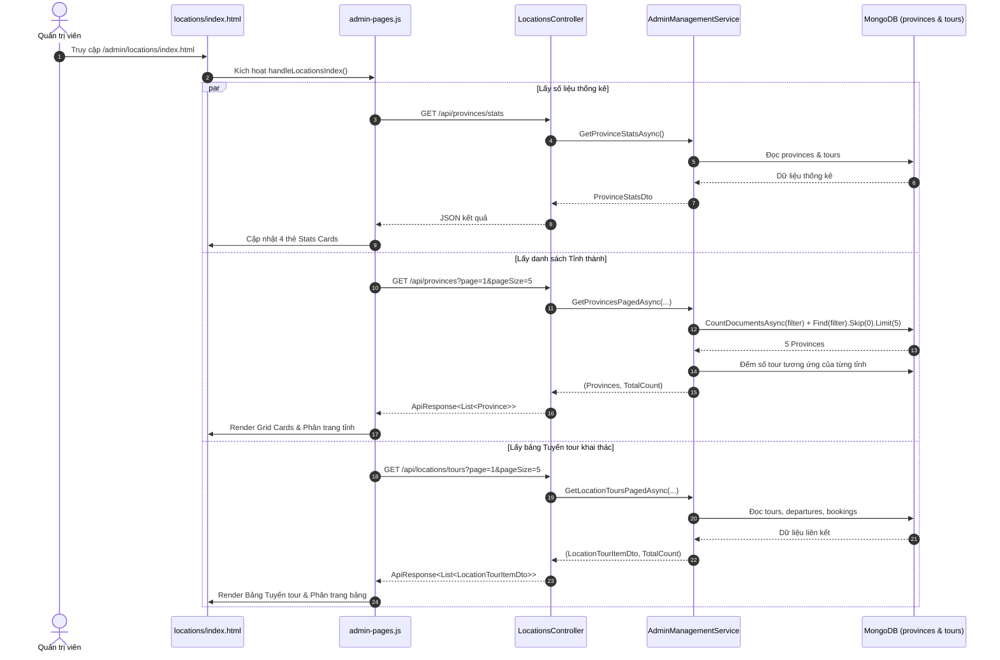
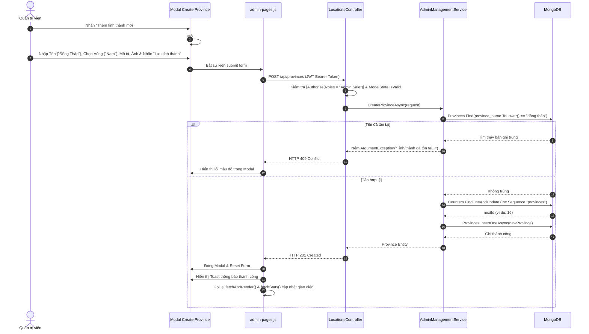
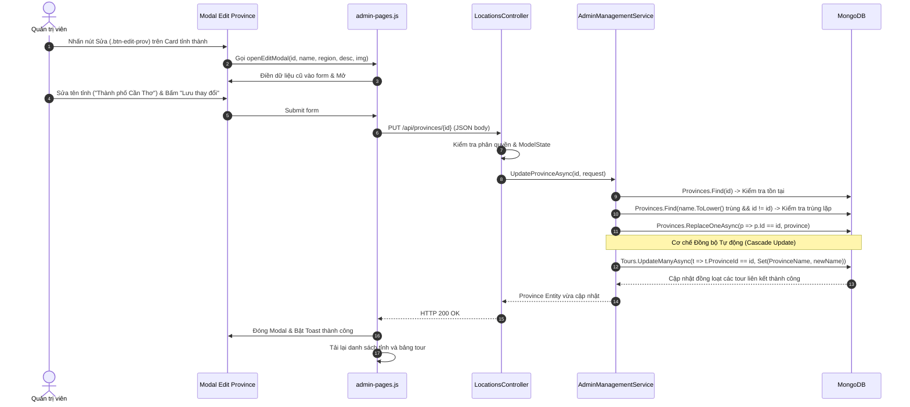
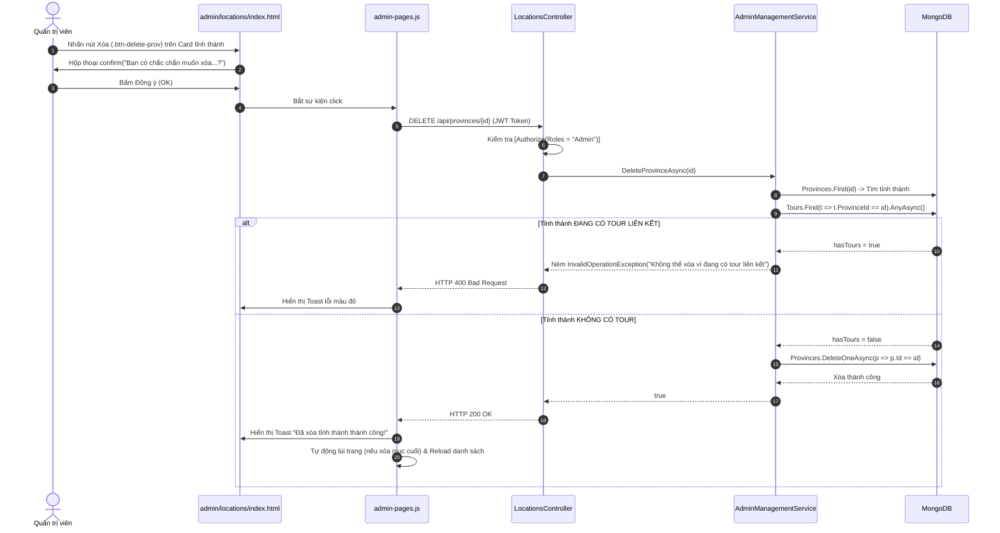

# BÁO CÁO PHÂN TÍCH CODE CHUYÊN SÂU – CHỨC NĂNG QUẢN LÝ ĐỊA ĐIỂM (ADMIN LOCATIONS)

> **Dự án**: `BookingTour_DotNet`  
> **Nhánh Git**: `feature/final_code`  
> **Trang quản trị**: `http://localhost:5281/admin/locations/index.html`  
> **Mục đích**: Tài liệu phân tích kỹ thuật chuẩn bị báo cáo và bảo vệ đồ án trước Hội đồng / Giảng viên hướng dẫn.  
> **Quy chuẩn thực hiện**: Phân tích 100% dựa trên source code thực tế trong hệ thống, không suy diễn, trích dẫn chính xác đường dẫn file, hàm xử lý và dòng code thực thi.

---

## MỤC LỤC TỔNG QUAN

1. [Truy vết và xác định toàn bộ file liên quan](#1-truy-vết-và-xác-định-toàn-bộ-file-liên-quan)
2. [Phân tích chi tiết giao diện HTML (`index.html`)](#2-phân-tích-chi-tiết-giao-diện-html-indexhtml)
3. [Phân tích JavaScript Frontend (`admin-pages.js`)](#3-phân-tích-javascript-frontend-admin-pagesjs)
4. [Bảng đặc tả API Endpoints hệ thống](#4-bảng-đặc-tả-api-endpoints-hệ-thống)
5. [Phân tích Backend Controller (`LocationsController.cs`)](#5-phân-tích-backend-controller-locationscontrollercs)
6. [Phân tích Service & Nghiệp vụ (`AdminManagementService.cs`)](#6-phân-tích-service--nghiệp-vụ-adminmanagementservicecs)
7. [Phân tích Model, DTO & MongoDB Schema](#7-phân-tích-model-dto--mongodb-schema)
8. [Các quy tắc nghiệp vụ đặc biệt & Ràng buộc toàn vẹn dữ liệu](#8-các-quy-tắc-nghiệp-vụ-đặc-biệt--ràng-buộc-toàn-vẹn-dữ-liệu)
9. [Mô tả luồng hoạt động toàn bộ chức năng (End-to-End Traces & Sơ đồ Mermaid)](#9-mô-tả-luồng-hoạt-động-toàn-bộ-chức-năng-end-to-end-traces--sơ-đồ-mermaid)
10. [Chuẩn bị tài liệu ôn bảo vệ (Kịch bản 5-7 phút, 20 Q&A phản biện, Code mở VS Code)](#10-chuẩn-bị-tài-liệu-ôn-bảo-vệ)

---

## 1. TRUY VẾT VÀ XÁC ĐỊNH TOÀN BỘ FILE LIÊN QUAN

Chức năng **Quản lý địa điểm (Locations Management)** được xây dựng nhằm quản trị danh mục tỉnh/thành phố, danh lam thắng cảnh và phân vùng du lịch (Bắc – Trung – Nam), đồng thời liên kết trực tiếp với các tuyến tour du lịch trên toàn quốc.

Mô hình kiến trúc tổng thể của chức năng:

```
                  [ Trình duyệt Admin ]
                            │
               (HTML5 / Tailwind CSS / DOM)
                            │
       ┌────────────────────┴────────────────────┐
       │ wwwroot/admin/locations/index.html      │
       │ wwwroot/admin/locations/create_province.html
       └────────────────────┬────────────────────┘
                            │ (DOM Events & Async Fetch)
       ┌────────────────────┴────────────────────┐
       │ wwwroot/assets/js/admin-pages.js        │ (Lines 3036 - 3923)
       │ wwwroot/assets/js/admin-router.js       │ (Lines 345 - 350)
       │ wwwroot/assets/js/api-client.js         │ (JWT Bearer Token Wrapper)
       └────────────────────┬────────────────────┘
                            │ HTTP Requests (JSON)
       ┌────────────────────┴────────────────────┐
       │ Controllers/LocationsController.cs      │ (Endpoints & Authorization)
       └────────────────────┬────────────────────┘
                            │ DTOs (Data Transfer Objects)
       ┌────────────────────┴────────────────────┐
       │ DTOs/AdminDtos.cs                       │ (ProvinceRequest, ProvinceStatsDto...)
       └────────────────────┬────────────────────┘
                            │ Business Logic & Integrity Checks
       ┌────────────────────┴────────────────────┐
       │ Services/IAdminManagementService.cs     │ (Interface Contracts)
       │ Services/AdminManagementService.cs      │ (Lines 243 - 530)
       └────────────────────┬────────────────────┘
                            │ MongoDB C# Driver (Builders & Aggregation)
       ┌────────────────────┴────────────────────┐
       │ Models/Province.cs & BaseEntity.cs      │ (Entity Definitions)
       │ Models/Tour.cs                          │ (Linked Tour Entity)
       │ Data/MongoDbContext.cs                  │ (Collections: provinces, tours, counters)
       └─────────────────────────────────────────┘
```

### Bảng chi tiết toàn bộ các file thực tế được sử dụng:

| STT | Tên file | Đường dẫn đầy đủ tương đối | Vai trò trong hệ thống | Các hàm / class quan trọng | File liên kết trực tiếp | Có sử dụng thực tế? |
| :---: | :--- | :--- | :--- | :--- | :--- | :---: |
| **1** | `index.html` | `wwwroot/admin/locations/index.html` | Giao diện quản trị chính: 4 thẻ thống kê, form tìm kiếm/lọc vùng miền, lưới card tỉnh thành, modal thêm mới, modal cập nhật, và bảng danh sách tuyến điểm & tour khai thác. | Layout, Stats Cards, `#provinceGrid`, `#createProvinceModal`, `#editProvinceModal`, `#locationToursTableBody` | `admin-pages.js`, `admin-router.js`, `api-client.js` | **CÓ** (File cốt lõi) |
| **2** | `create_province.html` | `wwwroot/admin/locations/create_province.html` | Giao diện tạo tỉnh thành độc lập (dành cho chế độ fallback không qua modal). | Form tạo tỉnh thành độc lập | `admin-pages.js` (`handleLocationsCreate`), `admin-router.js` | **CÓ** (Trang phụ trợ) |
| **3** | `admin-pages.js` | `wwwroot/assets/js/admin-pages.js` | Toàn bộ mã nguồn JavaScript xử lý tương tác phía client của module Địa điểm. | `handleLocationsIndex()`, `fetchStats()`, `fetchAndRender()`, `openCreateModal()`, `openEditModal()`, `loadToursTable()`, `handleLocationsCreate()` (Dòng 3036–3923) | `index.html`, `create_province.html`, `api-client.js` | **CÓ** (File cốt lõi) |
| **4** | `admin-router.js` | `wwwroot/assets/js/admin-router.js` | Bộ định tuyến Client: nhận diện URL `/locations/index.html` và kích hoạt hàm `handleLocationsIndex()`. | Routing block (Dòng 345–350) | `index.html`, `admin-pages.js` | **CÓ** |
| **5** | `api-client.js` | `wwwroot/assets/js/api-client.js` | Wrapper HTTP fetch API, tự động đính kèm `Authorization: Bearer <jwt_token>` và phân tích lỗi. | `window.BookingTourApi.apiRequest` | `admin-pages.js` | **CÓ** |
| **6** | `LocationsController.cs` | `Controllers/LocationsController.cs` | Controller tiếp nhận HTTP requests từ frontend, phân quyền `[Authorize(Roles = "Admin,Sale")]`, validation ModelState, trả mã HTTP chuẩn. | `GetAll()`, `GetStats()`, `GetLocationTours()`, `GetById()`, `Create()`, `Update()`, `Delete()` | `IAdminManagementService.cs`, `AdminDtos.cs` | **CÓ** (File cốt lõi) |
| **7** | `IAdminManagementService.cs` | `Services/IAdminManagementService.cs` | Interface định nghĩa các phương thức nghiệp vụ địa điểm. | `GetAllProvincesAsync()`, `GetProvincesPagedAsync()`, `GetProvinceStatsAsync()`, `CreateProvinceAsync()`, `UpdateProvinceAsync()`, `DeleteProvinceAsync()`, `GetLocationToursPagedAsync()` | `AdminManagementService.cs`, `LocationsController.cs` | **CÓ** |
| **8** | `AdminManagementService.cs` | `Services/AdminManagementService.cs` | Service thực thi nghiệp vụ địa điểm, truy vấn MongoDB, kiểm tra trùng lặp tên, ràng buộc tour, cascade sync tên tỉnh sang tour. | Các hàm trong `#region Provinces` (Dòng 243–530) | `MongoDbContext.cs`, `Province.cs`, `Tour.cs`, `AdminDtos.cs` | **CÓ** (File cốt lõi) |
| **9** | `AdminDtos.cs` | `DTOs/AdminDtos.cs` | Định nghĩa các DTO truyền nhận dữ liệu: request tạo/sửa, thống kê và DTO danh sách tour khai thác theo địa bàn. | `ProvinceRequest`, `ProvinceStatsDto`, `LocationTourItemDto` (Dòng 82–175) | `LocationsController.cs`, `AdminManagementService.cs` | **CÓ** |
| **10** | `Province.cs` | `Models/Province.cs` | Model thực thể MongoDB ánh xạ collection `provinces`. Kế thừa `BaseEntity`. | Class `Province` (`ProvinceName`, `Region`, `Description`, `ImageUrl`, `ToursCount`) | `BaseEntity.cs`, `MongoDbContext.cs` | **CÓ** |
| **11** | `BaseEntity.cs` | `Models/BaseEntity.cs` | Lớp cơ sở cung cấp `MongoId` (ObjectId), `Id` (số nguyên tự tăng), `CreatedAt`, `UpdatedAt`. | Class `BaseEntity` | `Province.cs` | **CÓ** |
| **12** | `Tour.cs` | `Models/Tour.cs` | Model Tour du lịch chứa trường `ProvinceId` và `ProvinceName` liên kết trực tiếp với địa điểm. | Fields: `ProvinceId`, `ProvinceName` | `AdminManagementService.cs` | **CÓ** (Liên kết nghiệp vụ) |
| **13** | `MongoDbContext.cs` | `Data/MongoDbContext.cs` | Khởi tạo collection `provinces`, cấp phát ID tự tăng qua `counters`, cấu hình Indexes cho `provinces`. | `Provinces`, `GetNextSequenceAsync("provinces")`, `EnsureIndexesAsync()` (Dòng 27, 37–49, 67–74) | `AdminManagementService.cs` | **CÓ** |

---

## 2. PHÂN TÍCH CHI TIẾT GIAO DIỆN HTML (`index.html`)

Giao diện `wwwroot/admin/locations/index.html` (475 dòng) được thiết kế hiện đại trên nền Tailwind CSS, chia bố cục thành **2 phân khu nghiệp vụ lớn**:
1. Phân khu Quản lý Tỉnh & Thành phố (Grid cards, bộ lọc, modal thêm/sửa).
2. Phân khu Quản lý Tuyến Điểm & Tour Khai Thác (Bảng dữ liệu chi tiết kèm phân trang riêng).

### 2.1. Cấu trúc Layout & Header trang
* **Thanh điều hướng Breadcrumb** (Dòng 122–126): `Hệ thống > Địa danh & Tỉnh thành`.
* **Tiêu đề chính**: "Quản Lý Địa Điểm & Danh Thắng".
* **Nút kích hoạt Modal tạo mới** (`#btnOpenCreateProvinceModal`, Dòng 131–135): Nút màu xanh navy (`bg-blue-900`), icon `add_location_alt`, cho phép mở popup thêm tỉnh thành mới ngay trên trang mà không phải tải lại trình duyệt.
* **Hộp thông báo (Alerts)**:
  * `#locationAlertSuccess` (Dòng 139–147): Thông báo màu xanh ngọc khi thêm/sửa/xóa thành công.
  * `#locationAlertError` (Dòng 148–156): Thông báo màu đỏ khi gặp lỗi từ máy chủ.

### 2.2. Bốn thẻ số liệu thống kê (Stats Cards)
Nằm tại dòng 159–203:
1. **Thẻ Tỉnh / Thành phố (`#statTotalProvinces`)**: Hiển thị tổng số tỉnh thành đã lưu trong hệ thống, kèm dòng phân rã theo 3 miền (`#statRegionBreakdown`: `Bắc: X • Trung: Y • Nam: Z`). Viền trái xanh navy (`border-l-blue-900`).
2. **Thẻ Tổng số Tour (`#statTotalTours`)**: Hiển thị tổng số tour du lịch đang hoạt động trong toàn hệ thống. Viền trái xanh lá (`border-l-emerald-600`).
3. **Thẻ Địa bàn khai thác (`#statActiveProvinces`)**: Số lượng tỉnh thành hiện đang có ít nhất 1 tour du lịch khai thác (`active_provinces_count`). Viền trái tím (`border-l-purple-600`).
4. **Thẻ Điểm đón khách (`#statPickupPoints`)**: Số lượng điểm xuất phát / điểm đón khách phân biệt trên toàn quốc. Viền trái vàng cam (`border-l-amber-500`).

### 2.3. Form Tìm kiếm & Lọc vùng miền (`#locationFilterForm`)
Nằm tại dòng 206–234:
* **Input từ khóa (`#filterKeyword`)**: Cho phép tìm kiếm theo tên tỉnh thành hoặc danh thắng (`name="keyword"`).
* **Dropdown vùng miền (`#filterRegion`)**: Lọc theo 3 miền: `Tất cả vùng miền`, `Miền Bắc` (`value="Bắc"`), `Miền Trung` (`value="Trung"`), `Miền Nam` (`value="Nam"`).
* **Nút Tìm kiếm (`button[type="submit"]`)** & **Nút Xóa lọc (`#btnResetFilter`)**.
* *Đặc biệt*: Khi submit form lọc, JavaScript sẽ đồng thời kích hoạt lọc lại cả danh sách Tỉnh thành VÀ danh sách Tuyến điểm tour bên dưới.

### 2.4. Khu vực Danh sách Tỉnh & Thành phố (`#provinceGrid`)
Nằm tại dòng 237–280:
* Tiêu đề: "Tỉnh & Thành phố", kèm nhãn đếm tổng số (`#provinceSummaryCount`).
* Hiển thị trạng thái xoay vòng khi nạp (`#provinceLoading`), thông báo rỗng (`#provinceEmpty`), thông báo lỗi kết nối (`#provinceError`) kèm nút thử lại (`#btnRetryProvinceList`).
* **Lưới Card (`#provinceGrid`)**: Bố cục 3 cột (`grid-cols-1 md:grid-cols-2 lg:grid-cols-3 gap-5`). Mỗi thẻ tỉnh thành hiển thị:
  * Ảnh đại diện thumbnail hoặc icon mặc định.
  * Tên tỉnh/thành phố in đậm (`truncate`).
  * Đoạn mô tả đặc trưng du lịch rút gọn 2 dòng (`line-clamp-2`).
  * Huy hiệu vùng miền có màu sắc riêng: Miền Bắc (Xanh dương), Miền Trung (Xanh ngọc), Miền Nam (Tím).
  * Huy hiệu số tour du lịch đang khai thác (`{tourCount} tour`).
  * 2 nút tác vụ: Nút Sửa (`.btn-edit-prov`) và Nút Xóa (`.btn-delete-prov`).
* **Thanh phân trang Tỉnh thành (`#provincePagination`)**: Tóm tắt số lượng (`#provincePaginationSummary`) và các nút chuyển trang thông minh (`#provincePaginationButtons`).

### 2.5. Khu vực Bảng Tuyến Điểm & Tour Khai Thác
Nằm tại dòng 282–334:
* Tiêu đề: "Danh Sách Tuyến Điểm & Tour Khai Thác" kèm nhãn số lượng (`#locationToursCountBadge`).
* Bảng dữ liệu (`#locationToursTableBody`) gồm 5 cột chuẩn mực:
  1. **Điểm tham quan / Tuyến Tour**: Ảnh đại diện tour, tên tour, số ngày đêm (`{days}N{nights}Đ`) và điểm đón khách (`pickup_point`).
  2. **Tỉnh / Thành**: Tên tỉnh thành nơi tour diễn ra.
  3. **Phân loại**: Danh mục tour (ví dụ: Tour Biển đảo, Tour Khám phá...).
  4. **Trạng thái mở bán**: Huy hiệu xanh "Đang mở bán" (nếu có chuyến khởi hành) hoặc huy hiệu vàng "Chờ lịch".
  5. **Lượt khách đã đặt**: Tổng số hành khách thực tế đã book và số chuyến khởi hành.
* **Thanh phân trang Tuyến Tour (`#locationToursPagination`)**: Độc lập hoàn toàn với phân trang của danh sách tỉnh thành bên trên.

### 2.6. Modal Thêm Tỉnh Thành Mới (`#createProvinceModal`)
Nằm tại dòng 338–400:
* Giao diện Popup nền mờ (`backdrop-blur-sm`).
* Các trường nhập liệu:
  * Tên tỉnh/thành phố (`#create_province_name`): Bắt buộc (`required`).
  * Phân vùng miền (`#create_region`): Bắt buộc, dropdown chọn `Bắc`, `Trung`, hoặc `Nam`.
  * Mô tả đặc trưng du lịch (`#create_description`): Textarea 3 dòng.
  * Hình ảnh đại diện URL (`#create_image_url`): Input dạng url.
* Hộp báo lỗi riêng trong modal (`#createProvinceError`).

### 2.7. Modal Cập Nhật Tỉnh Thành (`#editProvinceModal`)
Nằm tại dòng 402–465:
* Input ẩn chứa ID: `#edit_province_id`.
* Các trường: `#edit_province_name`, `#edit_region`, `#edit_description`, `#edit_image_url`.
* Hộp báo lỗi riêng trong modal (`#editProvinceError`).

### Bảng tổng hợp các phần tử HTML được JavaScript thao tác:

| Selector / Element ID | Loại phần tử | Vai trò thao tác của JavaScript |
| :--- | :--- | :--- |
| `#statTotalProvinces`, `#statRegionBreakdown` | `<p>` | Hiển thị tổng số tỉnh và số lượng theo 3 miền từ API Stats. |
| `#statTotalTours`, `#statActiveProvinces`, `#statPickupPoints` | `<p>` | Hiển thị tổng số tour, số tỉnh có tour, và số điểm đón khách. |
| `#locationFilterForm`, `#filterKeyword`, `#filterRegion` | `<form>`, `<input>`, `<select>` | Thu thập từ khóa tìm kiếm và vùng miền khi lọc dữ liệu. |
| `#provinceLoading`, `#provinceEmpty`, `#provinceError` | `<div>` | Ẩn/hiển thị trạng thái tải dữ liệu của danh sách tỉnh thành. |
| `#provinceGrid` | `<div>` | Render danh sách các thẻ tỉnh thành (Cards). |
| `#provincePaginationSummary`, `#provincePaginationButtons` | `<div>` | Cập nhật số trang và thanh điều hướng phân trang tỉnh thành. |
| `#locationToursTableBody` | `<tbody>` | Render danh sách các dòng dữ liệu bảng tuyến tour khai thác. |
| `#locationToursPaginationSummary`, `#locationToursPaginationButtons` | `<div>` | Cập nhật phân trang riêng biệt cho bảng tour khai thác. |
| `#createProvinceModal`, `#createProvinceForm` | `<div>`, `<form>` | Mở modal, reset form, gửi request POST thêm mới. |
| `#editProvinceModal`, `#editProvinceForm` | `<div>`, `<form>` | Đổ dữ liệu cũ, mở modal, gửi request PUT cập nhật. |
| `#locationAlertSuccess`, `#locationAlertError` | `<div>` | Hiển thị thông báo Toast nổi khi thao tác thành công/thất bại. |

---

## 3. PHÂN TÍCH JAVASCRIPT FRONTEND (`admin-pages.js`)

Mã nguồn xử lý nằm trọn vẹn trong hàm `handleLocationsIndex()` (Dòng 3036–3889) và `handleLocationsCreate()` (Dòng 3890–3923) của file `wwwroot/assets/js/admin-pages.js`.

```mermaid
graph TD
    Router["admin-router.js"] -->|URL: /locations/index.html| Init["handleLocationsIndex()"]
    Router -->|URL: /locations/create_province.html| CreatePage["handleLocationsCreate()"]

    Init --> fetchStats["fetchStats() -> GET /api/provinces/stats"]
    Init --> fetchAndRender["fetchAndRender() -> GET /api/provinces?page=&keyword=&region="]
    Init --> loadToursTable["loadToursTable() -> GET /api/locations/tours?page=&keyword=&region="]

    fetchAndRender --> renderGrid["Render HTML Cards vào #provinceGrid"]
    fetchAndRender --> renderPagination["renderPagination() -> Phân trang Tỉnh thành"]
    fetchAndRender --> eventEdit["Click .btn-edit-prov -> openEditModal()"]
    fetchAndRender --> eventDelete["Click .btn-delete-prov -> DELETE /api/provinces/{id}"]

    loadToursTable --> renderTable["Render Rows vào #locationToursTableBody"]
    loadToursTable --> renderTourPagination["renderTourPagination() -> Phân trang Bảng Tour"]

    openCreateModal["Submit #createProvinceForm"] -->|POST /api/provinces| reloadAfterCreate["Reload fetchAndRender() + fetchStats()"]
    openEditModal["Submit #editProvinceForm"] -->|PUT /api/provinces/{id}| reloadAfterEdit["Reload fetchAndRender() + fetchStats()"]
```

### 3.1. Các biến trạng thái nội bộ (State Variables)
```javascript
let currentPage = 1;        // Trang hiện tại của danh sách tỉnh thành
const pageSize = 5;         // Số lượng tỉnh thành trên mỗi trang
let currentKeyword = '';     // Từ khóa tìm kiếm hiện tại
let currentRegion = '';      // Vùng miền lọc hiện tại ('', 'Bắc', 'Trung', 'Nam')
let currentTourPage = 1;    // Trang hiện tại của bảng tuyến điểm & tour
const tourPageSize = 5;     // Số lượng tuyến điểm tour trên mỗi trang bảng
```

### 3.2. Phân tích chi tiết từng hàm nghiệp vụ

#### 1. `fetchStats()` (Dòng 3076–3112)
* **Vai trò**: Lấy dữ liệu thống kê tổng quan và đổ lên 4 thẻ Stats.
* **Input**: Không có.
* **Logic xử lý**:
  * Gọi API `GET /api/provinces/stats`.
  * Cập nhật số liệu vào `#statTotalProvinces`, `#statRegionBreakdown` (`Bắc: X • Trung: Y • Nam: Z`), `#statTotalTours`, `#statActiveProvinces`, `#statPickupPoints`.
  * Có cơ chế fallback đọc từ `BookingTourDB` cục bộ nếu máy chủ tạm thời không phản hồi.

#### 2. `fetchAndRender()` (Dòng 3139–3280)
* **Vai trò**: Tải dữ liệu tỉnh thành có phân trang, lọc và render danh sách dạng lưới Card.
* **Input**: Đọc từ biến trạng thái `currentPage`, `pageSize`, `currentKeyword`, `currentRegion`.
* **API được gọi**: `GET /api/provinces?page={currentPage}&pageSize={pageSize}&keyword={...}&region={...}`.
* **Logic xử lý**:
  * Bật loading (`#provinceLoading`), ẩn danh sách cũ.
  * Nhận mảng `provs`, `totalItems`, `totalPages`.
  * Cập nhật nhãn tổng số: `Hiển thị X / Y tỉnh thành`.
  * Nếu không có dữ liệu: Hiển thị `#provinceEmpty`.
  * Nếu có dữ liệu: Duyệt mảng `provs` và map thành chuỗi HTML thẻ Card. Với mỗi miền, gán class màu tương ứng (Bắc: xanh dương, Trung: xanh ngọc, Nam: tím).
  * Gắn sự kiện click mở modal sửa (`openEditModal`) cho tất cả nút `.btn-edit-prov`.
  * Gắn sự kiện click xóa cho tất cả nút `.btn-delete-prov`: Xác nhận `confirm()`, gọi API `DELETE /api/provinces/{id}`. Nếu xóa mục cuối cùng của trang thì tự động lùi về trang trước (`currentPage--`).
  * Gọi hàm `renderPagination()` cập nhật thanh phân trang.

#### 3. `renderPagination(totalItems, totalPages, safeCurrentPage)` (Dòng 3282–3362)
* **Vai trò**: Render giao diện phân trang ngắt dấu ba chấm `...` cho danh sách tỉnh thành.
* **Thuật toán `getProvincePaginationRange`**:
  * Nếu tổng số trang `<= 5`: Trả về toàn bộ `[1, 2, 3, 4, 5]`.
  * Nếu trang hiện tại `<= 3`: Trả về `[1, 2, 3, 4, '...', total]`.
  * Nếu trang hiện tại `>= total - 2`: Trả về `[1, '...', total - 3, total - 2, total - 1, total]`.
  * Nếu ở giữa: Trả về `[1, '...', current - 1, current, current + 1, '...', total]`.
* **Sự kiện**: Lắng nghe click các nút Prev/Next và các nút số trang để gán lại `currentPage` và gọi lại `fetchAndRender()`.

#### 4. `openCreateModal()` & Xử lý Submit Form Tạo mới (Dòng 3400–3521)
* **Vai trò**: Mở modal popup, kiểm tra dữ liệu và gửi request tạo tỉnh thành mới.
* **API được gọi**: `POST /api/provinces`.
* **Payload gửi lên**:
  ```json
  {
    "province_name": "Cần Thơ",
    "region": "Nam",
    "description": "Thủ phủ miền Tây sông nước...",
    "image_url": "https://..."
  }
  ```
* **Logic xử lý**:
  * Kiểm tra bắt buộc: Tên tỉnh không được rỗng, Vùng miền bắt buộc phải chọn.
  * Đổi nút submit sang trạng thái loading xoay vòng: `Đang lưu...`.
  * Khi API trả về thành công: Đóng modal, hiển thị Toast xanh (`showSuccessToast`), reset về trang 1 và gọi `fetchAndRender()` cùng `fetchStats()`.
  * Nếu lỗi: Bắt ngoại lệ và hiển thị thông báo lỗi màu đỏ ngay trong modal (`#createProvinceError`).

#### 5. `openEditModal(id, name, region, desc, img)` & Xử lý Submit Form Sửa (Dòng 3524–3649)
* **Vai trò**: Nạp dữ liệu cũ của tỉnh thành vào form modal sửa và gửi request cập nhật.
* **API được gọi**: `PUT /api/provinces/{id}`.
* **Logic xử lý**:
  * Đổ các giá trị cũ vào các input: `#edit_province_id`, `#edit_province_name`, `#edit_region`, `#edit_description`, `#edit_image_url`.
  * Khi submit: Kiểm tra validation, gọi API PUT.
  * Khi thành công: Đóng modal, hiển thị Toast thành công, reload lại dữ liệu trang hiện tại.

#### 6. `loadToursTable(page = 1)` (Dòng 3681–3797)
* **Vai trò**: Tải danh sách các tuyến tour du lịch đang khai thác trên địa bàn từ MongoDB và đổ vào bảng HTML.
* **API được gọi**: `GET /api/locations/tours?page={page}&pageSize=5&keyword={...}&region={...}`.
* **Logic xử lý**:
  * Nhận danh sách các đối tượng `LocationTourItemDto`.
  * Map dữ liệu thành các hàng `<tr>`: Tên tour, ảnh thumbnail, số ngày đêm, điểm đón khách, phân loại danh mục, huy hiệu trạng thái mở bán, tổng số lượt khách đã book.
  * Gọi hàm `renderTourPagination()` để vẽ thanh phân trang riêng biệt cho bảng tour.

#### 7. `handleLocationsCreate()` (Dòng 3890–3923)
* **Vai trò**: Xử lý submit cho trang tạo độc lập `wwwroot/admin/locations/create_province.html`. Thu thập dữ liệu từ `FormData`, gọi `POST /api/provinces` và chuyển hướng về `index.html` khi thành công.

---

## 4. BẢNG ĐẶC TẢ API ENDPOINTS HỆ THỐNG

Tất cả các API được định nghĩa trong `Controllers/LocationsController.cs`. Nhằm đảm bảo tính tương thích cao với cả trang quản trị và ứng dụng phía khách hàng, Controller hỗ trợ **các bí danh route kép** (`/api/locations`, `/locations`, `/api/provinces`):

| HTTP Method | Endpoint Route | Quyền truy cập | Request Parameters / Body | Response Data (`ApiResponse<T>`) | Mô tả chức năng |
| :---: | :--- | :---: | :--- | :--- | :--- |
| **GET** | `/api/locations`<br>`/locations`<br>`/api/provinces` | `[AllowAnonymous]` | Query: `search`, `keyword`, `region`, `page`, `pageSize`, `all` (bool) | `ApiResponse<List<Province>>`<br>(kèm `total`, `page`, `pageSize`) | Lấy danh sách tỉnh thành có tìm kiếm theo tên, lọc theo vùng miền, phân trang. Nếu `all=true` hoặc `pageSize >= 1000` thì trả về toàn bộ tỉnh thành. |
| **GET** | `/api/locations/stats`<br>`/api/provinces/stats` | `[AllowAnonymous]` | Không có | `ApiResponse<ProvinceStatsDto>` | Lấy số liệu thống kê: tổng số tỉnh, số tỉnh theo 3 miền Bắc/Trung/Nam, tổng số tour, số tỉnh có tour, số điểm đón khách. |
| **GET** | `/api/locations/tours`<br>`/api/provinces/tours`<br>`/locations/tours` | `[AllowAnonymous]` | Query: `search`, `keyword`, `region`, `provinceId`, `page`, `pageSize` | `ApiResponse<List<LocationTourItemDto>>`<br>(kèm `total`, `page`, `pageSize`) | Lấy danh sách các tuyến tour khai thác theo địa bàn hoặc vùng miền, tổng hợp số chuyến đi và số khách đã book. |
| **GET** | `/api/locations/{id}`<br>`/api/provinces/{id}` | `[AllowAnonymous]` | Route: `id` (int) | `ApiResponse<Province>` | Lấy thông tin chi tiết của 1 tỉnh thành theo mã ID, tính toán kèm số lượng tour (`tours_count`). |
| **POST** | `/api/locations`<br>`/api/provinces` | `[Authorize(Roles = "Admin,Sale")]` | Body JSON: `ProvinceRequest` | `ApiResponse<Province>`<br>(HTTP 201 Created) | Thêm tỉnh thành mới: tự sinh ID tự tăng, kiểm tra trùng tên (không phân biệt hoa thường), lưu vào MongoDB. |
| **PUT** | `/api/locations/{id}`<br>`/api/provinces/{id}` | `[Authorize(Roles = "Admin,Sale")]` | Route: `id` (int)<br>Body JSON: `ProvinceRequest` | `ApiResponse<Province>`<br>(HTTP 200 OK) | Cập nhật thông tin tỉnh thành. **Đồng bộ tự động tên tỉnh mới sang tất cả các tour đang liên kết**. |
| **DELETE** | `/api/locations/{id}`<br>`/api/provinces/{id}` | `[Authorize(Roles = "Admin")]` | Route: `id` (int) | `ApiResponse<bool>`<br>(HTTP 200 OK) | Xóa tỉnh thành. **Chặn xóa tuyệt đối nếu tỉnh thành đang có tour du lịch sử dụng**. |

---

## 5. PHÂN TÍCH BACKEND CONTROLLER (`LocationsController.cs`)

File `Controllers/LocationsController.cs` (159 dòng C#) kế thừa `ControllerBase`, sử dụng Dependency Injection tiêm `IAdminManagementService`.

### 5.1. Phân quyền và Cấu hình Route
* `[Route("api/[controller]")]`: Route gốc mặc định là `/api/locations`.
* Để hỗ trợ frontend gọi linh hoạt cả `/api/provinces` và `/locations`, mỗi action đều gắn các thuộc tính route bổ sung:
  ```csharp
  [HttpGet]
  [HttpGet("/locations")]
  [HttpGet("/api/provinces")]
  [AllowAnonymous]
  public async Task<IActionResult> GetAll(...)
  ```
* **Phân quyền vai trò (Role-based Authorization)**:
  * Thao tác Đọc (`GetAll`, `GetStats`, `GetLocationTours`, `GetById`): `[AllowAnonymous]` để trang đặt tour của khách hàng cũng có thể nạp danh sách địa điểm.
  * Thao tác Ghi (`Create`, `Update`): `[Authorize(Roles = "Admin,Sale")]` – Cho phép cả Admin và nhân viên Sale cập nhật địa bàn kinh doanh.
  * Thao tác Xóa (`Delete`): `[Authorize(Roles = "Admin")]` – **Chỉ duy nhất Admin tối cao** mới được phép xóa địa điểm khỏi hệ thống.

### 5.2. Phân tích chi tiết từng Action

#### 1. Action `GetAll` (Dòng 21–43)
* Nhận các tham số: `search`, `keyword`, `region`, `page`, `pageSize`, `all`.
* Chuẩn hóa từ khóa tìm kiếm: `var q = !string.IsNullOrWhiteSpace(search) ? search : keyword;`.
* Nhánh trả về toàn bộ (`all == true` hoặc `pageSize >= 1000`): Gọi `_service.GetAllProvincesAsync()`. Phục vụ các dropdown chọn tỉnh thành tại trang tạo tour hoặc trang lọc của khách hàng.
* Nhánh phân trang: Gọi `_service.GetProvincesPagedAsync(q, region, page, pageSize)`.

#### 2. Action `GetStats` (Dòng 45–52)
* Gọi `_service.GetProvinceStatsAsync()`.
* Trả về `ApiResponse<ProvinceStatsDto>.Ok(stats)` phục vụ 4 thẻ thống kê ở đầu trang.

#### 3. Action `GetLocationTours` (Dòng 54–75)
* Nhận các bộ lọc: `search`, `keyword`, `region`, `provinceId`, `page`, `pageSize`.
* Gọi `_service.GetLocationToursPagedAsync(q, region, provinceId, page, pageSize)`.
* Trả về danh sách `LocationTourItemDto` phục vụ bảng "Danh Sách Tuyến Điểm & Tour Khai Thác".

#### 4. Action `Create` (Dòng 87–107)
* Kiểm tra `!ModelState.IsValid` -> Trả về `BadRequest (400)`.
* Bắt ngoại lệ `ArgumentException` (lỗi trùng tên tỉnh thành) -> Trả về mã **HTTP 409 Conflict** (`Conflict(ApiResponse<object>.Fail(ex.Message))`).
* Khi thành công trả về mã **HTTP 201 Created**.

#### 5. Action `Update` (Dòng 109–133)
* Kiểm tra `ModelState.IsValid`.
* Bắt `KeyNotFoundException` -> Trả về **HTTP 404 Not Found**.
* Bắt `ArgumentException` (trùng tên với tỉnh thành khác) -> Trả về **HTTP 409 Conflict**.
* Trả về **HTTP 200 OK** kèm thực thể `Province` vừa được cập nhật.

#### 6. Action `Delete` (Dòng 135–157)
* Phân quyền khắt khe `[Authorize(Roles = "Admin")]`.
* Bắt `KeyNotFoundException` -> Trả về **HTTP 404**.
* Bắt `InvalidOperationException` (khi tỉnh thành đang có tour liên kết) -> Trả về **HTTP 400 Bad Request** kèm thông báo giải thích nguyên nhân.

---

## 6. PHÂN TÍCH SERVICE & NGHIỆP VỤ (`AdminManagementService.cs`)

Logic nghiệp vụ của Locations nằm trong `#region Provinces` (Dòng 243–530) của file `Services/AdminManagementService.cs`.

### 6.1. Nghiệp vụ Lấy danh sách & Đếm tour liên kết (`GetAllProvincesAsync` & `GetProvincesPagedAsync`)
1. **Trong `GetAllProvincesAsync` (Dòng 244–255)**:
   * Lấy toàn bộ tỉnh thành từ collection `provinces` sắp xếp theo tên.
   * Để tính số lượng tour của từng tỉnh mà không lặp truy vấn, service sử dụng **MongoDB Aggregation Pipeline**:
     ```csharp
     var counts = await _context.Tours.Aggregate()
         .Group(t => t.ProvinceId, group => new { Id = group.Key, Count = group.Count() })
         .ToListAsync();
     var countMap = counts.ToDictionary(x => x.Id, x => x.Count);
     foreach (var p in provinces)
     {
         p.ToursCount = countMap.GetValueOrDefault(p.Id);
     }
     ```
   * *Ý nghĩa bảo vệ*: Kỹ thuật Gom nhóm Aggregation `$group` thực thi ngay trên Database Engine, tính toán tức thì số tour của tất cả 63 tỉnh thành chỉ trong 1 truy vấn duy nhất.
2. **Trong `GetProvincesPagedAsync` (Dòng 257–291)**:
   * Xây dựng bộ lọc `Builders<Province>.Filter`:
     * Tìm kiếm Regex không phân biệt hoa thường theo `ProvinceName`.
     * Lọc Regex theo `Region`.
   * Thực hiện `CountDocumentsAsync` lấy tổng số bản ghi.
   * Thực hiện `Skip` và `Limit` lấy đúng 5 bản ghi của trang yêu cầu.
   * Gán `ToursCount` cho từng phần tử bằng `CountDocumentsAsync(t => t.ProvinceId == p.Id)`.

### 6.2. Thuật toán Thống kê Nghiệp vụ trong `GetProvinceStatsAsync` (Dòng 293–316)
* Đọc danh sách tỉnh thành và danh sách tour.
* **Tính toán số tỉnh đang có tour (`ActiveProvincesCount`)**:
  ```csharp
  var activeProvinceIds = allTours.Where(t => t.ProvinceId > 0)
      .Select(t => t.ProvinceId)
      .Distinct()
      .ToHashSet();
  ```
* **Tính toán số điểm đón khách phân biệt (`PickupPointsCount`)**:
  ```csharp
  var pickupCount = allTours
      .Where(t => !string.IsNullOrWhiteSpace(t.PickupPoint))
      .Select(t => t.PickupPoint!.Trim())
      .Distinct()
      .Count();
  ```
* Thống kê số lượng tỉnh thành theo từng miền bằng so khớp chuỗi không phân biệt hoa thường: `Region.Contains("Bắc")`, `Contains("Trung")`, `Contains("Nam")`.

### 6.3. Nghiệp vụ Thêm Tỉnh Thành Mới (`CreateProvinceAsync`)
Nằm tại dòng 328–363 của `AdminManagementService.cs`:
1. **Kiểm tra dữ liệu đầu vào**:
   * Tên tỉnh không được để trống (`string.IsNullOrWhiteSpace`).
   * Phân vùng miền không được để trống.
2. **Quy tắc Kiểm tra Trùng Tên Không Phân Biệt Hoa Thường**:
   ```csharp
   var trimmedName = request.ProvinceName.Trim();
   var existing = await _context.Provinces.Find(p => p.ProvinceName.ToLower() == trimmedName.ToLower()).FirstOrDefaultAsync();
   if (existing != null)
   {
       throw new ArgumentException($"Tỉnh/thành '{trimmedName}' đã tồn tại trong hệ thống.");
   }
   ```
   * Ngăn chặn việc người dùng vô tình tạo 2 bản ghi trùng nhau (ví dụ "Đà Nẵng" và "đà nẵng").
3. **Cấp phát ID số nguyên tự tăng**:
   * Gọi `await _context.GetNextSequenceAsync("provinces");`.
4. **Khởi tạo và lưu trữ**:
   * Tạo đối tượng `Province` với `CreatedAt` và `UpdatedAt` bằng `DateTime.UtcNow`.
   * Ghi bản ghi vào collection `provinces`.

### 6.4. Nghiệp vụ Cập Nhật & Đồng Bộ Dữ Liệu Tự Động (`UpdateProvinceAsync`)
Nằm tại dòng 365–397 của `AdminManagementService.cs`:
1. Tìm tỉnh thành theo ID. Nếu không có ném `KeyNotFoundException`.
2. Kiểm tra tên mới có bị trùng với **tỉnh thành khác** trong hệ thống hay không:
   ```csharp
   var duplicate = await _context.Provinces.Find(p => p.ProvinceName.ToLower() == trimmedName.ToLower() && p.Id != id).FirstOrDefaultAsync();
   if (duplicate != null)
       throw new ArgumentException($"Tên tỉnh/thành '{trimmedName}' đã được sử dụng.");
   ```
3. Cập nhật các trường: `ProvinceName`, `Region`, `Description`, `ImageUrl`, `UpdatedAt`.
4. Thực hiện `ReplaceOneAsync` lưu lại vào collection `provinces`.
5. **Cơ chế Đồng bộ Tự Động (Cascade Synchronization)**:
   ```csharp
   // Update province name in tours
   await _context.Tours.UpdateManyAsync(
       t => t.ProvinceId == id,
       Builders<Tour>.Update.Set(t => t.ProvinceName, province.ProvinceName)
   );
   ```
   * *Ý nghĩa bảo vệ*: Do trong collection `tours` có phi chuẩn hóa trường `province_name` để tăng tốc độ hiển thị, khi Admin đổi tên tỉnh thành (ví dụ sửa "TP. Hồ Chí Minh" thành "TP.HCM"), service tự động cập nhật đồng loạt trường `province_name` của toàn bộ các tour đang thuộc tỉnh đó, đảm bảo dữ liệu không bao giờ bị lệch pha.

### 6.5. Nghiệp vụ Xóa An Toàn & Ràng Buộc Khóa Ngoại (`DeleteProvinceAsync`)
Nằm tại dòng 399–412 của `AdminManagementService.cs`:
```csharp
public async Task<bool> DeleteProvinceAsync(int id)
{
    var province = await _context.Provinces.Find(p => p.Id == id).FirstOrDefaultAsync()
                   ?? throw new KeyNotFoundException($"Không tìm thấy tỉnh/thành mã {id}.");

    var hasTours = await _context.Tours.Find(t => t.ProvinceId == id).AnyAsync();
    if (hasTours)
    {
        throw new InvalidOperationException($"Không thể xóa tỉnh/thành '{province.ProvinceName}' vì đang có các tour du lịch liên kết.");
    }

    var result = await _context.Provinces.DeleteOneAsync(p => p.Id == id);
    return result.DeletedCount > 0;
}
```
* **Quy tắc bảo toàn dữ liệu**: Kiểm tra trong collection `tours` xem có tour nào đang có `ProvinceId == id` hay không.
* Nếu có, **ném ngoại lệ `InvalidOperationException` từ chối xóa ngay lập tức**.
* Điều này ngăn chặn triệt để hiện tượng "Tour mồ côi" (Tour trỏ tới một tỉnh thành không còn tồn tại trong hệ thống).

### 6.6. Nghiệp vụ Tổng hợp Bảng Tour Khai Thác (`GetLocationToursPagedAsync`)
Nằm tại dòng 414–529 của `AdminManagementService.cs`:
* Nhận các bộ lọc theo `provinceId`, `region`, hoặc từ khóa tìm kiếm trên Tour.
* Truy vấn danh sách Tour có phân trang.
* **Gom nhóm và tính toán số liệu thống kê liên quan**:
  * Đếm số chuyến khởi hành (`departures_count`) của từng tour từ collection `tour_departures`.
  * Tính tổng số hành khách đã đặt vé (`total_booked_passengers`) từ collection `bookings`.
  * Xác định trạng thái mở bán: Nếu tour có ít nhất 1 chuyến khởi hành thì hiển thị "Đang mở bán", ngược lại hiển thị "Chờ lịch".

---

## 7. PHÂN TÍCH MODEL, DTO & MONGODB SCHEMA

### 7.1. Model Thực Thể `Province` (`Models/Province.cs`)
```csharp
public class Province : BaseEntity
{
    [BsonElement("province_name")]
    [JsonPropertyName("province_name")]
    public string ProvinceName { get; set; } = string.Empty;

    [BsonElement("region")]
    [JsonPropertyName("region")]
    public string Region { get; set; } = string.Empty; // "Bắc", "Trung", "Nam"

    [BsonElement("description")]
    [JsonPropertyName("description")]
    public string? Description { get; set; }

    [BsonElement("image_url")]
    [JsonPropertyName("image_url")]
    public string? ImageUrl { get; set; }

    [BsonIgnore]
    [JsonPropertyName("tours_count")]
    public int ToursCount { get; set; }
}
```
* **Kế thừa `BaseEntity`**: Cung cấp `MongoId` (`_id` kiểu ObjectId), `Id` (số nguyên tự tăng), `CreatedAt` và `UpdatedAt` (UTC DateTime).
* **Trường ảo `[BsonIgnore]` `ToursCount`**: Không lưu trữ trực tiếp trong tài liệu MongoDB để tránh dư thừa, chỉ được tính toán động khi trả về cho Client.

### 7.2. Các DTO Liên Quan (`DTOs/AdminDtos.cs`)
1. **`ProvinceRequest`**: DTO dùng chung cho cả Tạo mới (POST) và Cập nhật (PUT).
   * `province_name` (`[Required]`).
   * `region` (`[Required]`).
   * `description`, `image_url` (tùy chọn).
2. **`ProvinceStatsDto`**: DTO chứa dữ liệu 4 thẻ thống kê:
   * `total_provinces`, `north_count`, `central_count`, `south_count`, `total_tours`, `active_provinces_count`, `pickup_points_count`.
3. **`LocationTourItemDto`**: DTO chứa dữ liệu từng dòng trong bảng tuyến tour khai thác:
   * `id`, `title`, `thumbnail_url`, `province_id`, `province_name`, `category_id`, `category_name`, `duration_text`, `pickup_point`, `min_price`, `departures_count`, `status_text`, `total_booked_passengers`, `bookings_count`.

### 7.3. MongoDB Collection & Thiết Kế Index
Trong `Data/MongoDbContext.cs`:
* Collection được khai báo:
  ```csharp
  public IMongoCollection<Province> Provinces => _database.GetCollection<Province>("provinces");
  ```
* Cơ chế cấp phát ID tự tăng: Lưu trong collection `counters` với tài liệu `_id: "provinces"`, dùng toán tử nguyên tử `$inc` để sinh ID 1, 2, 3...
* **Cấu hình Index** (Dòng 68–73):
  ```csharp
  await Provinces.Indexes.CreateManyAsync(new[]
  {
      new CreateIndexModel<Province>(Builders<Province>.IndexKeys.Ascending(p => p.Id), new CreateIndexOptions { Unique = true }),
      new CreateIndexModel<Province>(Builders<Province>.IndexKeys.Ascending(p => p.ProvinceName)),
      new CreateIndexModel<Province>(Builders<Province>.IndexKeys.Ascending(p => p.Region))
  });
  ```
  * **Index `Id` (Unique = true)**: Đảm bảo mã tỉnh thành là duy nhất, tối ưu hóa tìm kiếm theo ID đạt $O(1)$.
  * **Index `ProvinceName`**: Tăng tốc tối đa câu lệnh tìm kiếm tên tỉnh thành.
  * **Index `Region`**: Tăng tốc bộ lọc theo 3 miền Bắc – Trung – Nam.

---

## 8. CÁC QUY TẮC NGHIỆP VỤ ĐẶC BIỆT & RÀNG BUỘC TOÀN VẸN DỮ LIỆU

Module Quản lý Địa điểm áp dụng 6 quy tắc nghiệp vụ nghiêm ngặt trong mã nguồn:

1. **Quy tắc Kiểm tra Trùng Tên (Unique Case-Insensitive Name)**:
   * Không cho phép tạo 2 tỉnh thành trùng tên (kể cả khác cách viết hoa/thường).
   * Mã kiểm tra: `p.ProvinceName.ToLower() == trimmedName.ToLower()`.
   * Khi cập nhật: Kiểm tra trùng tên nhưng loại trừ chính ID đang cập nhật (`&& p.Id != id`).
2. **Quy tắc Ràng Buộc Khóa Ngoại khi Xóa (Referential Integrity Constraint)**:
   * Không thể xóa một tỉnh thành nếu collection `tours` đang có tour tham chiếu đến `ProvinceId` của tỉnh thành đó (`hasTours == true`).
   * Giúp hệ thống không bao giờ rơi vào trạng thái dữ liệu rác hoặc tour bị mất địa bàn hoạt động.
3. **Cơ chế Đồng Bộ Dữ Liệu Tự Động (Cascade Synchronization)**:
   * Khi đổi tên một tỉnh thành, hệ thống tự động chạy lệnh `UpdateManyAsync` cập nhật lại trường `ProvinceName` trên tất cả các tour thuộc tỉnh đó trong collection `tours`.
4. **Phân quyền vai trò khắt khe (Role Authorization)**:
   * Khách hàng: Chỉ có quyền đọc danh sách địa điểm để tìm tour.
   * Nhân viên Sale: Được phép thêm mới và chỉnh sửa thông tin địa điểm (`Roles = "Admin,Sale"`).
   * Nhân viên Sale **không có quyền xóa địa điểm**. Thao tác xóa được khóa chặt cho duy nhất vai trò `Admin` (`[Authorize(Roles = "Admin")]`).
5. **Tính toán Phân vùng và Điểm đón tự động**:
   * Hệ thống tự động tính số lượng tour của từng tỉnh bằng MongoDB Aggregation Pipeline `$group`, không lưu cứng số lượng vào cơ sở dữ liệu để tránh dữ liệu bị sai lệch khi tour được thêm hoặc xóa.
6. **Bảo vệ Trải nghiệm Phân trang (Pagination UX Protection)**:
   * Phía Client: Nếu người dùng xóa bản ghi cuối cùng của một trang (`provs.length === 1 && currentPage > 1`), JavaScript tự động giảm `currentPage--` trước khi tải lại dữ liệu, tránh trường hợp màn hình bị trống rỗng.

---

## 9. MÔ TẢ LUỒNG HOẠT ĐỘNG TOÀN BỘ CHỨC NĂNG (END-TO-END TRACES & SƠ ĐỒ MERMAID)

### 9.1. Luồng 1: Tải danh sách, Lọc & Thống kê địa điểm



---

### 9.2. Luồng 2: Thêm mới Tỉnh thành (Modal Create)



---

### 9.3. Luồng 3: Cập nhật Tỉnh thành & Đồng bộ Tên sang Tour (Cascade Sync)



---

### 9.4. Luồng 4: Xóa Tỉnh thành An toàn (Referential Integrity Check)



---

## 10. CHUẨN BỊ TÀI LIỆU ÔN BẢO VỆ

### 10.1. Kịch bản thuyết trình bảo vệ đồ án (5 – 7 phút tự nhiên, mạch lạc)

* **Phút 1: Giới thiệu vai trò của Module Quản lý Địa điểm**
  > "Kính thưa Thầy/Cô trong Hội đồng, một hệ thống du lịch lữ hành không thể vận hành hiệu quả nếu thiếu đi việc chuẩn hóa mạng lưới điểm đến. **Module Quản lý Địa điểm (Locations Management)** trong đồ án `BookingTour_DotNet` đóng vai trò là xương sống địa lý, quản lý toàn bộ các tỉnh thành, danh lam thắng cảnh và phân vùng du lịch Bắc – Trung – Nam. Nó liên kết trực tiếp với các Tour du lịch để phục vụ việc phân loại, tìm kiếm và gợi ý tour cho khách hàng."

* **Phút 2: Giới thiệu Giao diện & Trực quan hóa số liệu**
  > "Tại trang `admin/locations/index.html`, giao diện được thiết kế gồm 2 phân khu trực quan:
  > Phía trên là 4 thẻ thống kê động: Tổng số tỉnh thành kèm phân rã số lượng theo 3 miền, Tổng số tour, Địa bàn đang khai thác thực tế và Số điểm đón khách trên toàn quốc. Ngay bên dưới là lưới Card tỉnh thành, hiển thị ảnh đại diện, mô tả văn hóa du lịch, huy hiệu màu sắc phân vùng miền và số lượng tour đang khai thác tại tỉnh đó.
  > Phía dưới cùng là một tính năng đặc biệt: **Bảng Danh Sách Tuyến Điểm & Tour Khai Thác**, cho phép quản trị viên xem ngay các tour du lịch cụ thể đang hoạt động tại địa bàn đó kèm số lượt khách đã đặt."

* **Phút 3: Demo Thao tác Thêm & Kiểm soát dữ liệu đầu vào**
  > "Em xin demo thao tác Thêm tỉnh thành mới: Khi click 'Thêm tỉnh thành mới', Modal popup hiển thị. Nếu em cố tình nhập một tỉnh thành đã tồn tại (ví dụ 'Đà Nẵng'), hệ thống sẽ kiểm tra không phân biệt hoa thường và trả về mã lỗi HTTP 409 Conflict với thông báo rõ ràng. Khi nhập hợp lệ, hệ thống tự động sinh ID số nguyên tăng dần thông qua sequence collection `counters` của MongoDB và lưu vào collection `provinces`."

* **Phút 4: Điểm sáng kỹ thuật: Đồng bộ dữ liệu & Ràng buộc toàn vẹn**
  > "Về mặt kiến trúc backend, em đã giải quyết 2 bài toán quan trọng:
  > **Thứ nhất là Cơ chế Cascade Synchronization**: Khi Admin sửa tên một tỉnh thành, Service sẽ tự động cập nhật đồng loạt trường `province_name` trên tất cả các Tour thuộc tỉnh đó trong collection `tours`, giải quyết triệt để nguy cơ lệch dữ liệu giữa các collection phi chuẩn hóa.
  > **Thứ hai là Ràng buộc toàn vẹn khi Xóa (Referential Integrity)**: Khi xóa tỉnh thành, hệ thống kiểm tra xem có tour nào đang thuộc tỉnh đó hay không. Nếu có, hệ thống ném ngoại lệ từ chối xóa để ngăn chặn hiện tượng tour bị mất địa bàn liên kết."

* **Phút 5: Tổng kết & Sẵn sàng phản biện**
  > "Toàn bộ chức năng đều được bảo vệ bằng phân quyền: Nhân viên Sale được phép thêm và sửa địa bàn, nhưng riêng quyền Xóa thì chỉ có tài khoản Admin tối cao mới được thực hiện. Em xin cảm ơn Thầy/Cô và sẵn sàng trả lời các câu hỏi phản biện."

---

### 10.2. Bộ 20 câu hỏi phản biện chuyên sâu và câu trả lời chuẩn kỹ thuật

#### Nhóm 1: Cơ sở dữ liệu NoSQL & MongoDB

**Câu 1: Tại sao trong collection `tours` lại lưu cả `province_id` và `province_name`? Có bị dư thừa dữ liệu không?**
* **Trả lời**: Đây là kỹ thuật **Phi chuẩn hóa (Denormalization)** đặc trưng của NoSQL. Việc lưu kèm `province_name` trong tài liệu tour giúp khi hiển thị danh sách hàng trăm tour cho khách hàng, hệ thống không cần thực hiện `$lookup` sang collection `provinces`, tăng tốc độ đọc lên gấp nhiều lần. Để chống bất đồng bộ khi đổi tên tỉnh, trong `AdminManagementService.cs` dòng 391, em đã viết lệnh `UpdateManyAsync` tự động cập nhật lại tên tỉnh trên toàn bộ các tour liên quan.

**Câu 2: Bạn sinh mã ID số nguyên (`Id: 1, 2, 3...`) cho tỉnh thành như thế nào thay vì dùng ObjectId của MongoDB?**
* **Trả lời**: Trong `Data/MongoDbContext.cs` dòng 37–49, em sử dụng collection `counters` và hàm `GetNextSequenceAsync("provinces")`. Hàm này gọi `FindOneAndUpdateAsync` với toán tử nguyên tử `$inc: { SequenceValue: 1 }` và `ReturnDocument = After`. Lệnh này đảm bảo tính thread-safe trong môi trường đa luồng, cấp phát số nguyên tăng dần liên tục và duy nhất.

**Câu 3: Các Index đã được đánh trên collection `provinces` là gì và tại sao lại chọn các trường đó?**
* **Trả lời**: Trong `MongoDbContext.cs` dòng 68–73, em đã cấu hình 3 index:
  1. `Id` (Ascending, Unique = true): Đảm bảo ID duy nhất và tìm kiếm theo ID đạt độ phức tạp $O(1)$.
  2. `ProvinceName` (Ascending): Tối ưu hóa truy vấn tìm kiếm theo tên và kiểm tra trùng lặp tên.
  3. `Region` (Ascending): Tăng tốc độ lọc theo 3 miền Bắc – Trung – Nam.

**Câu 4: Số lượng tour (`tours_count`) của từng tỉnh thành được tính toán như thế nào? Có lưu cứng vào MongoDB không?**
* **Trả lời**: Trường `ToursCount` được đánh dấu `[BsonIgnore]` trong model `Province.cs` dòng 24, nghĩa là **hoàn toàn không lưu cứng vào MongoDB**. Số lượng tour được tính toán động khi gọi API:
  * Trong hàm `GetAllProvincesAsync`, em sử dụng **MongoDB Aggregation Pipeline `$group`** nhóm theo `ProvinceId` và đếm tổng số tour trong 1 truy vấn duy nhất.
  * Việc không lưu cứng giúp tránh tình trạng dữ liệu bị sai lệch khi có tour mới được thêm, chuyển tỉnh hoặc xóa đi.

---

#### Nhóm 2: Nghiệp vụ & Ràng buộc dữ liệu (Business Logic & Constraints)

**Câu 5: Nếu người dùng nhập tên tỉnh là "đà nẵng" trong khi hệ thống đã có "Đà Nẵng", hệ thống xử lý thế nào?**
* **Trả lời**: Hệ thống sẽ chặn lại ngay lập tức. Trong `AdminManagementService.cs` dòng 341, câu truy vấn kiểm tra trùng lặp sử dụng so khớp chuỗi chữ thường: `p.ProvinceName.ToLower() == trimmedName.ToLower()`. Nếu tìm thấy bản ghi, Service sẽ ném ra ngoại lệ `ArgumentException("Tỉnh/thành 'Đà Nẵng' đã tồn tại trong hệ thống")`, và Controller trả về mã **HTTP 409 Conflict**.

**Câu 6: Giả sử một tỉnh thành đang có 5 tour du lịch hoạt động, Admin bấm xóa tỉnh thành đó thì điều gì xảy ra?**
* **Trả lời**: Hệ thống sẽ **từ chối xóa tuyệt đối**. Trong `AdminManagementService.cs` dòng 404–408, hàm `DeleteProvinceAsync` thực hiện kiểm tra:
  `var hasTours = await _context.Tours.Find(t => t.ProvinceId == id).AnyAsync();`
  Nếu `hasTours == true`, hệ thống ném ngoại lệ `InvalidOperationException` thông báo: *"Không thể xóa tỉnh/thành vì đang có các tour du lịch liên kết"*, Controller trả về HTTP 400 Bad Request. Điều này đảm bảo tính toàn vẹn khóa ngoại của dữ liệu.

**Câu 7: Khi cập nhật tên một tỉnh thành, hệ thống làm thế nào để các tour du lịch cũ không bị hiển thị sai tên tỉnh?**
* **Trả lời**: Trong hàm `UpdateProvinceAsync` (`AdminManagementService.cs` dòng 391–394), sau khi thực hiện `ReplaceOneAsync` cho tỉnh thành, hệ thống ngay lập tức thực hiện cơ chế **Cascade Update**:
  `await _context.Tours.UpdateManyAsync(t => t.ProvinceId == id, Builders<Tour>.Update.Set(t => t.ProvinceName, province.ProvinceName));`
  Lệnh này cập nhật đồng loạt tên tỉnh mới cho toàn bộ các tour đang thuộc tỉnh đó chỉ trong một thao tác.

**Câu 8: Tại sao lại cần bảng "Danh Sách Tuyến Điểm & Tour Khai Thác" nằm chung trong trang Quản lý địa điểm?**
* **Trả lời**: Về mặt nghiệp vụ quản lý du lịch, người quản lý không chỉ quản lý tên địa danh trên giấy tờ mà cần biết địa danh đó đang được khai thác kinh doanh như thế nào: có những tour nào đi qua, bao nhiêu chuyến đã mở và đã thu hút bao nhiêu lượt khách. Bảng này tổng hợp dữ liệu từ 3 collection: `tours`, `tour_departures` và `bookings`, cung cấp góc nhìn kinh doanh toàn diện theo từng địa bàn.

---

#### Nhóm 3: Phân quyền & Bảo mật (Security & Authorization)

**Câu 9: Nhân viên Sale (Kinh doanh) có quyền xóa tỉnh thành không?**
* **Trả lời**: Dạ không. Trong `LocationsController.cs` dòng 137, Action `Delete` được thiết lập thuộc tính `[Authorize(Roles = "Admin")]`. Nhân viên Sale chỉ có quyền thêm mới và cập nhật địa bàn (`Roles = "Admin,Sale"`), hoàn toàn không thể thực hiện hành động xóa.

**Câu 10: Khách hàng chưa đăng nhập có thể xem danh sách địa điểm không? Tại sao?**
* **Trả lời**: Khách hàng chưa đăng nhập hoàn toàn xem được vì các Action `GetAll`, `GetStats`, `GetById`, `GetLocationTours` đều được gắn thẻ `[AllowAnonymous]`. Khách hàng ngoài trang chủ cần xem danh sách các tỉnh thành và các tour theo tỉnh để lựa chọn và tiến hành đặt tour.

**Câu 11: JWT Token được gửi kèm trong các request quản trị địa điểm như thế nào?**
* **Trả lời**: Frontend sử dụng thư viện wrapper `api-client.js`. Khi gọi `window.BookingTourApi.apiRequest`, hàm này tự động đọc chuỗi token từ `localStorage` hoặc Cookie của phiên đăng nhập quản trị và gắn vào Header: `Authorization: Bearer <token>`.

---

#### Nhóm 4: Thiết kế API & Mã phản hồi HTTP

**Câu 12: Khi tạo tỉnh thành thành công, Controller trả về mã HTTP status nào?**
* **Trả lời**: Controller trả về mã **HTTP 201 Created** (`StatusCode(StatusCodes.Status201Created, ApiResponse<Province>.Ok(...))` tại dòng 97 file `LocationsController.cs`). Đây là mã HTTP chuẩn quốc tế cho thao tác tạo mới tài nguyên thành công.

**Câu 13: Tại sao Controller lại hỗ trợ nhiều Route cùng lúc (`/api/locations`, `/locations`, `/api/provinces`)?**
* **Trả lời**: Đây là kỹ thuật thiết kế API đảm bảo tính **Tương thích ngược (Backward Compatibility)** và hỗ trợ đa nền tảng. Trang quản trị cũ và mới hoặc các module khác nhau có thể gọi tên theo ngữ cảnh địa phương (`locations` hoặc `provinces`) mà không bị lỗi 404 Route Not Found.

**Câu 14: Tại sao trong Action `GetAll`, khi tham số `all == true` hoặc `pageSize >= 1000` thì logic phân trang lại bị bỏ qua?**
* **Trả lời**: Nằm tại dòng 35–39 file `LocationsController.cs`. Nhánh này phục vụ các component Dropdown Select trên giao diện (ví dụ dropdown chọn Tỉnh thành khi tạo tour mới, hoặc dropdown bộ lọc ngoài trang chủ). Các dropdown này bắt buộc phải nạp đầy đủ danh sách tất cả các tỉnh thành trên cả nước chứ không thể chỉ nạp 5 tỉnh thành của trang 1.

---

#### Nhóm 5: Frontend & Trải nghiệm người dùng (UX)

**Câu 15: Tại sao bạn lại chọn thiết kế Modal để Thêm và Sửa tỉnh thành thay vì chuyển trang?**
* **Trả lời**: Dữ liệu của một tỉnh thành khá ngắn gọn (chỉ gồm Tên, Vùng miền, Mô tả, Link ảnh). Việc sử dụng Modal Popup giúp Admin thao tác nhanh chóng ngay trên màn hình hiện tại mà không phải chuyển trang, không làm gián đoạn trạng thái tìm kiếm hay vị trí cuộn trang hiện tại.

**Câu 16: Khi người dùng xóa một tỉnh thành ở trang 2 và trang 2 chỉ còn đúng 1 tỉnh thành đó, giao diện xử lý ra sao để không bị trắng màn hình?**
* **Trả lời**: Trong `admin-pages.js` dòng 3263–3265:
  `if (provs.length === 1 && currentPage > 1) { currentPage--; }`
  JavaScript kiểm tra nếu danh sách hiện tại chỉ có 1 phần tử và đang ở trang lớn hơn 1, sau khi xóa thành công sẽ tự động lùi về trang trước đó (`currentPage--`) rồi mới gọi lại `fetchAndRender()`.

**Câu 17: Thuật toán phân trang `getProvincePaginationRange` hoạt động như thế nào khi có nhiều hơn 5 trang?**
* **Trả lời**: Nằm tại dòng 3126 file `admin-pages.js`. Thuật toán sẽ chèn dấu ba chấm `...` linh hoạt tùy theo vị trí của trang hiện tại (ở đầu, ở cuối hoặc ở giữa). Điều này giúp thanh phân trang luôn cố định chiều dài, không bị tràn hay vỡ layout trên các thiết bị màn hình nhỏ.

**Câu 18: Khi Admin tìm kiếm từ khóa trên form lọc, bảng Tuyến tour bên dưới có được lọc theo không?**
* **Trả lời**: Dạ có. Tại sự kiện submit `#locationFilterForm` (dòng 3377 `admin-pages.js`), JavaScript kích hoạt đồng thời cả 2 hàm: `fetchAndRender()` để lọc lưới Card tỉnh thành VÀ `loadToursTable(1)` để lọc bảng danh sách các tuyến tour bên dưới theo cùng từ khóa đó.

**Câu 19: Thẻ thống kê "Điểm đón khách" (`#statPickupPoints`) được tính toán như thế nào?**
* **Trả lời**: Trong `AdminManagementService.cs` dòng 300–304, hệ thống duyệt danh sách tất cả các tour, lấy trường `PickupPoint`, loại bỏ khoảng trắng thừa, dùng toán tử `.Distinct().Count()` để đếm số lượng điểm đón duy nhất trên toàn quốc.

**Câu 20: Điều gì làm bạn tâm đắc nhất về mặt kỹ thuật trong module này?**
* **Trả lời**: Điểm em tâm đắc nhất là **Sự kết hợp hài hòa giữa cấu trúc phi chuẩn hóa của NoSQL để đạt tốc độ đọc cực đại và Cơ chế đồng bộ dữ liệu tự động (Cascade Update) kết hợp Ràng buộc khóa ngoại an toàn**. Dù MongoDB không có foreign key ràng buộc cứng như SQL Server, nhưng thông qua tầng Service, em vẫn đảm bảo được dữ liệu tour không bao giờ bị mồ côi và tên địa phương luôn được đồng nhất 100% trên toàn bộ hệ thống.

---

### 10.3. Danh sách các đoạn code "chìa khóa" cần mở trong VS Code khi bảo vệ

Khi Hội đồng yêu cầu kiểm tra mã nguồn thực tế, hãy mở đúng các file và trỏ chuột tới các dòng code sau:

1. **Cơ chế Cascade Update đồng bộ tên tỉnh sang Tour**:
   * **File**: `Services/AdminManagementService.cs`
   * **Dòng**: `390 – 395` (trong hàm `UpdateProvinceAsync`)
   * **Điểm nhấn**: Cho giảng viên thấy câu lệnh `_context.Tours.UpdateManyAsync` cập nhật đồng loạt `ProvinceName` trên collection `tours`.
2. **Ràng buộc khóa ngoại bảo vệ chống xóa tỉnh thành đang có tour**:
   * **File**: `Services/AdminManagementService.cs`
   * **Dòng**: `404 – 408` (trong hàm `DeleteProvinceAsync`)
   * **Điểm nhấn**: Cho giảng viên thấy đoạn code kiểm tra `hasTours` và ném `InvalidOperationException` từ chối xóa.
3. **Kiểm tra trùng tên tỉnh thành không phân biệt hoa thường**:
   * **File**: `Services/AdminManagementService.cs`
   * **Dòng**: `341 – 345` (trong `CreateProvinceAsync`) và `376 – 380` (trong `UpdateProvinceAsync`)
   * **Điểm nhấn**: Đoạn code dùng `p.ProvinceName.ToLower() == trimmedName.ToLower()` và loại trừ ID khi cập nhật.
4. **Tối ưu hóa đếm tour bằng MongoDB Aggregation Pipeline `$group`**:
   * **File**: `Services/AdminManagementService.cs`
   * **Dòng**: `247 – 253` (trong hàm `GetAllProvincesAsync`)
   * **Điểm nhấn**: Cách gom nhóm `$group` trên collection `tours` để đếm số tour của 63 tỉnh thành trong đúng 1 query duy nhất.
5. **Cấu hình 3 Indexes cho Collection `provinces`**:
   * **File**: `Data/MongoDbContext.cs`
   * **Dòng**: `68 – 73`
   * **Điểm nhấn**: Index `Id` (Unique), Index `ProvinceName`, Index `Region`.
6. **Xử lý Frontend đồng thời lọc cả Tỉnh thành và Bảng Tuyến tour**:
   * **File**: `wwwroot/assets/js/admin-pages.js`
   * **Dòng**: `3377 – 3385`
   * **Điểm nhấn**: Sự kiện submit form lọc kích hoạt đồng thời `fetchAndRender()` và `loadToursTable(1)`.

