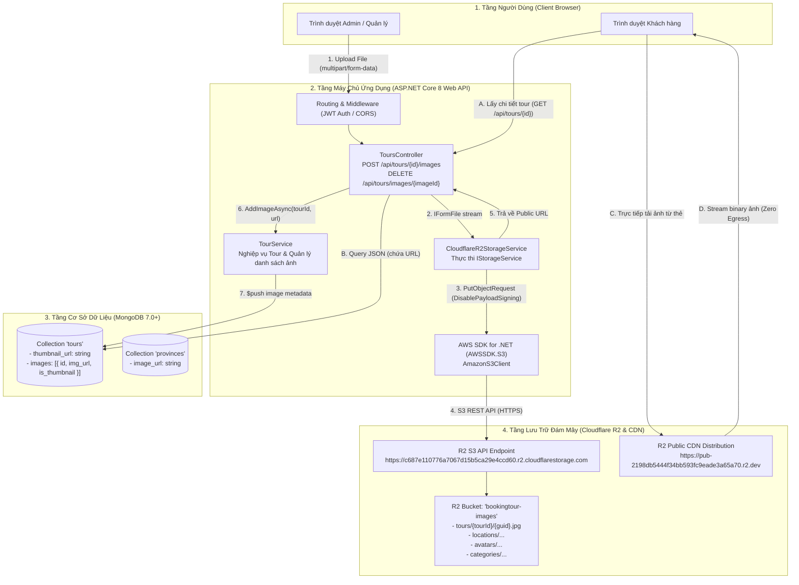
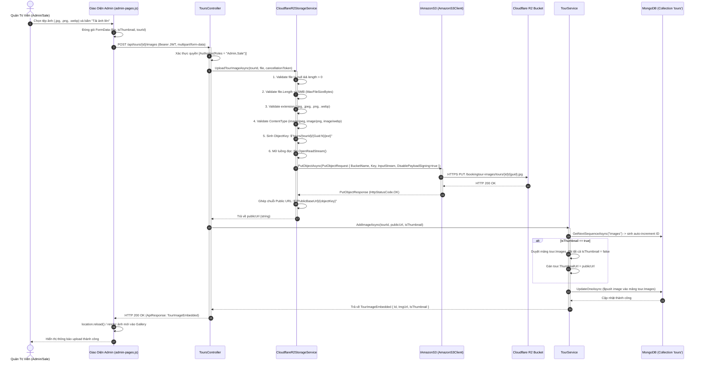
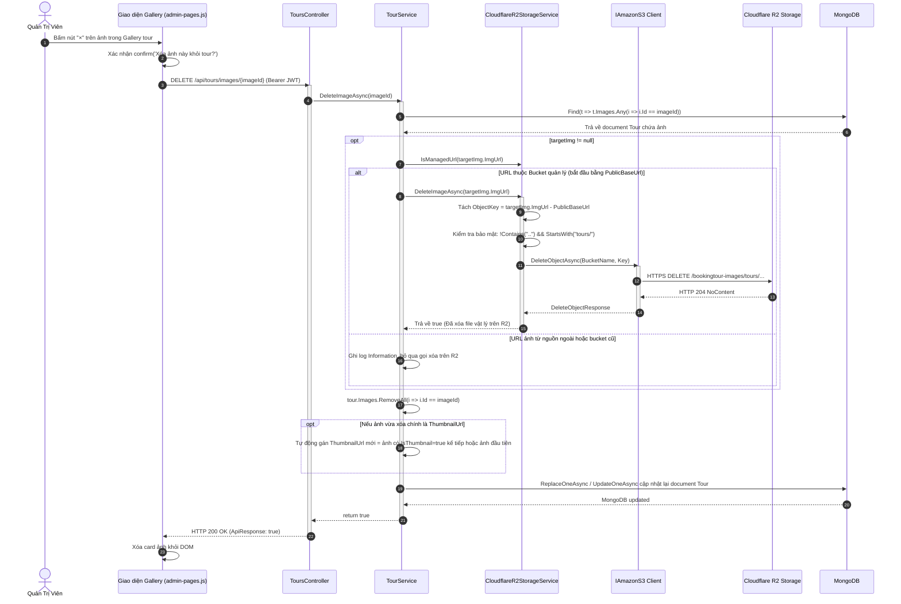
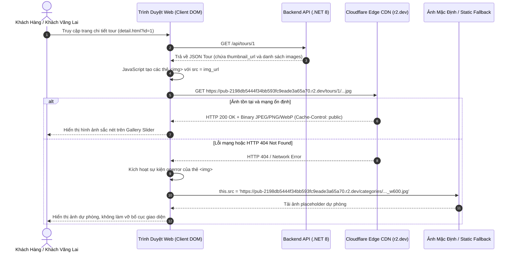

# BÁO CÁO PHÂN TÍCH TOÀN DIỆN CƠ CHẾ LƯU TRỮ HÌNH ẢNH CLOUDFLARE R2
## DỰ ÁN BOOKINGTOUR_DOTNET – NHÁNH FEATURE/FINAL_CODE

---

> **Mục đích tài liệu:** Tài liệu này cung cấp bản phân tích kỹ thuật chuyên sâu, chi tiết từng dòng mã nguồn về kiến trúc, luồng dữ liệu, cấu hình, cơ chế bảo mật, và tương tác giữa Frontend, Backend (.NET 8 Web API), MongoDB và dịch vụ lưu trữ đám mây Cloudflare R2 (S3-compatible Object Storage). Tài liệu được biên soạn phục vụ công tác báo cáo và bảo vệ đồ án tốt nghiệp trước Hội đồng Giảng viên.

---

## MỤC LỤC CHI TIẾT

1. [Tổng quan Cloudflare R2 trong dự án](#1-tổng-quan-cloudflare-r2-trong-dự-án)
2. [Hệ thống sơ đồ kiến trúc và luồng dữ liệu (Mermaid)](#2-hệ-thống-sơ-đồ-kiến-trúc-và-luồng-dữ-liệu-mermaid)
   - 2.1. Sơ đồ kiến trúc tổng thể hệ thống lưu trữ ảnh
   - 2.2. Sơ đồ tuần tự luồng tải ảnh lên (Upload Flow)
   - 2.3. Sơ đồ tuần tự luồng xóa và thay thế ảnh (Delete & Replace Flow)
   - 2.4. Sơ đồ tuần tự luồng hiển thị và cơ chế Fallback (Render Flow)
3. [Bảng danh mục các file mã nguồn liên quan](#3-bảng-danh-mục-các-file-mã-nguồn-liên-quan)
4. [Cấu hình hệ thống Cloudflare R2](#4-cấu-hình-hệ-thống-cloudflare-r2)
5. [Thư viện phụ thuộc và chuẩn giao thức S3](#5-thư-viện-phụ-thuộc-và-chuẩn-giao-thức-s3)
6. [Đăng ký Dependency Injection trong Program.cs](#6-đăng-ký-dependency-injection-trong-programcs)
7. [Cơ chế Upload ảnh chi tiết từng dòng code](#7-cơ-chế-upload-ảnh-chi-tiết-từng-dòng-code)
8. [Quy tắc đặt tên Object Key và cấu trúc thư mục R2](#8-quy-tắc-đặt-tên-object-key-và-cấu-trúc-thư-mục-r2)
9. [Cơ chế sinh và phân phối Public URL](#9-cơ-chế-sinh-và-phân-phối-public-url)
10. [Lưu trữ dữ liệu ảnh trong MongoDB](#10-lưu-trữ-dữ-liệu-ảnh-trong-mongodb)
11. [Hiển thị ảnh và cơ chế Fallback trên Frontend](#11-hiển-thị-ảnh-và-cơ-chế-fallback-trên-frontend)
12. [Cơ chế cập nhật và thay thế ảnh](#12-cơ-chế-cập-nhật-và-thay-thế-ảnh)
13. [Cơ chế xóa ảnh và kiểm soát an toàn](#13-cơ-chế-xóa-ảnh-và-kiểm-soát-an-toàn)
14. [Kiểm tra và Validation tập tin hình ảnh](#14-kiểm-tra-và-validation-tập-tin-hình-ảnh)
15. [Đánh giá bảo mật toàn diện](#15-đánh-giá-bảo-mật-toàn-diện)
16. [Xử lý lỗi và cơ chế chịu lỗi (Fault Tolerance)](#16-xử-lý-lỗi-và-cơ-chế-chịu-lỗi-fault-tolerance)
17. [Các hạn chế kỹ thuật hiện tại](#17-các-hạn-chế-kỹ-thuật-hiện-tại)
18. [Định hướng cải tiến và nâng cấp kiến trúc](#18-định-hướng-cải-tiến-và-nâng-cấp-kiến-trúc)
19. [Kịch bản thuyết trình bảo vệ đồ án (3–5 phút)](#19-kịch-bản-thuyết-trình-bảo-vệ-đồ-án-35-phút)
20. [Bộ 30 câu hỏi phản biện chuyên sâu và câu trả lời mẫu](#20-bộ-30-câu-hỏi-phản-biện-chuyên-sâu-và-câu-trả-lời-mẫu)
21. [Danh mục file thực tế cần mở khi giảng viên kiểm tra](#21-danh-mục-file-thực-tế-cần-mở-khi-giảng-viên-kiểm-tra)
22. [Lộ trình ôn tập và thứ tự học code](#22-lộ-trình-ôn-tập-và-thứ-tự-học-code)

---

## 1. TỔNG QUAN CLOUDFLARE R2 TRONG DỰ ÁN

Trong kiến trúc hệ thống **BookingTour_DotNet**, hình ảnh đóng vai trò quyết định đến trải nghiệm người dùng và tỷ lệ chuyển đổi đặt tour (hình ảnh danh lam thắng cảnh, bìa tour, album lịch trình, hình ảnh địa danh tỉnh thành, avatar nhân viên/khách hàng).

### 1.1. Cloudflare R2 là gì?
Cloudflare R2 là dịch vụ lưu trữ đối tượng đám mây phân tán (**Cloud Object Storage**) hoàn toàn tương thích với giao thức **Amazon S3 API**. R2 cho phép lưu trữ dữ liệu phi cấu trúc (unstructured data) với độ bền cao (99.999999999% - 11 số 9), khả năng mở rộng không giới hạn và tích hợp liền mạch với mạng lưới máy chủ biên (Edge Network) của Cloudflare.

### 1.2. Tại sao dự án chọn Cloudflare R2 thay vì giải pháp truyền thống?

| Tiêu chí | Lưu cục bộ trên Web Server (`wwwroot/uploads`) | Lưu Binary/Base64 trong MongoDB | Dùng AWS S3 truyền thống | **Dùng Cloudflare R2 (Lựa chọn dự án)** |
| :--- | :--- | :--- | :--- | :--- |
| **Chi phí truyền tải (Egress Fee)** | Tốn băng thông máy chủ hosting | Tốn băng thông truyền tải database | Tính phí đắt đỏ khi tải ảnh ra ngoài ($0.09/GB) | **0 ĐỒNG (Zero Egress Fees)** – Hoàn toàn miễn phí chiều tải ra |
| **Ảnh hưởng tải Server** | Server bị nghẽn Disk I/O khi nhiều user xem ảnh | Server backend và MongoDB bị quá tải RAM/CPU | Server hoàn toàn giải phóng việc stream ảnh | **Server Backend hoàn toàn giải phóng**, CDN Cloudflare phục vụ trực tiếp |
| **Kích thước Database** | Database không bị ảnh hưởng | Document phình to cực nhanh, chạm mốc giới hạn 16MB BSON của MongoDB | Database chỉ lưu chuỗi URL ngắn | **Database cực kỳ nhẹ**, chỉ lưu chuỗi Public URL (vài chục bytes) |
| **Khả năng Scale ngang (Stateless)** | Thất bại khi chạy nhiều instance (mỗi máy có ổ đĩa riêng) | Tốt nhưng database phình to làm chậm backup/restore | Rất tốt | **Hoàn hảo cho Docker / Stateless Web API**: các container không phụ thuộc ổ cứng |
| **Tốc độ tải qua CDN** | Chậm nếu khách ở xa máy chủ gốc | Rất chậm do phải query DB rồi parse Base64 | Cần mua thêm CloudFront | **Tích hợp sẵn mạng lưới toàn cầu Cloudflare CDN**, tải ảnh với độ trễ thấp |

---

## 2. HỆ THỐNG SƠ ĐỒ KIẾN TRÚC VÀ LUỒNG DỮ LIỆU (MERMAID)

### 2.1. Sơ đồ kiến trúc tổng thể hệ thống lưu trữ ảnh



---

### 2.2. Sơ đồ tuần tự luồng tải ảnh lên (Upload Flow)



---

### 2.3. Sơ đồ tuần tự luồng xóa và thay thế ảnh (Delete & Replace Flow)



---

### 2.4. Sơ đồ tuần tự luồng hiển thị và cơ chế Fallback (Render Flow)



---

## 3. BẢNG DANH MỤC CÁC FILE MÃ NGUỒN LIÊN QUAN

Dưới đây là bảng tổng hợp toàn bộ các file mã nguồn trực tiếp liên quan đến cơ chế cấu hình, lưu trữ, quản lý và hiển thị hình ảnh Cloudflare R2:

| STT | Đường dẫn file | Tầng kiến trúc | Vai trò & Trách nhiệm đối với Cloudflare R2 |
| :--- | :--- | :--- | :--- |
| 1 | `Configurations/R2Settings.cs` | Configuration | Class định nghĩa schema cấu hình R2 (BucketName, ServiceUrl, PublicBaseUrl, AccessKeyId, SecretAccessKey). |
| 2 | `appsettings.json` | Configuration | File JSON cấu hình môi trường, khai báo BucketName, ServiceUrl và PublicBaseUrl của Cloudflare R2. |
| 3 | `Backend_DotNet.csproj` | Project / Dependency | Khai báo thư viện NuGet `AWSSDK.S3` (v4.1.0) và cấu hình `UserSecretsId`. |
| 4 | `Program.cs` | Startup / DI | Ràng buộc `R2Settings`, đăng ký Singleton `IAmazonS3` (AmazonS3Client) và Scoped `IStorageService`. Chứa runner `--migrate-images` và `--audit-db`. |
| 5 | `Services/IStorageService.cs` | Abstraction | Interface chuẩn hóa các nghiệp vụ lưu trữ: `UploadTourImageAsync`, `DeleteImageAsync`, `IsManagedUrl`. |
| 6 | `Services/CloudflareR2StorageService.cs` | Implementation | Triển khai `IStorageService`, thực thi logic validation (5MB, MIME, extension), sinh GUID Object Key, gọi S3 API và xóa an toàn. |
| 7 | `Services/TourService.cs` | Business Logic | Xử lý lưu chuỗi URL ảnh vào MongoDB, phân định ảnh bìa (`ThumbnailUrl`), gọi xóa R2 khi xóa ảnh tour, fallback ảnh bìa tự động. |
| 8 | `Services/ImageMigrationService.cs` | CLI / Tooling | Dịch vụ đồng bộ tự động ảnh từ Internet/Unsplash lên R2, ghi file manifest và cập nhật URL trong MongoDB. |
| 9 | `Controllers/ToursController.cs` | API Controller | Tiếp nhận HTTP Request tải ảnh (`POST /api/tours/{id}/images`) và xóa ảnh (`DELETE /api/tours/images/{imageId}`) với quyền `[Authorize(Roles = "Admin,Sale")]`. |
| 10 | `Models/Tour.cs` | Entity Model | Định nghĩa cấu trúc document Tour trong MongoDB: `ThumbnailUrl` và danh sách mảng nhúng `Images`. |
| 11 | `Models/TourImageEmbedded.cs` | Embedded Model | Class đại diện phần tử ảnh nhúng trong Tour: `Id`, `ImgUrl` (chuỗi R2 URL), `IsThumbnail`. |
| 12 | `Models/Province.cs` | Entity Model | Lưu trữ thông tin tỉnh/thành phố, chứa thuộc tính `ImageUrl` trỏ đến ảnh R2. |
| 13 | `Data/DbSeeder.cs` | Database Seeder | Khởi tạo dữ liệu mẫu với các đường dẫn ảnh đã lưu trữ sẵn trên Cloudflare R2. |
| 14 | `Data/images-manifest.json` | Data / Manifest | Bảng kê danh mục 91 static assets (avatars, banners, categories, locations, tours) đã được lưu trên R2. |
| 15 | `wwwroot/assets/js/api-client.js` | Frontend Core | Xử lý gửi HTTP Request; tự động nhận diện `FormData` để không ghi đè `Content-Type`, cho phép browser tự tạo boundary upload file. |
| 16 | `wwwroot/assets/js/admin-pages.js` | Frontend Admin | Quản lý form upload modal, bắt sự kiện click xóa ảnh gallery, submit tạo/sửa tour kèm ảnh đại diện. |
| 17 | `wwwroot/assets/js/customer-pages.js` | Frontend Client | Render slider ảnh tour chi tiết, thẻ booking tour, xử lý `onerror` chuyển hướng sang fallback image. |
| 18 | `wwwroot/admin/tours/show.html` | Frontend UI | Trang chi tiết tour phía Admin với khu vực Gallery ảnh, nút upload modal và nút xóa ảnh. |

---

## 4. CẤU HÌNH HỆ THỐNG CLOUDFLARE R2

### 4.1. Mã nguồn class cấu hình: `Configurations/R2Settings.cs`

```csharp
namespace Backend_DotNet.Configurations;

public class R2Settings
{
    public const string SectionName = "R2Settings";

    public string BucketName { get; set; } = "bookingtour-images";
    public string ServiceUrl { get; set; } = "https://c687e110776a7067d15b5ca29e4ccd60.r2.cloudflarestorage.com";
    public string PublicBaseUrl { get; set; } = "https://pub-2198db5444f34bb593fc9eade3a65a70.r2.dev";
    public string AccessKeyId { get; set; } = string.Empty;
    public string SecretAccessKey { get; set; } = string.Empty;
}
```

### 4.2. Khai báo trong `appsettings.json`

```json
"R2Settings": {
  "BucketName": "bookingtour-images",
  "ServiceUrl": "https://c687e110776a7067d15b5ca29e4ccd60.r2.cloudflarestorage.com",
  "PublicBaseUrl": "https://pub-2198db5444f34bb593fc9eade3a65a70.r2.dev"
}
```

### 4.3. Giải thích ý nghĩa từng thông số kỹ thuật

1. **`BucketName` (`bookingtour-images`)**:
   - Tên thùng chứa (bucket) được tạo trên Cloudflare R2 Dashboard. Mọi tập tin upload sẽ được đặt vào bucket này.
2. **`ServiceUrl`**:
   - Endpoint chuẩn S3 của Cloudflare dành riêng cho tài khoản: `https://<account_id>.r2.cloudflarestorage.com`.
   - Chuỗi `c687e110776a7067d15b5ca29e4ccd60` chính là Cloudflare Account ID duy nhất của dự án.
3. **`PublicBaseUrl` (`https://pub-2198db5444f34bb593fc9eade3a65a70.r2.dev`)**:
   - Tên miền phân phối công khai được Cloudflare cấp phát cho bucket (R2 Managed Public Subdomain).
   - Mọi người dùng trên Internet có thể truy cập đọc (HTTP GET) trực tiếp các đối tượng thông qua domain này mà không cần ký presigned URL hay qua backend.
4. **`AccessKeyId` & `SecretAccessKey`**:
   - Cặp khóa xác thực chuẩn AWS S3 do Cloudflare sinh ra khi tạo **R2 API Token** (với quyền hạn Object Read & Write).

### 4.4. Cơ chế bảo mật thông tin xác thực (Credentials)
- **Tuyệt đối không hardcode SecretKey trong code hoặc `appsettings.json`**:
  Trong `appsettings.json`, hai trường `AccessKeyId` và `SecretAccessKey` được lược bỏ.
- **Môi trường phát triển cục bộ (Local Development)**:
  Sử dụng công cụ **.NET User Secrets** với ID `eb8d579c-8f1b-4d48-8bc7-b0b4850c514f` (lưu tại `%APPDATA%\Microsoft\UserSecrets\...` trên máy lập trình viên, nằm ngoài Git repository).
- **Môi trường Production / Docker Container**:
  Nạp thông qua biến môi trường của hệ điều hành:
  - `R2Settings__AccessKeyId=...`
  - `R2Settings__SecretAccessKey=...`

---

## 5. THƯ VIỆN PHỤ THUỘC VÀ CHUẨN GIAO THỨC S3

Trong file dự án `Backend_DotNet.csproj`:
```xml
<PackageReference Include="AWSSDK.S3" Version="4.1.0" />
```

### Tại sao lại dùng thư viện AWS SDK (`AWSSDK.S3`) để kết nối Cloudflare R2?
- **Chuẩn giao thức mở (Open S3-compatible standard)**: Cloudflare thiết kế R2 tương thích hoàn toàn với API của Amazon S3 (REST API v4 signature).
- **Không cần SDK riêng**: Không cần cài đặt SDK độc quyền của Cloudflare, hệ thống có thể tận dụng SDK chính thức, lâu đời và tối ưu nhất của Amazon Web Services (`AWSSDK.S3`).
- **Tính khả chuyển (Portability)**: Khi doanh nghiệp muốn chuyển đổi nhà cung cấp đám mây từ Cloudflare R2 sang AWS S3, MinIO (on-premise), Google Cloud Storage hay Wasabi, ta chỉ cần thay đổi cấu hình `ServiceUrl` và `BucketName` mà không phải viết lại bất kỳ một dòng code C# nào trong tầng Service.

---

## 6. ĐĂNG KÝ DEPENDENCY INJECTION TRONG PROGRAM.CS

Tại file `Program.cs` (dòng 22 - 40):

```csharp
// 1. Ràng buộc cấu hình từ appsettings / user-secrets / env vars
builder.Services.Configure<R2Settings>(builder.Configuration.GetSection(R2Settings.SectionName));

// 2. Đăng ký Amazon S3 Client dưới dạng Singleton
builder.Services.AddSingleton<IAmazonS3>(sp =>
{
    var r2 = sp.GetRequiredService<IOptions<R2Settings>>().Value;
    var config = new AmazonS3Config
    {
        ServiceURL = r2.ServiceUrl,
        AuthenticationRegion = "auto", // Bắt buộc đối với Cloudflare R2
        ForcePathStyle = true          // Path-style addressing: https://endpoint/bucket/key
    };
    return new AmazonS3Client(new BasicAWSCredentials(r2.AccessKeyId, r2.SecretAccessKey), config);
});

// 3. Đăng ký Storage Service phục vụ nghiệp vụ
builder.Services.AddScoped<IStorageService, CloudflareR2StorageService>();
builder.Services.AddScoped<ImageMigrationService>();
```

### Phân tích kiến trúc Dependency Injection:
1. **Tại sao `IAmazonS3` đăng ký là `AddSingleton`?**
   - `AmazonS3Client` quản lý bên trong một HTTP Client Connection Pool.
   - Việc dùng Singleton đảm bảo tái sử dụng TCP socket kết nối tới Cloudflare R2, tránh tình trạng **Socket Exhaustion** (cạn kiệt cổng kết nối) khi có hàng ngàn lượt upload diễn ra đồng thời.
2. **Tại sao `IStorageService` đăng ký là `AddScoped`?**
   - Tuân thủ vòng đời của HTTP Request trong ứng dụng web. Mỗi request sẽ nhận một instance mới của `CloudflareR2StorageService` kèm theo logger tương ứng, giúp giải phóng tài nguyên bộ nhớ sạch sẽ sau khi request hoàn tất.
3. **Ý nghĩa của 2 thuộc tính trong `AmazonS3Config`**:
   - `AuthenticationRegion = "auto"`: Cloudflare R2 là hệ thống lưu trữ toàn cầu phân tán, không chia theo các Region địa lý như `us-east-1` hay `ap-southeast-1` của AWS. Giá trị `"auto"` là quy định bắt buộc của Cloudflare để AWS SDK tính toán Signature Version 4 chính xác.
   - `ForcePathStyle = true`: Ép SDK sử dụng cấu trúc đường dẫn dạng Path (`endpoint/bucket/key`) thay vì Virtual-Host (`bucket.endpoint/key`), tương thích tuyệt đối với endpoint của R2.

---

## 7. CƠ CHẾ UPLOAD ẢNH CHI TIẾT TỪNG DÒNG CODE

Mã nguồn tại file `Services/CloudflareR2StorageService.cs`:

```csharp
public async Task<string> UploadTourImageAsync(int tourId, IFormFile file, CancellationToken cancellationToken = default)
{
    // Bước 1: Kiểm tra tập tin có tồn tại hay rỗng không
    if (file == null || file.Length == 0)
    {
        throw new ArgumentException("Tập tin hình ảnh không được để trống.");
    }

    // Bước 2: Giới hạn dung lượng tối đa 5 MB
    if (file.Length > MaxFileSizeBytes)
    {
        throw new ArgumentException("Dung lượng hình ảnh vượt quá giới hạn tối đa cho phép (5 MB).");
    }

    // Bước 3: Kiểm tra phần mở rộng file (Extension Whitelist)
    var ext = Path.GetExtension(file.FileName);
    if (string.IsNullOrWhiteSpace(ext) || !AllowedExtensions.Contains(ext))
    {
        throw new ArgumentException("Định dạng file không hợp lệ. Hệ thống chỉ chấp nhận hình ảnh định dạng JPG, JPEG, PNG, WEBP.");
    }

    // Bước 4: Kiểm tra MIME type trong HTTP Header (ContentType)
    if (string.IsNullOrWhiteSpace(file.ContentType) || !AllowedContentTypes.Contains(file.ContentType))
    {
        throw new ArgumentException("MIME type hình ảnh không hợp lệ.");
    }

    // Bước 5: Sinh object key ngẫu nhiên an toàn: tours/{tourId}/{guid}.{ext}
    var safeExt = ext.ToLowerInvariant();
    var objectKey = $"tours/{tourId}/{Guid.NewGuid():N}{safeExt}";

    try
    {
        // Bước 6: Mở luồng stream từ file được upload
        using var stream = file.OpenReadStream();
        var putRequest = new PutObjectRequest
        {
            BucketName = _r2Settings.BucketName,
            Key = objectKey,
            InputStream = stream,
            ContentType = file.ContentType,
            DisablePayloadSigning = true // Cực kỳ quan trọng với Cloudflare R2
        };

        // Bước 7: Gửi yêu cầu PUT lên Cloudflare R2 qua AWS SDK
        var response = await _s3Client.PutObjectAsync(putRequest, cancellationToken);
        if (response.HttpStatusCode != HttpStatusCode.OK)
        {
            _logger.LogError("Upload file lên Cloudflare R2 thất bại với mã trạng thái: {StatusCode}", response.HttpStatusCode);
            throw new InvalidOperationException($"Tải ảnh lên kho lưu trữ thất bại (Mã lỗi: {response.HttpStatusCode}).");
        }

        // Bước 8: Xây dựng Public URL hoàn chỉnh và trả về cho Controller
        var publicBase = _r2Settings.PublicBaseUrl.TrimEnd('/');
        var publicUrl = $"{publicBase}/{objectKey}";
        _logger.LogInformation("Upload ảnh tour {TourId} lên Cloudflare R2 thành công: {Url}", tourId, publicUrl);
        return publicUrl;
    }
    catch (AmazonS3Exception s3Ex)
    {
        _logger.LogError(s3Ex, "Lỗi kết nối hoặc xử lý S3/Cloudflare R2: {Message}", s3Ex.Message);
        throw new InvalidOperationException($"Lỗi lưu trữ Cloudflare R2: {s3Ex.Message}");
    }
}
```

### Những điểm kỹ thuật mấu chốt trong code:
1. **`using var stream = file.OpenReadStream();`**:
   - Sử dụng Stream trực tiếp từ file upload thay vì đọc toàn bộ file vào mảng byte (`byte[]`) hay `MemoryStream`. Điều này giúp tiết kiệm tối đa bộ nhớ RAM của Web API server, tránh gây áp lực lên GC (Garbage Collector) khi nhiều file được tải lên cùng lúc.
2. **`DisablePayloadSigning = true`**:
   - Đây là thuộc tính tối quan trọng khi làm việc với Cloudflare R2 qua AWS S3 SDK. Mặc định AWS SDK yêu cầu tính toán checksum băm SHA256 trên toàn bộ payload của stream trước khi gửi đi (Payload Signing). Việc bật `DisablePayloadSigning = true` cho phép truyền luồng dạng chunked streaming trực tiếp lên Cloudflare R2, tăng tốc độ upload lên gấp nhiều lần và tránh lỗi bắt tay chữ ký không tương thích giữa AWS SDK và R2.
3. **`Guid.NewGuid():N`**:
   - Định dạng `:N` loại bỏ các dấu gạch ngang (`-`), sinh ra chuỗi 32 ký tự hexa liên tục (ví dụ: `4f8b9e1a2c3d4e5f6a7b8c9d0e1f2a3b`), giúp Object Key ngắn gọn, chuẩn URL và không bị lỗi mã hóa ký tự đặc biệt.

---

## 8. QUY TẮC ĐẶT TÊN OBJECT KEY VÀ CẤU TRÚC THƯ MỤC R2

Trong Cloudflare R2 (cũng như Amazon S3), khái niệm "thư mục" thực chất là tiền tố (**Prefix**) của Object Key. Hệ thống quản lý các đối tượng dưới dạng phẳng (Flat Namespace) với các phân vùng logic:

```
bookingtour-images (Bucket)
│
├── tours/                                      # Thư mục chứa ảnh tour du lịch
│   ├── 1/                                      # Mã tourId tương ứng
│   │   ├── 4f8b9e1a2c3d4e5f6a7b8c9d0e1f2a3b.jpg
│   │   └── 9c1a3b5e7f2d4e6a8b0c1d2e3f4a5b6c.png
│   ├── 2/
│   │   └── d5e6f7a8b9c0d1e2f3a4b5c6d7e8f9a0.webp
│   └── tour_1528127269322-539801943592_w1200.jpg # Ảnh tour mẫu (migrated)
│
├── locations/                                  # Thư mục ảnh tỉnh thành & điểm đến
│   ├── location_1599707367072-cd6ada2bc375_w800.jpg  (Hà Nội)
│   ├── location_1580837119756-563d608dd119_w800.jpg  (Hà Giang)
│   └── location_1559592413-7cec4d0cae2b_w800.jpg     (Đà Nẵng)
│
├── avatars/                                    # Thư mục ảnh đại diện
│   ├── avatar_admin_1e3a8a_80x80.png
│   └── avatar_customer_...png
│
├── categories/                                 # Thư mục ảnh danh mục tour
│   └── category_1528127269322-539801943592_w600.jpg
│
└── banners/                                    # Thư mục ảnh banner tiếp thị
    └── banner_hero_home_...jpg
```

### Lợi ích của quy tắc đặt tên:
- **Tự động phân loại theo Tour ID**: Nhìn vào Object Key `tours/15/...` là lập tức xác định được bức ảnh thuộc về tour nào.
- **Chống ghi đè (Anti-collision)**: Tên file gốc của người dùng như `hinh_anh.jpg` bị loại bỏ hoàn toàn, thay thế bằng GUID duy nhất. Hai người quản trị cùng upload file trùng tên sẽ không bao giờ ghi đè lên nhau.
- **Chống tấn công liệt kê (Anti-enumeration / Enumeration Attack)**: Kẻ tấn công không thể đoán được URL ảnh tiếp theo như khi đặt tên theo số thứ tự tuần tiến `1.jpg`, `2.jpg`.

---

## 9. CƠ CHẾ SINH VÀ PHÂN PHỐI PUBLIC URL

### 9.1. Công thức sinh URL
Public URL của một tấm ảnh được Backend tạo ra bởi phép ghép chuỗi:

$$\text{Public URL} = \text{PublicBaseUrl} + \text{"/"} + \text{ObjectKey}$$

*Ví dụ thực tế:*
- `PublicBaseUrl`: `https://pub-2198db5444f34bb593fc9eade3a65a70.r2.dev`
- `ObjectKey`: `tours/5/a1b2c3d4e5f67890123456789abcdef0.jpg`
- $\rightarrow$ **URL hoàn chỉnh**: `https://pub-2198db5444f34bb593fc9eade3a65a70.r2.dev/tours/5/a1b2c3d4e5f67890123456789abcdef0.jpg`

### 9.2. Cơ chế phân phối và Cache qua CDN
Khi trình duyệt khách hàng gửi HTTP GET tới Public URL:
1. **Edge Hit**: Yêu cầu tới thẳng Data Center của Cloudflare gần người dùng nhất (ví dụ trạm Hà Nội hoặc TP.HCM).
2. **Caching**: Cloudflare tự động lưu bản cache của tấm ảnh tại Edge Server. Các khách hàng tiếp theo cùng truy cập bức ảnh đó sẽ được phục vụ ngay tức thì từ bộ nhớ cache mà không cần truy vấn ngược lại R2 Storage.
3. **Tiết kiệm tài nguyên**: Máy chủ Web API (.NET 8) của dự án hoàn toàn không tốn 1 byte băng thông nào cho quá trình xem ảnh của hàng ngàn khách hàng.

---

## 10. LƯU TRỮ DỮ LIỆU ẢNH TRONG MONGODB

### 10.1. Nguyên tắc cốt lõi: Chỉ lưu URL dạng chuỗi, không lưu Binary
Hệ thống **BookingTour_DotNet** tuân thủ triệt để nguyên lý thiết kế cơ sở dữ liệu hiện đại: **Không bao giờ lưu binary file / Base64 vào database**. 

```
┌──────────────────────────────────────┐        ┌──────────────────────────────────────┐
│          MongoDB Document            │        │          Cloudflare R2 Bucket        │
│  {                                   │        │                                      │
│    "id": 1,                          │        │  [Binary Data: 2.4 MB JPEG]          │
│    "title": "Tour Đà Nẵng 3N2Đ",    │        │  Key: tours/1/4f8b9e...jpg           │
│    "thumbnail_url": "https://pub.../ │───────>│                                      │
│    "images": [                       │        └──────────────────────────────────────┘
│      { "id": 1, "img_url": "..." }   │
│    ]                                 │
│  }                                   │
└──────────────────────────────────────┘
```

### 10.2. Bảng kê các Entity và Field lưu trữ URL ảnh

| Collection | Model Class C# | Tên Field MongoDB | Kiểu dữ liệu | Ý nghĩa nghiệp vụ |
| :--- | :--- | :--- | :--- | :--- |
| `tours` | `Models/Tour.cs` | `thumbnail_url` | `string` (nullable) | URL của ảnh đại diện chính (ảnh bìa) của Tour. |
| `tours` | `Models/Tour.cs` | `images` | `Array of Object` (`List<TourImageEmbedded>`) | Mảng các ảnh chi tiết trong album/gallery của Tour. |
| Embedded trong `tours.images` | `Models/TourImageEmbedded.cs` | `img_url` | `string` | URL ảnh R2 cụ thể trong danh sách gallery. |
| Embedded trong `tours.images` | `Models/TourImageEmbedded.cs` | `is_thumbnail` | `bool` | Đánh dấu ảnh này có phải là ảnh bìa hay không. |
| `provinces` | `Models/Province.cs` | `image_url` | `string` (nullable) | URL ảnh phong cảnh tiêu biểu của tỉnh/thành phố. |
| `bookings` | `Models/Booking.cs` | `tour_image` | `string` (`[BsonIgnore]`) | Thuộc tính ảo, được mapping động khi truy vấn chi tiết đơn đặt tour. |
| `tour_departures` | `Models/TourDeparture.cs`| `thumbnail_url` | `string` (`[BsonIgnore]`) | Thuộc tính ảo, được mapping từ Tour sang Lịch khởi hành. |

### 10.3. Mã nguồn Entity `Tour` và `TourImageEmbedded`

File `Models/TourImageEmbedded.cs`:
```csharp
public class TourImageEmbedded
{
    [BsonElement("id")]
    [JsonPropertyName("id")]
    public int Id { get; set; }

    [BsonElement("img_url")]
    [JsonPropertyName("img_url")]
    public string ImgUrl { get; set; } = string.Empty;

    [BsonElement("is_thumbnail")]
    [JsonPropertyName("is_thumbnail")]
    public bool IsThumbnail { get; set; }
}
```

File `Models/Tour.cs`:
```csharp
[BsonElement("thumbnail_url")]
[JsonPropertyName("thumbnail_url")]
public string? ThumbnailUrl { get; set; }

[BsonElement("images")]
[JsonPropertyName("images")]
public List<TourImageEmbedded> Images { get; set; } = new();
```

---

## 11. HIỂN THỊ ẢNH VÀ CƠ CHẾ FALLBACK TRÊN FRONTEND

### 11.1. Luồng hiển thị trên trang Chi tiết Tour (`customer-pages.js`)
Tại dòng 523 - 534 của file `wwwroot/assets/js/customer-pages.js`:

```javascript
// 4. Image Gallery Slider
const slider = document.getElementById('slider');
if (slider && Array.isArray(tour.images) && tour.images.length > 0) {
  slider.innerHTML = tour.images.map((img, idx) => `
    <div class="min-w-full h-full relative snap-start flex-shrink-0">
      
      <div class="absolute bottom-6 left-6 bg-black/40 backdrop-blur-md px-4 py-2 rounded-xl text-white text-sm font-medium flex items-center gap-2">
        <span>${html(tour.title)}</span>
        ${idx === 0 ? '<span class="bg-orange-500 text-white text-[10px] px-2 py-0.5 rounded font-bold uppercase">Ảnh bìa</span>' 
                    : `<span class="bg-white/20 text-white text-[10px] px-2 py-0.5 rounded font-bold">Ảnh ${idx + 1}/${tour.images.length}</span>`}
      </div>
    </div>
  `).join('');
}
```

### 11.2. Luồng hiển thị trên thẻ Booking của Khách hàng
Tại dòng 1272 - 1275 của file `wwwroot/assets/js/customer-pages.js`:

```javascript
<div class="relative w-full sm:w-44 h-44 sm:h-32 rounded-2xl overflow-hidden shrink-0 shadow-xs border border-slate-100 bg-slate-100">
  
  <span class="absolute top-2 left-2 px-2 py-0.5 bg-slate-900/70 backdrop-blur-xs text-white text-[10px] font-mono font-bold rounded-md">#${html(b.booking_code)}</span>
</div>
```

### 11.3. Phân tích cơ chế Fallback `onerror`
- **Mục đích**: Bảo vệ tính thẩm mỹ của trang web khi URL ảnh gặp sự cố (ảnh bị xóa trên bucket, lỗi mạng, hoặc DNS).
- **Cách thức hoạt động**: Khi trình duyệt không thể tải được ảnh từ `src`, sự kiện DOM `error` kích hoạt thuộc tính `onerror`. Đoạn script gán `this.src` thành một URL ảnh tĩnh dự phòng độ phân giải cao được lưu trữ cố định trên Cloudflare R2.
- **Tối ưu Lazy Loading**: Thẻ `` tích hợp thuộc tính `loading="lazy"` giúp trình duyệt chỉ tải ảnh khi người dùng cuộn màn hình tới khu vực hiển thị, tiết kiệm băng thông và tối ưu chỉ số Core Web Vitals (LCP/CLS).

---

## 12. CƠ CHẾ CẬP NHẬT VÀ THAY THẾ ẢNH

### 12.1. Quy trình đổi ảnh bìa khi sửa Tour (`admin-pages.js` và `TourService.cs`)
1. **Phía Giao diện Admin (`wwwroot/assets/js/admin-pages.js`, dòng 1365 - 1395)**:
   - Khi Admin chỉnh sửa thông tin Tour và chọn một tệp ảnh đại diện mới qua `<input type="file" name="thumbnailImage">`:
   - Bước 1: Gửi `PUT /api/tours/{id}` cập nhật thông tin chữ của Tour trước.
   - Bước 2: Kiểm tra nếu `file?.size > 0`, tiếp tục khởi tạo `FormData` mới với `upload.set('file', file)` và `upload.set('isThumbnail', 'true')`, sau đó gọi tiếp API `POST /api/tours/{id}/images`.
2. **Phía Backend (`TourService.cs`, dòng 368 - 395)**:
   ```csharp
   public async Task<TourImageEmbedded> AddImageAsync(int tourId, string imgUrl, bool isThumbnail)
   {
       var tour = await _context.Tours.Find(t => t.Id == tourId).FirstOrDefaultAsync()
                  ?? throw new KeyNotFoundException($"Không tìm thấy tour {tourId}.");

       if (isThumbnail)
       {
           // Hủy trạng thái thumbnail của tất cả ảnh cũ
           foreach (var img in tour.Images)
           {
               img.IsThumbnail = false;
           }
           // Gán ảnh mới làm ảnh bìa chính
           tour.ThumbnailUrl = imgUrl;
       }

       var nextImgId = await _context.GetNextSequenceAsync("images");
       var newImg = new TourImageEmbedded
       {
           Id = nextImgId,
           ImgUrl = imgUrl,
           IsThumbnail = isThumbnail
       };
       tour.Images.Add(newImg);

       await _context.Tours.ReplaceOneAsync(t => t.Id == tourId, tour);
       return newImg;
   }
   ```

### 12.2. Nhận định chuyên sâu: Vấn đề Orphan Objects (Đối tượng mồ côi)
- Khi người dùng cập nhật ảnh bìa mới, ảnh bìa cũ **không tự động bị xóa** khỏi Cloudflare R2 bucket.
- Ảnh cũ chỉ bị hủy cờ `is_thumbnail = false` và vẫn tồn tại trong danh sách `tour.Images` (trở thành một ảnh trong album của tour).
- **Ưu điểm**: Người quản trị không bị mất dữ liệu ảnh cũ nếu muốn đổi lại sau này.
- **Hạn chế**: Nếu người quản trị liên tục upload ảnh thử nghiệm mà không xóa thủ công, dung lượng lưu trữ trên bucket sẽ tăng dần theo thời gian.

---

## 13. CƠ CHẾ XÓA ẢNH VÀ KIỂM SOÁT AN TOÀN

### 13.1. Xóa ảnh đơn lẻ trong Gallery (`TourService.cs`, dòng 397 - 440)

```csharp
public async Task<bool> DeleteImageAsync(int imageId)
{
    var tour = await _context.Tours.Find(t => t.Images.Any(i => i.Id == imageId)).FirstOrDefaultAsync()
               ?? throw new KeyNotFoundException($"Không tìm thấy hình ảnh mã {imageId}.");

    var targetImg = tour.Images.FirstOrDefault(i => i.Id == imageId);
    if (targetImg != null)
    {
        // 1. Kiểm tra xem ảnh có thuộc bucket quản lý của dự án hay không
        if (_storageService.IsManagedUrl(targetImg.ImgUrl))
        {
            try
            {
                // 2. Gọi R2 Service xóa file vật lý
                await _storageService.DeleteImageAsync(targetImg.ImgUrl);
            }
            catch (Exception ex)
            {
                _logger.LogWarning(ex, "Xóa object R2 cho ảnh {ImageId} ({Url}) thất bại, tiếp tục xóa metadata trong MongoDB.", imageId, targetImg.ImgUrl);
            }
        }
        else
        {
            _logger.LogInformation("Ảnh {ImageId} ({Url}) là URL bên ngoài hoặc thuộc bucket cũ, bỏ qua xóa object R2.", imageId, targetImg.ImgUrl);
        }
    }

    // 3. Xóa ảnh khỏi mảng tour.Images
    tour.Images.RemoveAll(i => i.Id == imageId);

    // 4. Nếu ảnh vừa xóa là ảnh bìa (ThumbnailUrl), tự động chọn ảnh khác làm ảnh bìa
    if (targetImg != null && tour.ThumbnailUrl == targetImg.ImgUrl)
    {
        var nextThumb = tour.Images.FirstOrDefault(i => i.IsThumbnail) ?? tour.Images.FirstOrDefault();
        tour.ThumbnailUrl = nextThumb?.ImgUrl;
        if (nextThumb != null)
        {
            nextThumb.IsThumbnail = true;
        }
    }

    await _context.Tours.ReplaceOneAsync(t => t.Id == tour.Id, tour);
    return true;
}
```

### 13.2. Kiểm tra an toàn trước khi xóa trong `CloudflareR2StorageService.cs`

```csharp
public async Task<bool> DeleteImageAsync(string? imageUrl, CancellationToken cancellationToken = default)
{
    if (string.IsNullOrWhiteSpace(imageUrl)) return false;

    if (!IsManagedUrl(imageUrl)) return true;

    var publicBase = _r2Settings.PublicBaseUrl.TrimEnd('/');
    var objectKey = imageUrl.Substring(publicBase.Length).TrimStart('/');

    // BẢO MẬT: Chống Path Traversal và chỉ cho phép xóa trong tiền tố tours/
    if (string.IsNullOrWhiteSpace(objectKey) || objectKey.Contains("..") || !objectKey.StartsWith("tours/", StringComparison.OrdinalIgnoreCase))
    {
        _logger.LogWarning("Bỏ qua lệnh xóa do object key không hợp lệ hoặc có dấu hiệu can thiệp đường dẫn: {Key}", objectKey);
        return false;
    }

    try
    {
        var deleteRequest = new DeleteObjectRequest
        {
            BucketName = _r2Settings.BucketName,
            Key = objectKey
        };

        var response = await _s3Client.DeleteObjectAsync(deleteRequest, cancellationToken);
        return response.HttpStatusCode == HttpStatusCode.NoContent || response.HttpStatusCode == HttpStatusCode.OK;
    }
    catch (AmazonS3Exception s3Ex)
    {
        _logger.LogError(s3Ex, "Lỗi khi xóa object trên Cloudflare R2: {Message}", s3Ex.Message);
        return false;
    }
}
```

### 13.3. Xóa toàn bộ Tour (`DeleteTourAsync`): Phân tích code thực tế
Tại dòng 276 - 296 của `TourService.cs`:
- Khi xóa một Tour qua hàm `DeleteTourAsync`, hệ thống kiểm tra các ràng buộc đặt chỗ (`Bookings`), sau đó xóa `TourDepartures` và xóa document `Tour` trong MongoDB.
- **Quan sát thực tế**: Code hiện tại **chưa lặp qua danh sách `tour.Images` để gọi `DeleteImageAsync`**. Điều này có nghĩa là các ảnh của Tour bị xóa vẫn còn lưu lại trên Cloudflare R2 bucket. Đây là một điểm sinh viên có thể chủ động trình bày như một phát hiện kiến trúc và đề xuất phương án hoàn thiện (xem mục 17 & 18).

---

## 14. KIỂM TRA VÀ VALIDATION TẬP TIN HÌNH ẢNH

Trong `CloudflareR2StorageService.cs`, hệ thống thiết lập 4 tầng phòng thủ nghiêm ngặt:

```csharp
private const long MaxFileSizeBytes = 5 * 1024 * 1024; // 5 MB

private static readonly HashSet<string> AllowedExtensions = new(StringComparer.OrdinalIgnoreCase)
{
    ".jpg", ".jpeg", ".png", ".webp"
};

private static readonly HashSet<string> AllowedContentTypes = new(StringComparer.OrdinalIgnoreCase)
{
    "image/jpeg", "image/pjpeg", "image/png", "image/x-png", "image/webp"
};
```

1. **Kiểm tra File rỗng**: `file == null || file.Length == 0` $\rightarrow$ Ném lỗi ngay lập tức.
2. **Kiểm tra kích thước (Size Boundary)**: Ngăn chặn tải file vượt quá 5 MB, phòng chống tấn công làm cạn kiệt băng thông hoặc đầy bộ nhớ đệm server.
3. **Danh sách trắng đuôi file (Extension Whitelist)**: Dùng `HashSet` với `StringComparer.OrdinalIgnoreCase` để so khớp nhanh $O(1)$, chỉ chấp nhận các định dạng ảnh web tiêu chuẩn (`.jpg`, `.jpeg`, `.png`, `.webp`). Các file nguy hiểm như `.exe`, `.php`, `.sh`, `.html` đều bị từ chối.
4. **Danh sách trắng MIME Type (ContentType Whitelist)**: Kiểm tra thông tin Content-Type gửi lên trong HTTP Request header từ trình duyệt, ngăn chặn tải lên các tập tin dạng `application/pdf`, `text/plain`,...

---

## 15. ĐÁNH GIÁ BẢO MẬT TOÀN DIỆN

| Tiêu chuẩn bảo mật | Thực trạng trong mã nguồn BookingTour_DotNet | Đánh giá & Rủi ro | Giải pháp khuyến nghị |
| :--- | :--- | :--- | :--- |
| **Bảo mật Credentials (Khóa API)** | Không lưu AccessKey/SecretKey trong mã nguồn hoặc Git repo. Tách biệt cấu hình qua UserSecrets và Environment Variables. | **Rất tốt (Đạt chuẩn Production)** | Giữ vững cơ chế này, xoay vòng khóa API (Key Rotation) định kỳ trên Cloudflare. |
| **Phân quyền truy cập (RBAC)** | Endpoint `/api/tours/{id}/images` yêu cầu `[Authorize(Roles = "Admin,Sale")]`. Khách hàng không thể gọi API upload. | **Rất tốt** | Đảm bảo token JWT được kiểm tra tính hợp lệ qua Middleware. |
| **Chống Path Traversal (Leo thư mục)** | Kiểm tra `objectKey.Contains("..")` và bắt buộc `StartsWith("tours/")` trước khi xóa file trên R2. | **Rất tốt** | Ngăn chặn kẻ xấu xóa nhầm các tài nguyên quan trọng khác trong bucket như `avatars/` hay `banners/`. |
| **Chống Overwrite & Trùng lặp** | Tên file được sinh bằng `Guid.NewGuid():N`. | **Rất tốt** | Loại bỏ 100% nguy cơ tấn công ghi đè file có sẵn. |
| **Kiểm tra chữ ký file (Magic Bytes)** | Hiện tại mới chỉ kiểm tra đuôi file và header `ContentType`. Chưa đọc các bytes đầu tiên của file (Header Signature). | **Trung bình (Tiềm ẩn rủi ro)** | Kẻ xấu có thể đổi tên file mã độc `shell.php` thành `shell.jpg` để qua mặt. Tuy nhiên do file được lưu trên R2 (chứ không chạy trên server .NET) nên rủi ro thực thi mã độc là rất thấp. Cần bổ sung kiểm tra Magic Bytes để đạt chuẩn tối đa. |
| **Bảo vệ Bucket (Public Read-only)** | Bucket R2 chỉ mở quyền Đọc công khai thông qua Public Subdomain (`r2.dev`). Quyền Ghi/Xóa bắt buộc phải có API Token kèm Signature AWS S3. | **Rất an toàn** | Khách truy cập không thể gửi lệnh DELETE/PUT trực tiếp tới Cloudflare R2 nếu không có SecretKey của Backend. |

---

## 16. XỬ LÝ LỖI VÀ CƠ CHẾ CHỊU LỖI (FAULT TOLERANCE)

### 16.1. Bắt ngoại lệ chuyên biệt `AmazonS3Exception`
Khi kết nối tới Cloudflare R2 bị gián đoạn (mất mạng, sai khóa API, sai tên bucket, timeout):
```csharp
catch (AmazonS3Exception s3Ex)
{
    _logger.LogError(s3Ex, "Lỗi kết nối hoặc xử lý S3/Cloudflare R2: {Message}", s3Ex.Message);
    throw new InvalidOperationException($"Lỗi lưu trữ Cloudflare R2: {s3Ex.Message}");
}
```
- Hệ thống ghi lại toàn bộ StackTrace và thông điệp kỹ thuật vào Logger để lập trình viên chẩn đoán.
- Bọc lại bằng ngoại lệ thân thiện `InvalidOperationException` để Controller trả về mã `HTTP 400 Bad Request` kèm thông báo tiếng Việt dễ hiểu cho người dùng giao diện.

### 16.2. Cơ chế suy thoái nhẹ nhàng (Graceful Degradation) khi xóa ảnh
Tại `TourService.cs` (dòng 412 - 415):
- Khi xóa ảnh, nếu Cloudflare R2 gặp lỗi (ví dụ file trên R2 đã bị xóa trước đó hoặc mạng chập chờn), khối `catch` sẽ ghi nhận log `_logger.LogWarning(...)` và **không làm dừng tiến trình**.
- Hệ thống vẫn tiếp tục xóa metadata của bức ảnh trong MongoDB để bảo đảm giao diện của khách hàng và admin không bị hiển thị các bức ảnh rác/ảnh lỗi.

---

## 17. CÁC HẠN CHẾ KỸ THUẬT HIỆN TẠI

1. **Thiếu kiểm tra Magic Bytes (File Signatures)**:
   - Chưa kiểm tra các byte đầu của file (ví dụ JPEG là `FF D8 FF`, PNG là `89 50 4E 47 0D 0A 1A 0A`).
2. **Chưa có Transaction phân tán giữa R2 và MongoDB**:
   - Nếu upload ảnh lên R2 thành công nhưng lưu vào MongoDB bị lỗi (ví dụ mất kết nối database), file ảnh trên R2 sẽ bị mồ côi (không được ai tham chiếu).
   - Ngược lại, khi tạo tour qua trang Create Tour: tour được tạo trong MongoDB trước, sau đó upload ảnh. Nếu upload ảnh thất bại, tour vẫn tồn tại nhưng không có ảnh.
3. **Chưa tự động xóa ảnh khi xóa Tour**:
   - Hàm `DeleteTourAsync` chỉ xóa document `Tour` trong MongoDB, chưa quét danh sách `Images` để dọn sạch trên R2.
4. **Chưa xử lý nén và thay đổi kích thước ảnh (Image Processing)**:
   - File người dùng upload thế nào thì lưu nguyên bản như thế, chưa có cơ chế nén xuống WebP hay sinh ra các bản thu nhỏ (thumbnail `w400`, `w800`, `w1200`) tại thời điểm upload.

---

## 18. ĐỊNH HƯỚNG CẢI TIẾN VÀ NÂNG CẤP KIẾN TRÚC

1. **Bổ sung kiểm tra Magic Bytes**:
   Sử dụng thư viện phân tích nhị phân hoặc đọc trực tiếp các bytes đầu của Stream trước khi gửi lên R2.
2. **Áp dụng cơ chế Presigned Upload URL (Tải trực tiếp từ trình duyệt)**:
   - Thay vì Client upload file qua Backend .NET rồi Backend upload tiếp lên R2 (tốn 2 lần băng thông và RAM của server):
   - Client gọi API: `GET /api/tours/{id}/presigned-upload-url` $\rightarrow$ Backend sinh URL có chữ ký tạm thời (hạn 15 phút).
   - Client dùng JavaScript `fetch()` tải trực tiếp file lên Cloudflare R2.
   - Client gọi lại Backend lưu chuỗi URL vào MongoDB.
   - $\rightarrow$ **Giải phóng 100% tải upload cho máy chủ Backend!**
3. **Tích hợp Cloudflare Image Resizing / Cloudflare Workers**:
   - Sử dụng dịch vụ tối ưu ảnh tự động trên đường truyền của Cloudflare: tự động chuyển đổi sang định dạng AVIF/WebP tùy theo trình duyệt của khách hàng, tự động thay đổi kích thước ảnh theo tham số URL (ví dụ `...jpg?width=400&quality=80`).
4. **Background Job dọn dẹp Orphan Objects**:
   - Xây dựng một Worker định kỳ (dùng Hangfire hoặc BackgroundService) đối soát danh sách Object Keys trên R2 với các URL đang lưu trong MongoDB, tự động xóa các đối tượng mồ côi sau 30 ngày.

---

## 19. KỊCH BẢN THUYẾT TRÌNH BẢO VỆ ĐỒ ÁN (3–5 PHÚT)

*Sinh viên có thể sử dụng nguyên văn kịch bản dưới đây để trình bày tự tin, mạch lạc trước Hội đồng:*

> "Kính thưa Thầy/Cô trong Hội đồng chấm đồ án,
> 
> Hôm nay em xin phép được trình bày về **Kiến trúc và Cơ chế lưu trữ hình ảnh đám mây sử dụng Cloudflare R2** trong dự án BookingTour_DotNet.
> 
> Trong một hệ thống đặt tour du lịch trực tuyến, hình ảnh chiếm đến hơn 80% dung lượng truyền tải và là yếu tố quan trọng nhất thu hút khách hàng. Nếu lưu ảnh trực tiếp trên ổ cứng máy chủ web (`wwwroot`) hoặc lưu binary Base64 vào MongoDB, hệ thống sẽ gặp 3 bài toán lớn:
> 1. Thứ nhất, database MongoDB sẽ bị phình to cực nhanh, làm chậm toàn bộ các thao tác truy vấn dữ liệu.
> 2. Thứ hai, máy chủ backend bị nghẽn I/O khi phục vụ hàng ngàn lượt xem ảnh cùng lúc và không thể mở rộng theo kiến trúc Stateless Microservices.
> 3. Thứ ba, chi phí băng thông tải ra (Egress Fees) rất đắt đỏ nếu dùng các giải pháp truyền thống như AWS S3.
> 
> Để giải quyết triệt để vấn đề này, nhóm em đã lựa chọn **Cloudflare R2 Object Storage**:
> - Cloudflare R2 tương thích hoàn toàn với chuẩn S3 API nhưng có ưu điểm vượt trội là **Zero Egress Fees – Miễn phí 100% chi phí băng thông tải ra**.
> - Về mặt kiến trúc: Backend .NET 8 của tụi em sử dụng thư viện chính thức `AWSSDK.S3` để kết nối tới Cloudflare R2 thông qua một custom ServiceURL và Singleton Client.
> - Khi Admin upload ảnh cho một tour:
>   - Hệ thống tiến hành kiểm tra 4 bước an toàn: kiểm tra dung lượng tối đa 5MB, kiểm tra danh sách trắng đuôi file (.jpg, .png, .webp) và kiểm tra MIME type.
>   - Sau đó sinh một Object Key ngẫu nhiên chứa mã Tour và chuỗi GUID không thể trùng lặp, ví dụ `tours/1/{guid}.jpg`.
>   - File được mở dưới dạng Stream nhị phân và đẩy thẳng lên Cloudflare R2 với cấu hình `DisablePayloadSigning = true`.
>   - Sau khi upload thành công, R2 trả về mã 200 OK. Backend ghép chuỗi thành Public URL và lưu chuỗi URL ngắn này vào mảng `images` của collection `tours` trong MongoDB.
> - Khi khách hàng truy cập website xem tour: Trình duyệt sẽ tải ảnh trực tiếp từ mạng lưới Edge CDN toàn cầu của Cloudflare thông qua Public Base URL. Máy chủ Backend hoàn toàn không phải gánh tải truyền file.
> - Nếu một bức ảnh gặp sự cố kết nối, Frontend đã được tích hợp sẵn cơ chế dự phòng `onerror` để tự động hiển thị ảnh placeholder chuẩn, đảm bảo giao diện không bao giờ bị vỡ.
> 
> Nhờ kiến trúc phân tách rõ ràng giữa **Tầng dữ liệu (MongoDB)** và **Tầng tài nguyên đa phương tiện (Cloudflare R2)**, hệ thống BookingTour của tụi em vận hành cực kỳ nhanh, nhẹ, bảo mật và tiết kiệm chi phí tối đa.
> 
> Em xin chân thành cảm ơn Thầy/Cô đã lắng nghe và em sẵn sàng trả lời các câu hỏi phản biện ạ!"

---

## 20. BỘ 30 CÂU HỎI PHẢN BIỆN CHUYÊN SÂU VÀ CÂU TRẢ LỜI MẪU

### Nhóm 1: Kiến trúc & Công nghệ tổng quan
**Câu 1: Tại sao không lưu ảnh trực tiếp trên máy chủ backend (Local Storage) mà phải dùng Cloudflare R2?**
- *Trả lời:* Lưu local storage làm backend trở thành **Stateful**, khi triển khai hệ thống lên Docker Container hoặc triển khai nhiều máy chủ (Cluster/Load Balancing), các server sẽ không đồng bộ được file của nhau. Ngoài ra, việc phục vụ file tĩnh cục bộ sẽ chiếm dụng tài nguyên I/O đĩa và băng thông của Web Server, làm giảm hiệu năng xử lý API nghiệp vụ đặt tour.

**Câu 2: Tại sao không chuyển ảnh thành chuỗi Base64 và lưu trực tiếp trong document MongoDB?**
- *Trả lời:* Chuỗi Base64 làm tăng kích thước file thêm khoảng 33%. MongoDB có giới hạn kích thước tối đa cho 1 document BSON là 16 MB. Nếu lưu Base64, mỗi khi truy vấn thông tin Tour, server phải load toàn bộ chuỗi Base64 khổng lồ vào RAM, gây lãng phí bộ nhớ và nghẽn băng thông mạng giữa Web API và MongoDB.

**Câu 3: Cloudflare R2 khác gì so với AWS S3 truyền thống?**
- *Trả lời:* Điểm khác biệt lớn nhất là **chi phí Egress (Băng thông tải ra)**. AWS S3 tính phí đắt đỏ khi người dùng tải ảnh từ bucket về trình duyệt (khoảng $0.09/GB). Cloudflare R2 có chính sách **Zero Egress Fees**, hoàn toàn miễn phí băng thông chiều tải ra. Ngoài ra, R2 được tích hợp tự nhiên với mạng lưới CDN toàn cầu của Cloudflare.

**Câu 4: Dự án đang dùng thư viện gì để tương tác với Cloudflare R2?**
- *Trả lời:* Dự án sử dụng gói NuGet `AWSSDK.S3` phiên bản 4.1.0 của chính Amazon. Vì Cloudflare R2 hỗ trợ hoàn toàn giao thức chuẩn S3 API nên có thể dùng client của Amazon để thao tác mà không cần thư viện bên thứ ba.

**Câu 5: Trong `Program.cs`, `IAmazonS3` được đăng ký dưới dạng Singleton hay Scoped? Tại sao?**
- *Trả lời:* Đăng ký dạng **Singleton**. `AmazonS3Client` quản lý bên trong một HTTP Connection Pool. Đăng ký Singleton giúp tái sử dụng các kết nối TCP, tăng hiệu năng và tránh lỗi cạn kiệt socket mạng (Socket Exhaustion) khi có nhiều request đồng thời.

---

### Nhóm 2: Cấu hình & Dependency Injection
**Câu 6: File cấu hình R2 nằm ở đâu? Khóa bí mật (SecretKey) được quản lý như thế nào?**
- *Trả lời:* Cấu hình được khai báo trong `Configurations/R2Settings.cs` và ánh xạ từ `appsettings.json`. Khóa bí mật `SecretAccessKey` tuyệt đối không lưu trong file code hay git repo, mà được quản lý qua **.NET User Secrets** trong môi trường phát triển cục bộ và qua **Environment Variables** khi triển khai Docker/Production.

**Câu 7: Hai thông số `AuthenticationRegion = "auto"` và `ForcePathStyle = true` trong `Program.cs` có ý nghĩa gì?**
- *Trả lời:* 
  - `AuthenticationRegion = "auto"`: Cloudflare R2 là mạng lưu trữ toàn cầu không phân chia region địa lý như AWS, nên `"auto"` là giá trị bắt buộc để AWS SDK tính chữ ký xác thực S3 Signature v4 chính xác.
  - `ForcePathStyle = true`: Yêu cầu client gọi API theo định dạng đường dẫn `endpoint/bucket/key` thay vì tên miền phụ `bucket.endpoint/key`, đảm bảo tương thích với endpoint của Cloudflare.

**Câu 8: Interface `IStorageService` có những phương thức nào?**
- *Trả lời:* Gồm 3 phương thức:
  1. `UploadTourImageAsync(int tourId, IFormFile file, ...)`: Tải ảnh tour lên R2.
  2. `DeleteImageAsync(string? imageUrl, ...)`: Xóa ảnh khỏi R2.
  3. `IsManagedUrl(string? imageUrl)`: Kiểm tra URL có thuộc bucket của dự án hay không.

**Câu 9: Service nào trực tiếp gọi `IStorageService` trong dự án?**
- *Trả lời:* `ToursController` gọi trực tiếp `_storageService.UploadTourImageAsync` khi nhận file từ form upload. `TourService` gọi `_storageService.DeleteImageAsync` khi quản trị viên xóa ảnh khỏi gallery.

**Câu 10: `ImageMigrationService` dùng để làm gì?**
- *Trả lời:* Là dịch vụ tiện ích CLI (chạy qua lệnh `dotnet run -- --migrate-images`) dùng để đồng bộ toàn bộ ảnh mẫu từ Internet/Unsplash lên Cloudflare R2, lưu danh mục vào `images-manifest.json` và cập nhật lại URL trong MongoDB.

---

### Nhóm 3: Quy trình Upload & Đặt tên file
**Câu 11: Quy tắc đặt tên Object Key của ảnh trên R2 là gì? Cho ví dụ?**
- *Trả lời:* Quy tắc: `tours/{tourId}/{Guid.NewGuid():N}{ext}`. Ví dụ: `tours/10/a3f1c8e9b2d44f1a8c5e7b9d0e1f2a3b.jpg`.

**Câu 12: Tại sao lại dùng GUID để đặt tên file thay vì giữ nguyên tên gốc của người dùng?**
- *Trả lời:* Giữ tên gốc dễ gây trùng tên ghi đè file của nhau, dễ gặp lỗi ký tự có dấu/khoảng trắng trong URL và có nguy cơ bị tấn công Path Traversal. Dùng GUID bảo đảm 100% tính duy nhất, bảo mật và chuẩn hóa URL.

**Câu 13: Tại sao trong Object Key lại có tiền tố `{tourId}`?**
- *Trả lời:* Giúp phân nhóm logic các tài nguyên trên bucket theo từng Tour. Khi cần kiểm toán hoặc dọn dẹp ảnh của Tour số 10, ta chỉ cần quét prefix `tours/10/`.

**Câu 14: Tại sao trong `PutObjectRequest` phải đặt `DisablePayloadSigning = true`?**
- *Trả lời:* Mặc định AWS SDK yêu cầu băm SHA256 toàn bộ stream trước khi upload. Cloudflare R2 không yêu cầu điều này. Đặt `DisablePayloadSigning = true` giúp kích hoạt chế độ streaming chunked upload, giúp upload nhanh hơn và tránh lỗi tính sai chữ ký.

**Câu 15: Sau khi upload file lên R2 thành công, Backend lưu cái gì vào MongoDB?**
- *Trả lời:* Backend ghép `PublicBaseUrl` với `objectKey` thành một chuỗi URL đầy đủ (ví dụ `https://pub-2198db5444f34bb593fc9eade3a65a70.r2.dev/tours/...jpg`) và lưu chuỗi string này vào MongoDB.

---

### Nhóm 4: Validation & Bảo mật
**Câu 16: Hệ thống kiểm tra tính hợp lệ của file upload như thế nào?**
- *Trả lời:* Qua 4 bước: kiểm tra file không rỗng, giới hạn dung lượng $\le$ 5MB, kiểm tra phần mở rộng nằm trong whitelist (`.jpg`, `.jpeg`, `.png`, `.webp`), và kiểm tra MIME ContentType nằm trong whitelist (`image/jpeg`, `image/png`, `image/webp`).

**Câu 17: Dung lượng file tối đa cho phép upload là bao nhiêu? Khai báo ở đâu?**
- *Trả lời:* Tối đa 5 MB, khai báo tại hằng số `private const long MaxFileSizeBytes = 5 * 1024 * 1024;` trong file `Services/CloudflareR2StorageService.cs`.

**Câu 18: Nếu người dùng đổi đuôi file `virus.exe` thành `virus.jpg` thì hệ thống có chặn được không?**
- *Trả lời:* Hệ thống hiện tại kiểm tra đuôi file và header `ContentType`. Nếu kẻ tấn công đổi đuôi file và giả mạo Content-Type, file vẫn có thể được upload lên R2. Tuy nhiên, file này được lưu trữ tĩnh trên R2 chứ không được thực thi trên máy chủ Web API, nên server hoàn toàn an toàn. Để hoàn thiện 100%, ta cần bổ sung thêm bước kiểm tra **Magic Bytes** (File Header Signatures).

**Câu 19: Phương thức `DeleteImageAsync` phòng chống tấn công leo thư mục (Path Traversal) như thế nào?**
- *Trả lời:* Phương thức kiểm tra: `if (objectKey.Contains("..") || !objectKey.StartsWith("tours/")) return false;`. Nếu URL chứa ký tự `..` hoặc cố tình trỏ tới thư mục khác ngoài `tours/`, hệ thống sẽ từ chối xóa ngay lập tức.

**Câu 20: API upload và delete ảnh được bảo vệ bằng quyền gì?**
- *Trả lời:* Được bảo vệ bằng thuộc tính `[Authorize(Roles = "Admin,Sale")]`. Chỉ người dùng có token JWT hợp lệ với vai trò Admin hoặc Sale mới có quyền thực hiện.

---

### Nhóm 5: Quy trình Xóa & Cập nhật
**Câu 21: Khi xóa một ảnh trong Gallery của Tour thì điều gì xảy ra?**
- *Trả lời:* 
  1. Backend tìm Tour chứa ảnh.
  2. Kiểm tra `IsManagedUrl`. Nếu thuộc R2 bucket dự án, gọi `DeleteObjectAsync` xóa file trên R2.
  3. Xóa phần tử khỏi mảng `tour.Images` trong MongoDB.
  4. Nếu ảnh vừa xóa là ảnh bìa, tự động chọn ảnh còn lại làm ảnh bìa mới.

**Câu 22: Nếu xóa file trên Cloudflare R2 thất bại (ví dụ mất mạng) thì ảnh trong MongoDB có bị xóa không?**
- *Trả lời:* **Có**. Để đảm bảo trải nghiệm người dùng không bị treo hoặc lỗi giao diện, hệ thống áp dụng cơ chế Graceful Degradation: ghi log cảnh báo lỗi R2 và vẫn tiếp tục xóa metadata trong MongoDB.

**Câu 23: Khi xóa một Tour (`DeleteTourAsync`), các ảnh của Tour đó trên R2 có tự động bị xóa không?**
- *Trả lời:* Trong code hiện tại, `DeleteTourAsync` chỉ xóa document Tour trong MongoDB và các Lịch khởi hành, chưa gọi lệnh quét xóa các file trên R2. Các file này sẽ trở thành Orphan Objects trên R2. Em đề xuất hướng nâng cấp là bổ sung hàm dọn dẹp R2 trước khi xóa tour.

**Câu 24: Phương thức `IsManagedUrl` hoạt động như thế nào?**
- *Trả lời:* Phương thức kiểm tra xem chuỗi URL có bắt đầu bằng `_r2Settings.PublicBaseUrl` hay không. Nếu ảnh là link ngoài (ví dụ ảnh Unsplash cũ), nó trả về `false` để tránh việc vô tình gửi lệnh xóa lên R2 với URL không tồn tại.

**Câu 25: Khi cập nhật Tour với ảnh bìa mới, ảnh bìa cũ có bị xóa khỏi R2 không?**
- *Trả lời:* Không. Ảnh bìa cũ chỉ bị đặt `IsThumbnail = false` và vẫn được lưu trong album ảnh của tour, giúp bảo toàn dữ liệu nếu sau này muốn chọn lại ảnh đó làm ảnh bìa.

---

### Nhóm 6: Hiển thị & Xử lý lỗi
**Câu 26: Tại sao trình duyệt khách hàng có thể xem được ảnh trên R2 mà không cần đăng nhập?**
- *Trả lời:* Vì Cloudflare R2 bucket được bật chế độ **Public Access** thông qua tên miền phụ `r2.dev` (`PublicBaseUrl`). Chế độ này cấp quyền HTTP GET công khai cho tất cả mọi người, nhưng quyền Ghi/Sửa/Xóa vẫn được bảo vệ nghiêm ngặt bằng API Token.

**Câu 27: Cơ chế `onerror` trên Frontend hoạt động như thế nào?**
- *Trả lời:* Nếu ảnh trên R2 bị lỗi mạng hoặc bị xóa (HTTP 404), sự kiện `onerror` của thẻ `` sẽ tự động kích hoạt và gán `this.src` thành một URL ảnh tĩnh mặc định dự phòng, giúp giao diện không bao giờ bị vỡ hoặc hiện icon ảnh lỗi.

**Câu 28: Nếu tải file lên Cloudflare R2 bị lỗi mạng thì Backend xử lý ra sao?**
- *Trả lời:* Service bắt ngoại lệ `AmazonS3Exception`, ghi log chi tiết và ném ra `InvalidOperationException`. Controller bắt lại và trả về HTTP 400 Bad Request kèm câu thông báo lỗi bằng tiếng Việt để hiển thị lên popup của giao diện Admin.

**Câu 29: Trình bày giải pháp Presigned URL để nâng cấp hiệu năng upload ảnh?**
- *Trả lời:* Thay vì client upload file qua Backend .NET rồi Backend đẩy lên R2 (tốn RAM và 2 lần băng thông), Backend sẽ sinh ra một URL có kèm chữ ký xác thực thời hạn ngắn (Presigned PUT URL). Trình duyệt sẽ dùng JavaScript đẩy thẳng file nhị phân lên Cloudflare R2, sau đó chỉ gửi chuỗi URL về cho Backend lưu MongoDB.

**Câu 30: Collection `provinces` lưu trữ ảnh như thế nào?**
- *Trả lời:* Collection `provinces` có thuộc tính `image_url` lưu trực tiếp Public URL của ảnh đại diện tỉnh/thành phố trên Cloudflare R2 (được đặt trong thư mục `locations/...`). Dữ liệu này được nạp sẵn qua `DbSeeder.cs` hoặc đồng bộ qua `ImageMigrationService.cs`.

---

## 21. DANH MỤC FILE THỰC TẾ CẦN MỞ KHI GIẢNG VIÊN KIỂM TRA

Khi Giảng viên yêu cầu mở mã nguồn để chứng minh các khẳng định trong báo cáo, sinh viên hãy mở đúng các file và dòng code sau:

```
┌────────────────────────────────────────────────────────────────────────────────────────┐
│ BẢNG HƯỚNG DẪN MỞ CODE TRỰC TIẾP TRONG VS CODE                                        │
├───────────────────────────────────┬──────────────┬─────────────────────────────────────┤
│ Nội dung giảng viên yêu cầu xem   │ Đường dẫn    │ Dòng code cần chỉ vào               │
├───────────────────────────────────┼──────────────┼─────────────────────────────────────┤
│ 1. Cấu hình Bucket & ServiceUrl   │ appsettings  │ Dòng 19 - 23                        │
│ 2. Đăng ký S3 Client Singleton    │ Program.cs   │ Dòng 25 - 35                        │
│ 3. Đăng ký Storage Service Scoped │ Program.cs   │ Dòng 37 - 39                        │
│ 4. Logic Validate dung lượng 5MB  │ CloudflareR2 │ Dòng 17, 54 - 58                    │
│ 5. Whitelist đuôi file & MIME     │ CloudflareR2 │ Dòng 19 - 34, 60 - 71               │
│ 6. Sinh GUID Object Key           │ CloudflareR2 │ Dòng 74 - 76                        │
│ 7. Gửi lệnh PutObjectRequest      │ CloudflareR2 │ Dòng 80 - 89                        │
│ 8. Kiểm tra an toàn khi xóa ảnh   │ CloudflareR2 │ Dòng 115 - 130                      │
│ 9. API Controller nhận file form  │ ToursCtrl    │ Dòng 179 - 216                      │
│ 10. API Controller xóa ảnh        │ ToursCtrl    │ Dòng 218 - 231                      │
│ 11. Lưu metadata vào Tour MongoDB │ TourService  │ Dòng 368 - 395                      │
│ 12. Xóa ảnh & fallback thumbnail  │ TourService  │ Dòng 397 - 435                      │
│ 13. Model Tour lưu thumbnail/ảnh  │ Tour.cs      │ Dòng 60 - 66                        │
│ 14. Frontend Upload Modal (Admin) │ admin-pages  │ Dòng 1551 - 1575                    │
│ 15. Frontend Gallery & Fallback   │ customer-pgs │ Dòng 523 - 534 (Slider & onerror)   │
└───────────────────────────────────┴──────────────┴─────────────────────────────────────┘
```

---

## 22. LỘ TRÌNH ÔN TẬP VÀ THỨ TỰ HỌC CODE

Để làm chủ hoàn toàn kiến thức về Cloudflare R2 trước ngày bảo vệ, sinh viên nên ôn luyện theo đúng 5 bước sau:

- **Bước 1: Nắm chắc Luồng dữ liệu tổng quát (15 phút)**
  - Học thuộc sơ đồ tuần tự tại Mục 2.2 và 2.3.
  - Tự vẽ lại trên giấy luồng đi từ Browser $\rightarrow$ Controller $\rightarrow$ StorageService $\rightarrow$ Cloudflare R2 $\rightarrow$ TourService $\rightarrow$ MongoDB.

- **Bước 2: Hiểu rõ từng dòng code trong `CloudflareR2StorageService.cs` (20 phút)**
  - Nắm được tại sao phải có 4 bước validation.
  - Hiểu rõ ý nghĩa của `DisablePayloadSigning = true` và `Guid.NewGuid():N`.
  - Hiểu cách thức bảo vệ Path Traversal trong hàm xóa.

- **Bước 3: Hiểu mối quan hệ giữa Tour và TourImageEmbedded trong MongoDB (15 phút)**
  - Phân biệt giữa `thumbnail_url` (chuỗi URL ảnh chính) và `images` (mảng danh sách các ảnh chi tiết).
  - Nắm vững logic: khi xóa một ảnh bìa, hàm `DeleteImageAsync` trong `TourService.cs` tự động gán ảnh kế tiếp làm ảnh bìa như thế nào.

- **Bước 4: Đọc kỹ 30 câu hỏi phản biện chuyên sâu tại Mục 20 (30 phút)**
  - Đọc đi đọc lại câu trả lời mẫu cho các câu hỏi hay bị hỏi nhất: Câu 1, 2, 3, 5, 12, 14, 18, 22 và 29.
  - Tự đứng trước gương hoặc trả lời thử cho bạn bè nghe.

- **Bước 5: Thực hành mở code trực tiếp trên máy tính cá nhân (10 phút)**
  - Mở sẵn VS Code, định vị trước các file theo Bảng tại Mục 21.
  - Tập thói quen vừa chỉ chuột vào đúng dòng code vừa giải thích rành rọt cho giảng viên.

---
*Báo cáo được hoàn thiện và chuẩn hóa kỹ thuật dựa trên mã nguồn thực tế tại nhánh `feature/final_code` của dự án BookingTour_DotNet.*

